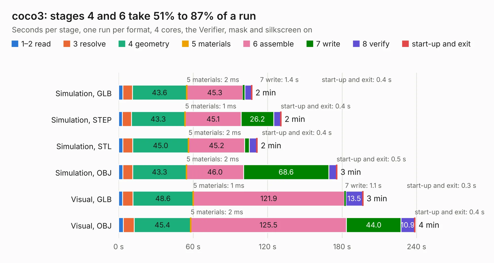

# 494. coco3

Board 494 of the 3,130 of [Corpus Testing](../Corpus-Testing.md), on [Corpus Page 5](../CorpusTestingPages/Corpus-Testing-05.md#494-coco3).

| Mode and format | 1–2 read | 3 resolve | 4 geometry | 5 materials | 6 assemble | 7 write | 8 verify | start-up and exit | Total |
|---|---:|---:|---:|---:|---:|---:|---:|---:|---:|
| Simulation, GLB | 3.3 | 7.9 | 43.6 | 2&nbsp;ms | 45.3 | 1.4 | 5.4 | 0.4 | 107.4 |
| Simulation, STEP | 3.0 | 7.2 | 43.3 | 1&nbsp;ms | 45.1 | 26.2 | 5.5 | 0.4 | 130.9 |
| Simulation, STL | 3.3 | 8.0 | 45.0 | 2&nbsp;ms | 45.2 | 3.7 | 6.0 | 0.4 | 111.7 |
| Simulation, OBJ | 3.4 | 7.9 | 43.3 | 2&nbsp;ms | 46.0 | 68.6 | 6.1 | 0.5 | 175.9 |
| Visual, GLB | 3.2 | 8.3 | 48.6 | 1&nbsp;ms | 121.9 | 1.1 | 13.5 | 0.3 | 196.9 |
| Visual, OBJ | 3.7 | 8.9 | 45.4 | 2&nbsp;ms | 125.5 | 44.0 | 10.9 | 0.4 | 238.7 |

<table align="center"><tr><td valign="top">

| Board | Repo: [baldengineer/bit-preserve](https://github.com/baldengineer/bit-preserve) Board: `coco3.kicad_pcb` |
|---|---|
| Folder | Tandy-RS / TRS-80 Color Computer / Color Computer 3 / 26-3334 / coco3 |
| Complexity | 347&nbsp;/&nbsp;1000 (size&nbsp;257, features&nbsp;90) |
| KESE&nbsp;features | through vias, slotted holes, custom pads, rounded, trapezoid or chamfered pads, filled zones, copper drawings, curved board outline |
| Tested | 9th November 2026 |
| Copper&nbsp;layers | 2 |
| File&nbsp;format | KiCad 5 (20171130) |
| Parts,&nbsp;tracks,&nbsp;vias | 207, 5,167, 236 |
| Triangles,&nbsp;simulation | 7,786,556 in 252 parts |
| Verifier | PASS in all six runs |

</td><td valign="top">

<table>
<tr><th>File type</th><th>File size</th><th>Peak memory used</th></tr>
<tr><th colspan="3" align="left">Simulation</th></tr>
<tr><td>GLB</td><td align="right">263&nbsp;MB</td><td align="right">2.1&nbsp;GB</td></tr>
<tr><td>STEP</td><td align="right">1.3&nbsp;GB</td><td align="right">3.1&nbsp;GB</td></tr>
<tr><td>STL</td><td align="right">389&nbsp;MB</td><td align="right">2.1&nbsp;GB</td></tr>
<tr><td>OBJ</td><td align="right">825&nbsp;MB</td><td align="right">4.9&nbsp;GB</td></tr>
<tr><th colspan="3" align="left">Visual</th></tr>
<tr><td>GLB</td><td align="right">192&nbsp;MB</td><td align="right">2.9&nbsp;GB</td></tr>
<tr><td>OBJ</td><td align="right">615&nbsp;MB</td><td align="right">3.7&nbsp;GB</td></tr>
</table>

</td></tr></table>

| Previous | Next |
|:---|---:|
| [493. coco2](b0493b_bit-preserve_Tandy-RS-TRS-80-Color-Computer-Color-Computer-2-26-313xB-coco2_coco2.md) | [495. gd 6502 proto pcb](b0495b_Mega-IIe_kicad-files-gd-6502-proto-pcb_gd-6502-proto-pcb.md) |
