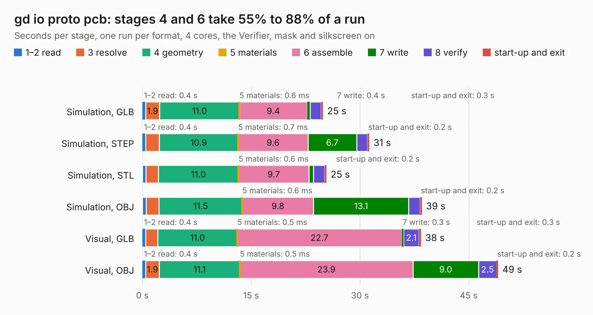

# 495. gd io proto pcb

Board 495 of the 3,108 of [Corpus Testing](../Corpus-Testing.md), on [Corpus Page 5](../CorpusTestingPages/Corpus-Testing-05.md#495-gd-io-proto-pcb).

| Mode and format | 1–2 read | 3 resolve | 4 geometry | 5 materials | 6 assemble | 7 write | 8 verify | start-up and exit | Total |
|---|---:|---:|---:|---:|---:|---:|---:|---:|---:|
| Simulation, GLB | 0.4 | 1.9 | 11.0 | 0.6&nbsp;ms | 9.4 | 0.4 | 1.5 | 0.3 | 24.9 |
| Simulation, STEP | 0.4 | 1.9 | 10.9 | 0.7&nbsp;ms | 9.6 | 6.7 | 1.5 | 0.2 | 31.3 |
| Simulation, STL | 0.5 | 1.7 | 11.0 | 0.6&nbsp;ms | 9.7 | 0.6 | 1.5 | 0.2 | 25.4 |
| Simulation, OBJ | 0.5 | 1.7 | 11.5 | 0.6&nbsp;ms | 9.8 | 13.1 | 1.6 | 0.2 | 38.5 |
| Visual, GLB | 0.4 | 1.7 | 11.0 | 0.5&nbsp;ms | 22.7 | 0.3 | 2.1 | 0.3 | 38.4 |
| Visual, OBJ | 0.4 | 1.9 | 11.1 | 0.5&nbsp;ms | 23.9 | 9.0 | 2.5 | 0.2 | 49.1 |

<table align="center"><tr><td valign="top">

| Board | Repo: [baldengineer/Mega-IIe](https://github.com/baldengineer/Mega-IIe) Board: `gd io proto pcb.kicad_pcb` |
|---|---|
| Folder | kicad files / gd io proto pcb / mk1 |
| Complexity | 265&nbsp;/&nbsp;1000 (size&nbsp;210, features&nbsp;55) |
| KESE&nbsp;features | through vias, rounded, trapezoid or chamfered pads, filled zones, curved board outline |
| Tested | 9th November 2026 |
| Copper&nbsp;layers | 2 |
| File&nbsp;format | KiCad 5 (20171130) |
| Parts,&nbsp;tracks,&nbsp;vias | 35, 950, 46 |
| Triangles,&nbsp;simulation | 2,390,828 in 115 parts |
| Verifier | PASS in all six runs |

</td><td valign="top">

<table>
<tr><th>File type</th><th>File size</th><th>Peak memory used</th></tr>
<tr><th colspan="3" align="left">Simulation</th></tr>
<tr><td>GLB</td><td align="right">83&nbsp;MB</td><td align="right">994&nbsp;MB</td></tr>
<tr><td>STEP</td><td align="right">434&nbsp;MB</td><td align="right">1.0&nbsp;GB</td></tr>
<tr><td>STL</td><td align="right">120&nbsp;MB</td><td align="right">939&nbsp;MB</td></tr>
<tr><td>OBJ</td><td align="right">254&nbsp;MB</td><td align="right">1.6&nbsp;GB</td></tr>
<tr><th colspan="3" align="left">Visual</th></tr>
<tr><td>GLB</td><td align="right">58&nbsp;MB</td><td align="right">1.1&nbsp;GB</td></tr>
<tr><td>OBJ</td><td align="right">177&nbsp;MB</td><td align="right">1.2&nbsp;GB</td></tr>
</table>

</td></tr></table>

| Previous | Next |
|:---|---:|
| [494. gd io proto pcb](b0494b_Mega-IIe_kicad-files-gd-io-proto-pcb_gd-io-proto-pcb.md) | [496. gd IWM proto pcb](b0496b_Mega-IIe_gd-IWM-proto-pcb.md) |
