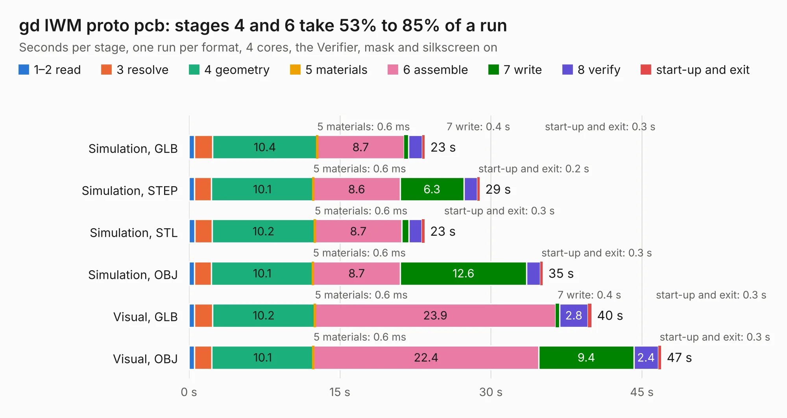

# 496. gd IWM proto pcb

Board 496 of the 3,105 of [Corpus Testing](../Corpus-Testing.md), on [Corpus Page 5](../CorpusTestingPages/Corpus-Testing-05.md#496-gd-iwm-proto-pcb).

| Mode and format | 1–2 read | 3 resolve | 4 geometry | 5 materials | 6 assemble | 7 write | 8 verify | start-up and exit | Total |
|---|---:|---:|---:|---:|---:|---:|---:|---:|---:|
| Simulation, GLB | 0.6 | 1.8 | 10.4 | 0.6&nbsp;ms | 8.7 | 0.4 | 1.3 | 0.3 | 23.4 |
| Simulation, STEP | 0.5 | 1.7 | 10.1 | 0.6&nbsp;ms | 8.6 | 6.3 | 1.3 | 0.2 | 28.9 |
| Simulation, STL | 0.6 | 1.7 | 10.2 | 0.6&nbsp;ms | 8.7 | 0.7 | 1.3 | 0.3 | 23.4 |
| Simulation, OBJ | 0.5 | 1.7 | 10.1 | 0.6&nbsp;ms | 8.7 | 12.6 | 1.3 | 0.3 | 35.2 |
| Visual, GLB | 0.6 | 1.8 | 10.2 | 0.6&nbsp;ms | 23.9 | 0.4 | 2.8 | 0.3 | 40.0 |
| Visual, OBJ | 0.6 | 1.7 | 10.1 | 0.6&nbsp;ms | 22.4 | 9.4 | 2.4 | 0.3 | 46.9 |

<table align="center"><tr><td valign="top">

| Board | Repo: [baldengineer/Mega-IIe](https://github.com/baldengineer/Mega-IIe) Board: `gd IWM proto pcb.kicad_pcb` |
|---|---|
| Folder | kicad files / gd IWM proto pcb |
| Complexity | 234&nbsp;/&nbsp;1000 (size&nbsp;179, features&nbsp;55) |
| KESE&nbsp;features | through vias, rounded, trapezoid or chamfered pads, filled zones, curved board outline |
| Tested | 9th November 2026 |
| Copper&nbsp;layers | 2 |
| File&nbsp;format | KiCad 5 (20171130) |
| Parts,&nbsp;tracks,&nbsp;vias | 60, 915, 138 |
| Triangles,&nbsp;simulation | 2,155,188 in 116 parts |
| Verifier | PASS in all six runs |

</td><td valign="top">

<table>
<tr><th>File type</th><th>File size</th><th>Peak memory used</th></tr>
<tr><th colspan="3" align="left">Simulation</th></tr>
<tr><td>GLB</td><td align="right">73&nbsp;MB</td><td align="right">905&nbsp;MB</td></tr>
<tr><td>STEP</td><td align="right">341&nbsp;MB</td><td align="right">952&nbsp;MB</td></tr>
<tr><td>STL</td><td align="right">108&nbsp;MB</td><td align="right">897&nbsp;MB</td></tr>
<tr><td>OBJ</td><td align="right">223&nbsp;MB</td><td align="right">1.4&nbsp;GB</td></tr>
<tr><th colspan="3" align="left">Visual</th></tr>
<tr><td>GLB</td><td align="right">56&nbsp;MB</td><td align="right">1.0&nbsp;GB</td></tr>
<tr><td>OBJ</td><td align="right">171&nbsp;MB</td><td align="right">1.2&nbsp;GB</td></tr>
</table>

</td></tr></table>

| Previous | Next |
|:---|---:|
| [495. gd io proto pcb](b0495b_Mega-IIe_kicad-files-gd-io-proto-pcb-mk1_gd-io-proto-pcb.md) | [497. gd MEGA-65c02 proto pcb](b0497b_Mega-IIe_gd-MEGA-65c02-proto-pcb.md) |
