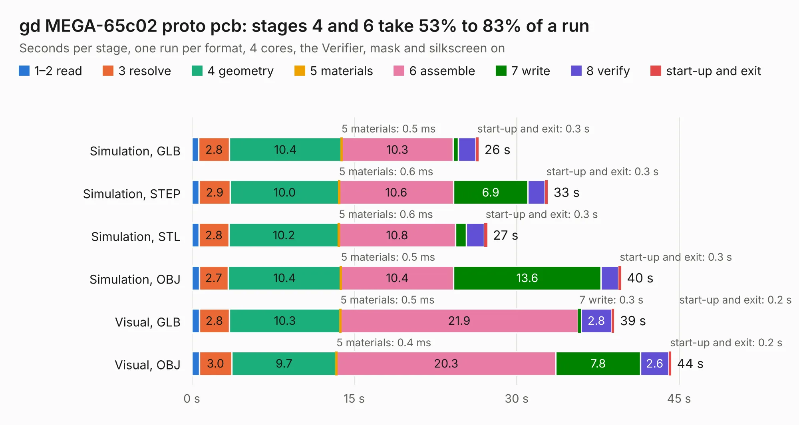

# 496. gd MEGA-65c02 proto pcb

Board 496 of the 3,103 of [Corpus Testing](../Corpus-Testing.md), on [Corpus Page 5](../CorpusTestingPages/Corpus-Testing-05.md#496-gd-mega-65c02-proto-pcb).

| Mode and format | 1–2 read | 3 resolve | 4 geometry | 5 materials | 6 assemble | 7 write | 8 verify | start-up and exit | Total |
|---|---:|---:|---:|---:|---:|---:|---:|---:|---:|
| Simulation, GLB | 0.6 | 2.8 | 10.4 | 0.5&nbsp;ms | 10.3 | 0.5 | 1.6 | 0.3 | 26.5 |
| Simulation, STEP | 0.7 | 2.9 | 10.0 | 0.6&nbsp;ms | 10.6 | 6.9 | 1.6 | 0.3 | 32.9 |
| Simulation, STL | 0.6 | 2.8 | 10.2 | 0.6&nbsp;ms | 10.8 | 1.0 | 1.7 | 0.3 | 27.3 |
| Simulation, OBJ | 0.7 | 2.7 | 10.4 | 0.5&nbsp;ms | 10.4 | 13.6 | 1.6 | 0.3 | 39.7 |
| Visual, GLB | 0.7 | 2.8 | 10.3 | 0.5&nbsp;ms | 21.9 | 0.3 | 2.8 | 0.2 | 39.0 |
| Visual, OBJ | 0.7 | 3.0 | 9.7 | 0.4&nbsp;ms | 20.3 | 7.8 | 2.6 | 0.2 | 44.3 |

<table align="center"><tr><td valign="top">

| Board | Repo: [baldengineer/Mega-IIe](https://github.com/baldengineer/Mega-IIe) Board: `gd MEGA-65c02 proto pcb.kicad_pcb` |
|---|---|
| Folder | kicad files / gd MEGA-65c02 proto pcb |
| Complexity | 313&nbsp;/&nbsp;1000 (size&nbsp;248, features&nbsp;65) |
| KESE&nbsp;features | through vias, rounded, trapezoid or chamfered pads, filled zones, copper text, curved board outline |
| Tested | 9th November 2026 |
| Copper&nbsp;layers | 4 |
| File&nbsp;format | KiCad 7 (20221018) |
| Parts,&nbsp;tracks,&nbsp;vias | 51, 1,631, 139 |
| Triangles,&nbsp;simulation | 3,306,470 in 145 parts |
| Verifier | PASS in all six runs |

</td><td valign="top">

<table>
<tr><th>File type</th><th>File size</th><th>Peak memory used</th></tr>
<tr><th colspan="3" align="left">Simulation</th></tr>
<tr><td>GLB</td><td align="right">113&nbsp;MB</td><td align="right">1.0&nbsp;GB</td></tr>
<tr><td>STEP</td><td align="right">459&nbsp;MB</td><td align="right">1.2&nbsp;GB</td></tr>
<tr><td>STL</td><td align="right">165&nbsp;MB</td><td align="right">1.1&nbsp;GB</td></tr>
<tr><td>OBJ</td><td align="right">349&nbsp;MB</td><td align="right">2.1&nbsp;GB</td></tr>
<tr><th colspan="3" align="left">Visual</th></tr>
<tr><td>GLB</td><td align="right">65&nbsp;MB</td><td align="right">1.2&nbsp;GB</td></tr>
<tr><td>OBJ</td><td align="right">202&nbsp;MB</td><td align="right">1.4&nbsp;GB</td></tr>
</table>

</td></tr></table>

| Previous | Next |
|:---|---:|
| [495. gd IWM proto pcb](b0495b_Mega-IIe_gd-IWM-proto-pcb.md) | [497. gd MegaII proto pcb](b0497b_Mega-IIe_kicad-files-gd-MegaII-proto-pcb_gd-MegaII-proto-pcb.md) |
