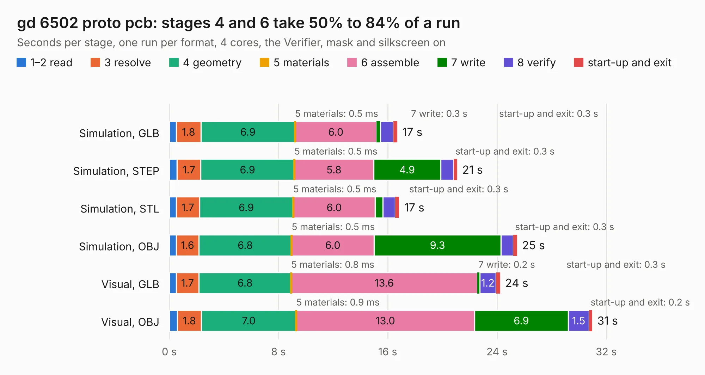

# 496. gd 6502 proto pcb

Board 496 of the 3,138 of [Corpus Testing](../Corpus-Testing.md), on [Corpus Page 5](../CorpusTestingPages/Corpus-Testing-05.md#496-gd-6502-proto-pcb).

| Mode and format | 1–2 read | 3 resolve | 4 geometry | 5 materials | 6 assemble | 7 write | 8 verify | start-up and exit | Total |
|---|---:|---:|---:|---:|---:|---:|---:|---:|---:|
| Simulation, GLB | 0.5 | 1.8 | 6.9 | 0.5&nbsp;ms | 6.0 | 0.3 | 1.0 | 0.3 | 16.7 |
| Simulation, STEP | 0.6 | 1.7 | 6.9 | 0.5&nbsp;ms | 5.8 | 4.9 | 1.0 | 0.3 | 21.1 |
| Simulation, STL | 0.5 | 1.7 | 6.9 | 0.5&nbsp;ms | 6.0 | 0.6 | 0.9 | 0.3 | 16.8 |
| Simulation, OBJ | 0.5 | 1.6 | 6.8 | 0.5&nbsp;ms | 6.0 | 9.3 | 0.9 | 0.3 | 25.5 |
| Visual, GLB | 0.5 | 1.7 | 6.8 | 0.8&nbsp;ms | 13.6 | 0.2 | 1.2 | 0.3 | 24.2 |
| Visual, OBJ | 0.6 | 1.8 | 7.0 | 0.9&nbsp;ms | 13.0 | 6.9 | 1.5 | 0.2 | 31.0 |

<table align="center"><tr><td valign="top">

| Board | Repo: [baldengineer/Mega-IIe](https://github.com/baldengineer/Mega-IIe) Board: `gd 6502 proto pcb.kicad_pcb` |
|---|---|
| Folder | kicad files / gd 6502 proto pcb |
| Complexity | 304&nbsp;/&nbsp;1000 (size&nbsp;224, features&nbsp;80) |
| KESE&nbsp;features | through vias, custom pads, rounded, trapezoid or chamfered pads, filled zones, copper drawings, curved board outline |
| Tested | 9th November 2026 |
| Copper&nbsp;layers | 4 |
| File&nbsp;format | KiCad 7 (20221018) |
| Parts,&nbsp;tracks,&nbsp;vias | 37, 755, 47 |
| Triangles,&nbsp;simulation | 1,611,454 in 92 parts |
| Verifier | PASS in all six runs |

</td><td valign="top">

<table>
<tr><th>File type</th><th>File size</th><th>Peak memory used</th></tr>
<tr><th colspan="3" align="left">Simulation</th></tr>
<tr><td>GLB</td><td align="right">55&nbsp;MB</td><td align="right">633&nbsp;MB</td></tr>
<tr><td>STEP</td><td align="right">244&nbsp;MB</td><td align="right">703&nbsp;MB</td></tr>
<tr><td>STL</td><td align="right">81&nbsp;MB</td><td align="right">619&nbsp;MB</td></tr>
<tr><td>OBJ</td><td align="right">168&nbsp;MB</td><td align="right">1.1&nbsp;GB</td></tr>
<tr><th colspan="3" align="left">Visual</th></tr>
<tr><td>GLB</td><td align="right">35&nbsp;MB</td><td align="right">780&nbsp;MB</td></tr>
<tr><td>OBJ</td><td align="right">106&nbsp;MB</td><td align="right">817&nbsp;MB</td></tr>
</table>

</td></tr></table>

| Previous | Next |
|:---|---:|
| [495. coco3](b0495b_bit-preserve_coco3.md) | [497. gd audio proto pcb-rev1 bad footprint](b0497b_Mega-IIe_gd-audio-proto-pcb-rev1-bad-footprint.md) |
