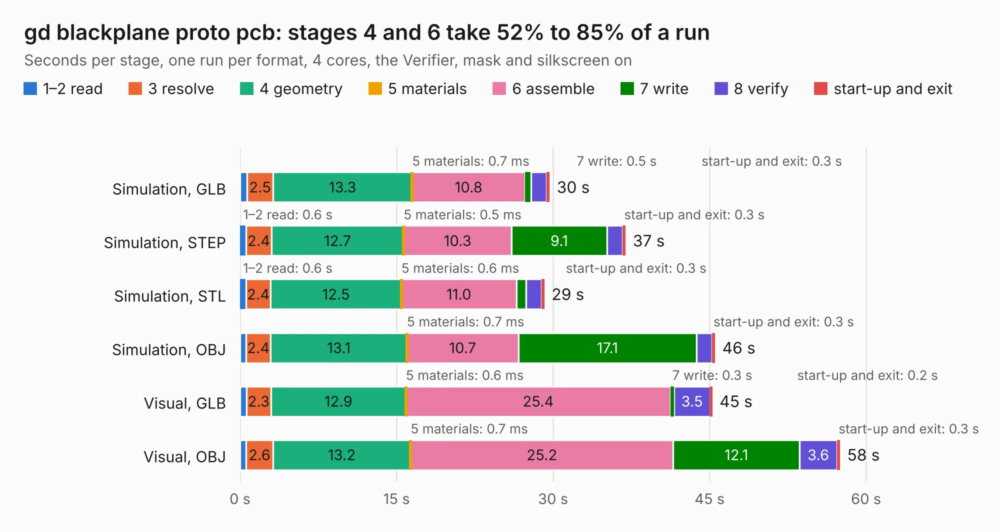

# 497. gd blackplane proto pcb

Board 497 of the 3,128 of [Corpus Testing](../Corpus-Testing.md), on [Corpus Page 5](../CorpusTestingPages/Corpus-Testing-05.md#497-gd-blackplane-proto-pcb).

| Mode and format | 1–2 read | 3 resolve | 4 geometry | 5 materials | 6 assemble | 7 write | 8 verify | start-up and exit | Total |
|---|---:|---:|---:|---:|---:|---:|---:|---:|---:|
| Simulation, GLB | 0.7 | 2.5 | 13.3 | 0.7&nbsp;ms | 10.8 | 0.5 | 1.5 | 0.3 | 29.7 |
| Simulation, STEP | 0.6 | 2.4 | 12.7 | 0.5&nbsp;ms | 10.3 | 9.1 | 1.5 | 0.3 | 37.0 |
| Simulation, STL | 0.6 | 2.4 | 12.5 | 0.6&nbsp;ms | 11.0 | 0.9 | 1.5 | 0.3 | 29.2 |
| Simulation, OBJ | 0.6 | 2.4 | 13.1 | 0.7&nbsp;ms | 10.7 | 17.1 | 1.5 | 0.3 | 45.5 |
| Visual, GLB | 0.6 | 2.3 | 12.9 | 0.6&nbsp;ms | 25.4 | 0.3 | 3.5 | 0.2 | 45.3 |
| Visual, OBJ | 0.6 | 2.6 | 13.2 | 0.7&nbsp;ms | 25.2 | 12.1 | 3.6 | 0.3 | 57.5 |

<table align="center"><tr><td valign="top">

| Board | Repo: [baldengineer/Mega-IIe](https://github.com/baldengineer/Mega-IIe) Board: `gd blackplane proto pcb.kicad_pcb` |
|---|---|
| Folder | kicad files / gd backplane proto pcb |
| Complexity | 230&nbsp;/&nbsp;1000 (size&nbsp;175, features&nbsp;55) |
| KESE&nbsp;features | through vias, rounded, trapezoid or chamfered pads, filled zones, curved board outline |
| Tested | 9th November 2026 |
| Copper&nbsp;layers | 2 |
| File&nbsp;format | KiCad 5 (20171130) |
| Parts,&nbsp;tracks,&nbsp;vias | 33, 1,404, 42 |
| Triangles,&nbsp;simulation | 3,146,394 in 59 parts |
| Verifier | PASS in all six runs |

</td><td valign="top">

<table>
<tr><th>File type</th><th>File size</th><th>Peak memory used</th></tr>
<tr><th colspan="3" align="left">Simulation</th></tr>
<tr><td>GLB</td><td align="right">107&nbsp;MB</td><td align="right">1.1&nbsp;GB</td></tr>
<tr><td>STEP</td><td align="right">530&nbsp;MB</td><td align="right">1.3&nbsp;GB</td></tr>
<tr><td>STL</td><td align="right">157&nbsp;MB</td><td align="right">1.1&nbsp;GB</td></tr>
<tr><td>OBJ</td><td align="right">332&nbsp;MB</td><td align="right">2.0&nbsp;GB</td></tr>
<tr><th colspan="3" align="left">Visual</th></tr>
<tr><td>GLB</td><td align="right">76&nbsp;MB</td><td align="right">1.3&nbsp;GB</td></tr>
<tr><td>OBJ</td><td align="right">234&nbsp;MB</td><td align="right">1.6&nbsp;GB</td></tr>
</table>

</td></tr></table>

| Previous | Next |
|:---|---:|
| [496. gd audio proto pcb-rev1 bad footprint](b0496b_Mega-IIe_gd-audio-proto-pcb-rev1-bad-footprint.md) | [498. gd blackplane proto pcb](b0498b_Mega-IIe_kicad-files-gd-backplane-proto-pcb-rev1_gd-blackplane-proto-pcb.md) |
