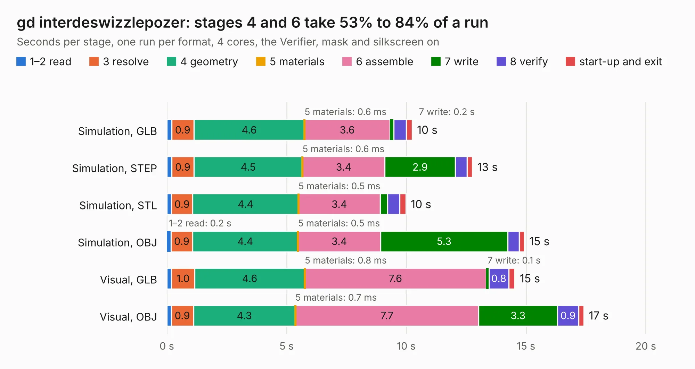

# 499. gd interdeswizzlepozer

Board 499 of the 3,129 of [Corpus Testing](../Corpus-Testing.md), on [Corpus Page 5](../CorpusTestingPages/Corpus-Testing-05.md#499-gd-interdeswizzlepozer).

| Mode and format | 1–2 read | 3 resolve | 4 geometry | 5 materials | 6 assemble | 7 write | 8 verify | start-up and exit | Total |
|---|---:|---:|---:|---:|---:|---:|---:|---:|---:|
| Simulation, GLB | 0.2 | 0.9 | 4.6 | 0.6&nbsp;ms | 3.6 | 0.2 | 0.5 | 0.2 | 10.2 |
| Simulation, STEP | 0.2 | 0.9 | 4.5 | 0.6&nbsp;ms | 3.4 | 2.9 | 0.5 | 0.2 | 12.8 |
| Simulation, STL | 0.2 | 0.9 | 4.4 | 0.5&nbsp;ms | 3.4 | 0.3 | 0.5 | 0.3 | 10.0 |
| Simulation, OBJ | 0.2 | 0.9 | 4.4 | 0.5&nbsp;ms | 3.4 | 5.3 | 0.5 | 0.2 | 14.9 |
| Visual, GLB | 0.2 | 1.0 | 4.6 | 0.8&nbsp;ms | 7.6 | 0.1 | 0.8 | 0.3 | 14.5 |
| Visual, OBJ | 0.2 | 0.9 | 4.3 | 0.7&nbsp;ms | 7.7 | 3.3 | 0.9 | 0.2 | 17.4 |

<table align="center"><tr><td valign="top">

| Board | Repo: [baldengineer/Mega-IIe](https://github.com/baldengineer/Mega-IIe) Board: `gd interdeswizzlepozer.kicad_pcb` |
|---|---|
| Folder | kicad files / gd interdeswizzlepozer pcb |
| Complexity | 185&nbsp;/&nbsp;1000 (size&nbsp;140, features&nbsp;45) |
| KESE&nbsp;features | through vias, filled zones, curved board outline |
| Tested | 9th November 2026 |
| Copper&nbsp;layers | 2 |
| File&nbsp;format | KiCad 5 (20171130) |
| Parts,&nbsp;tracks,&nbsp;vias | 8, 336, 32 |
| Triangles,&nbsp;simulation | 1,091,766 in 55 parts |
| Verifier | PASS in all six runs |

</td><td valign="top">

<table>
<tr><th>File type</th><th>File size</th><th>Peak memory used</th></tr>
<tr><th colspan="3" align="left">Simulation</th></tr>
<tr><td>GLB</td><td align="right">38&nbsp;MB</td><td align="right">470&nbsp;MB</td></tr>
<tr><td>STEP</td><td align="right">195&nbsp;MB</td><td align="right">516&nbsp;MB</td></tr>
<tr><td>STL</td><td align="right">55&nbsp;MB</td><td align="right">446&nbsp;MB</td></tr>
<tr><td>OBJ</td><td align="right">112&nbsp;MB</td><td align="right">772&nbsp;MB</td></tr>
<tr><th colspan="3" align="left">Visual</th></tr>
<tr><td>GLB</td><td align="right">24&nbsp;MB</td><td align="right">520&nbsp;MB</td></tr>
<tr><td>OBJ</td><td align="right">71&nbsp;MB</td><td align="right">563&nbsp;MB</td></tr>
</table>

</td></tr></table>

| Previous | Next |
|:---|---:|
| [498. gd blackplane proto pcb](b0498b_Mega-IIe_kicad-files-gd-backplane-proto-pcb-rev1_gd-blackplane-proto-pcb.md) | [500. gd io proto pcb](b0500b_Mega-IIe_kicad-files-gd-io-proto-pcb_gd-io-proto-pcb.md) |
