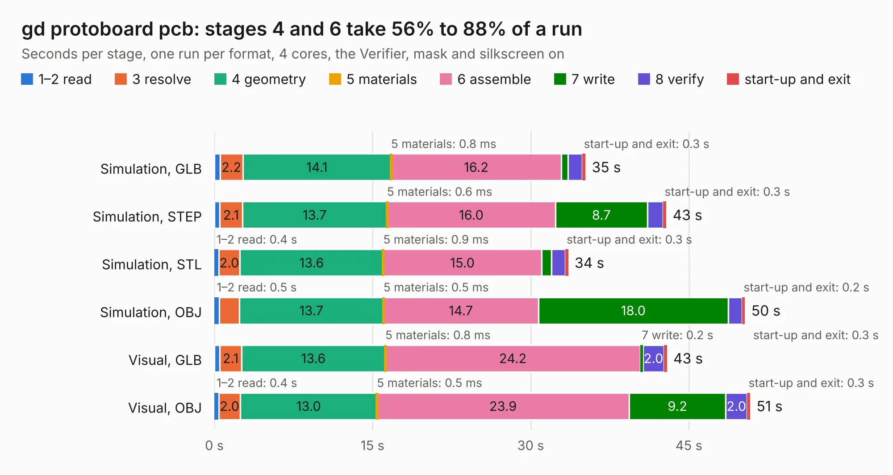

# 502. gd protoboard pcb

Board 502 of the 3,107 of [Corpus Testing](../Corpus-Testing.md), on [Corpus Page 5](../CorpusTestingPages/Corpus-Testing-05.md#502-gd-protoboard-pcb).

| Mode and format | 1–2 read | 3 resolve | 4 geometry | 5 materials | 6 assemble | 7 write | 8 verify | start-up and exit | Total |
|---|---:|---:|---:|---:|---:|---:|---:|---:|---:|
| Simulation, GLB | 0.5 | 2.2 | 14.1 | 0.8&nbsp;ms | 16.2 | 0.6 | 1.3 | 0.3 | 35.2 |
| Simulation, STEP | 0.5 | 2.1 | 13.7 | 0.6&nbsp;ms | 16.0 | 8.7 | 1.5 | 0.3 | 42.9 |
| Simulation, STL | 0.4 | 2.0 | 13.6 | 0.9&nbsp;ms | 15.0 | 0.9 | 1.3 | 0.3 | 33.6 |
| Simulation, OBJ | 0.5 | 1.9 | 13.7 | 0.5&nbsp;ms | 14.7 | 18.0 | 1.3 | 0.2 | 50.3 |
| Visual, GLB | 0.5 | 2.1 | 13.6 | 0.8&nbsp;ms | 24.2 | 0.2 | 2.0 | 0.3 | 42.9 |
| Visual, OBJ | 0.4 | 2.0 | 13.0 | 0.5&nbsp;ms | 23.9 | 9.2 | 2.0 | 0.3 | 50.8 |

<table align="center"><tr><td valign="top">

| Board | Repo: [baldengineer/Mega-IIe](https://github.com/baldengineer/Mega-IIe) Board: `gd protoboard pcb.kicad_pcb` |
|---|---|
| Folder | kicad files / gd protoboard pcb |
| Complexity | 228&nbsp;/&nbsp;1000 (size&nbsp;163, features&nbsp;65) |
| KESE&nbsp;features | through vias, rounded, trapezoid or chamfered pads, filled zones, copper drawings, curved board outline |
| Tested | 9th November 2026 |
| Copper&nbsp;layers | 2 |
| File&nbsp;format | KiCad 7 (20221018) |
| Parts,&nbsp;tracks,&nbsp;vias | 120, 269, 12 |
| Triangles,&nbsp;simulation | 2,964,746 in 61 parts |
| Verifier | PASS in all six runs |

</td><td valign="top">

<table>
<tr><th>File type</th><th>File size</th><th>Peak memory used</th></tr>
<tr><th colspan="3" align="left">Simulation</th></tr>
<tr><td>GLB</td><td align="right">99&nbsp;MB</td><td align="right">915&nbsp;MB</td></tr>
<tr><td>STEP</td><td align="right">424&nbsp;MB</td><td align="right">1.2&nbsp;GB</td></tr>
<tr><td>STL</td><td align="right">148&nbsp;MB</td><td align="right">924&nbsp;MB</td></tr>
<tr><td>OBJ</td><td align="right">308&nbsp;MB</td><td align="right">1.9&nbsp;GB</td></tr>
<tr><th colspan="3" align="left">Visual</th></tr>
<tr><td>GLB</td><td align="right">48&nbsp;MB</td><td align="right">1.1&nbsp;GB</td></tr>
<tr><td>OBJ</td><td align="right">150&nbsp;MB</td><td align="right">1.1&nbsp;GB</td></tr>
</table>

</td></tr></table>

| Previous | Next |
|:---|---:|
| [501. proto socket adapter](b0501b_Mega-IIe_proto-socket-adapter.md) | [503. gd rev2 crystalposer](b0503b_Mega-IIe_gd-rev2-crystalposer.md) |
