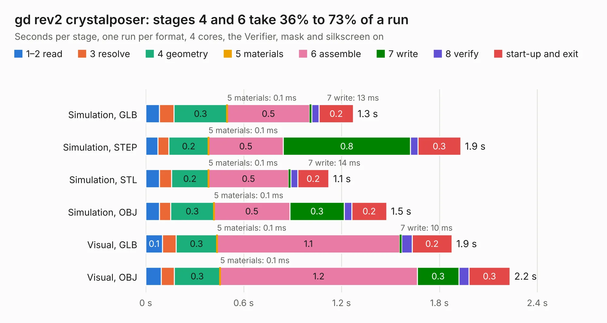

# 503. gd rev2 crystalposer

Board 503 of the 3,104 of [Corpus Testing](../Corpus-Testing.md), on [Corpus Page 5](../CorpusTestingPages/Corpus-Testing-05.md#503-gd-rev2-crystalposer).

| Mode and format | 1–2 read | 3 resolve | 4 geometry | 5 materials | 6 assemble | 7 write | 8 verify | start-up and exit | Total |
|---|---:|---:|---:|---:|---:|---:|---:|---:|---:|
| Simulation, GLB | 83&nbsp;ms | 90&nbsp;ms | 0.3 | 0.1&nbsp;ms | 0.5 | 13&nbsp;ms | 46&nbsp;ms | 0.2 | 1.3 |
| Simulation, STEP | 75&nbsp;ms | 68&nbsp;ms | 0.2 | 0.1&nbsp;ms | 0.5 | 0.8 | 46&nbsp;ms | 0.3 | 1.9 |
| Simulation, STL | 83&nbsp;ms | 74&nbsp;ms | 0.2 | 0.1&nbsp;ms | 0.5 | 14&nbsp;ms | 42&nbsp;ms | 0.2 | 1.1 |
| Simulation, OBJ | 83&nbsp;ms | 69&nbsp;ms | 0.3 | 0.1&nbsp;ms | 0.5 | 0.3 | 47&nbsp;ms | 0.2 | 1.5 |
| Visual, GLB | 0.1 | 82&nbsp;ms | 0.3 | 0.1&nbsp;ms | 1.1 | 10&nbsp;ms | 65&nbsp;ms | 0.2 | 1.9 |
| Visual, OBJ | 94&nbsp;ms | 81&nbsp;ms | 0.3 | 0.1&nbsp;ms | 1.2 | 0.3 | 62&nbsp;ms | 0.3 | 2.2 |

<table align="center"><tr><td valign="top">

| Board | Repo: [baldengineer/Mega-IIe](https://github.com/baldengineer/Mega-IIe) Board: `gd rev2 crystalposer.kicad_pcb` |
|---|---|
| Folder | kicad files / gd rev2 crystalposer |
| Complexity | 203&nbsp;/&nbsp;1000 (size&nbsp;93, features&nbsp;110) |
| KESE&nbsp;features | through vias, custom pads, rounded, trapezoid or chamfered pads, filled zones, copper drawings, curved board outline, stack-up, dielectric εr and tanδ |
| Tested | 9th November 2026 |
| Copper&nbsp;layers | 2 |
| File&nbsp;format | KiCad 6 (20211014) |
| Parts,&nbsp;tracks,&nbsp;vias | 5, 10, 7 |
| Triangles,&nbsp;simulation | 68,552 in 16 parts |
| Verifier | PASS in all six runs |

</td><td valign="top">

<table>
<tr><th>File type</th><th>File size</th><th>Peak memory used</th></tr>
<tr><th colspan="3" align="left">Simulation</th></tr>
<tr><td>GLB</td><td align="right">2.4&nbsp;MB</td><td align="right">168&nbsp;MB</td></tr>
<tr><td>STEP</td><td align="right">12&nbsp;MB</td><td align="right">174&nbsp;MB</td></tr>
<tr><td>STL</td><td align="right">3.4&nbsp;MB</td><td align="right">170&nbsp;MB</td></tr>
<tr><td>OBJ</td><td align="right">6.6&nbsp;MB</td><td align="right">172&nbsp;MB</td></tr>
<tr><th colspan="3" align="left">Visual</th></tr>
<tr><td>GLB</td><td align="right">1.8&nbsp;MB</td><td align="right">152&nbsp;MB</td></tr>
<tr><td>OBJ</td><td align="right">5.1&nbsp;MB</td><td align="right">153&nbsp;MB</td></tr>
</table>

</td></tr></table>

| Previous | Next |
|:---|---:|
| [502. gd protoboard pcb](b0502b_Mega-IIe_gd-protoboard-pcb.md) | [504. gd rev3](b0504b_Mega-IIe_gd-rev3.md) |
