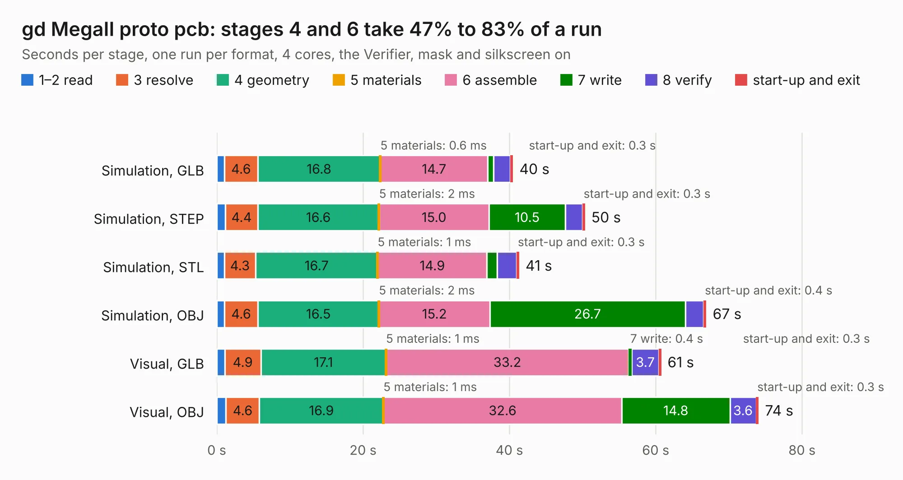

# 504. gd MegaII proto pcb

Board 504 of the 3,128 of [Corpus Testing](../Corpus-Testing.md), on [Corpus Page 5](../CorpusTestingPages/Corpus-Testing-05.md#504-gd-megaii-proto-pcb).

| Mode and format | 1–2 read | 3 resolve | 4 geometry | 5 materials | 6 assemble | 7 write | 8 verify | start-up and exit | Total |
|---|---:|---:|---:|---:|---:|---:|---:|---:|---:|
| Simulation, GLB | 1.0 | 4.6 | 16.8 | 0.6&nbsp;ms | 14.7 | 0.8 | 2.3 | 0.3 | 40.5 |
| Simulation, STEP | 1.2 | 4.4 | 16.6 | 2&nbsp;ms | 15.0 | 10.5 | 2.3 | 0.3 | 50.3 |
| Simulation, STL | 1.0 | 4.3 | 16.7 | 1&nbsp;ms | 14.9 | 1.4 | 2.7 | 0.3 | 41.3 |
| Simulation, OBJ | 1.0 | 4.6 | 16.5 | 2&nbsp;ms | 15.2 | 26.7 | 2.5 | 0.4 | 66.9 |
| Visual, GLB | 1.1 | 4.9 | 17.1 | 1&nbsp;ms | 33.2 | 0.4 | 3.7 | 0.3 | 60.7 |
| Visual, OBJ | 1.3 | 4.6 | 16.9 | 1&nbsp;ms | 32.6 | 14.8 | 3.6 | 0.3 | 74.1 |

<table align="center"><tr><td valign="top">

| Board | Repo: [baldengineer/Mega-IIe](https://github.com/baldengineer/Mega-IIe) Board: `gd MegaII proto pcb.kicad_pcb` |
|---|---|
| Folder | kicad files / gd MegaII proto pcb |
| Complexity | 297&nbsp;/&nbsp;1000 (size&nbsp;242, features&nbsp;55) |
| KESE&nbsp;features | through vias, rounded, trapezoid or chamfered pads, filled zones, curved board outline |
| Tested | 9th November 2026 |
| Copper&nbsp;layers | 4 |
| File&nbsp;format | KiCad 7 (20221018) |
| Parts,&nbsp;tracks,&nbsp;vias | 54, 1,412, 217 |
| Triangles,&nbsp;simulation | 4,075,592 in 145 parts |
| Verifier | PASS in all six runs |

</td><td valign="top">

<table>
<tr><th>File type</th><th>File size</th><th>Peak memory used</th></tr>
<tr><th colspan="3" align="left">Simulation</th></tr>
<tr><td>GLB</td><td align="right">139&nbsp;MB</td><td align="right">1.2&nbsp;GB</td></tr>
<tr><td>STEP</td><td align="right">562&nbsp;MB</td><td align="right">1.5&nbsp;GB</td></tr>
<tr><td>STL</td><td align="right">204&nbsp;MB</td><td align="right">1.3&nbsp;GB</td></tr>
<tr><td>OBJ</td><td align="right">433&nbsp;MB</td><td align="right">2.6&nbsp;GB</td></tr>
<tr><th colspan="3" align="left">Visual</th></tr>
<tr><td>GLB</td><td align="right">84&nbsp;MB</td><td align="right">1.4&nbsp;GB</td></tr>
<tr><td>OBJ</td><td align="right">265&nbsp;MB</td><td align="right">1.7&nbsp;GB</td></tr>
</table>

</td></tr></table>

| Previous | Next |
|:---|---:|
| [503. gd MEGA-65c02 proto pcb](b0503b_Mega-IIe_gd-MEGA-65c02-proto-pcb.md) | [505. gd power supply board pcb](b0505b_Mega-IIe_kicad-files-gd-power-supply-board-pcb_gd-power-supply-board-pcb.md) |
