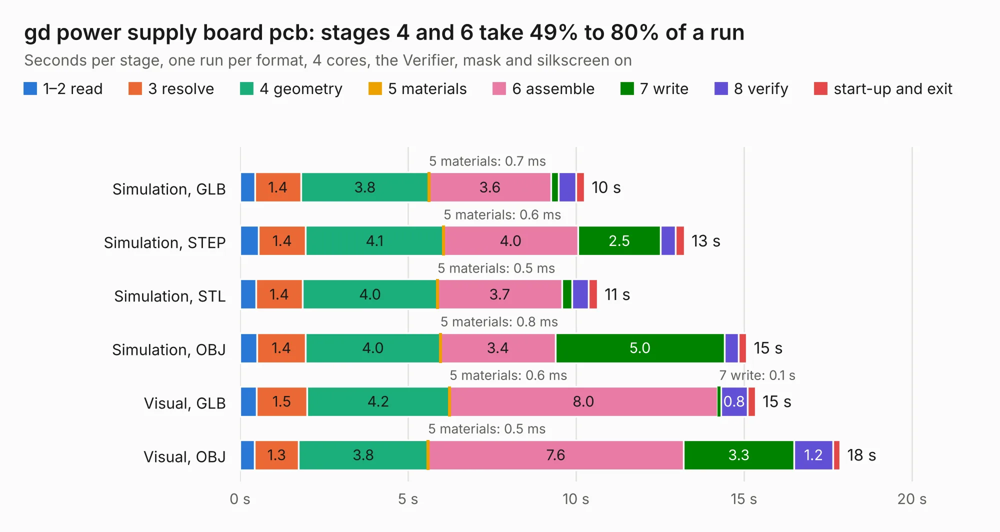

# 504. gd power supply board pcb

Board 504 of the 3,121 of [Corpus Testing](../Corpus-Testing.md), on [Corpus Page 5](../CorpusTestingPages/Corpus-Testing-05.md#504-gd-power-supply-board-pcb).

| Mode and format | 1–2 read | 3 resolve | 4 geometry | 5 materials | 6 assemble | 7 write | 8 verify | start-up and exit | Total |
|---|---:|---:|---:|---:|---:|---:|---:|---:|---:|
| Simulation, GLB | 0.4 | 1.4 | 3.8 | 0.7&nbsp;ms | 3.6 | 0.2 | 0.5 | 0.2 | 10.3 |
| Simulation, STEP | 0.6 | 1.4 | 4.1 | 0.6&nbsp;ms | 4.0 | 2.5 | 0.4 | 0.3 | 13.2 |
| Simulation, STL | 0.5 | 1.4 | 4.0 | 0.5&nbsp;ms | 3.7 | 0.3 | 0.5 | 0.3 | 10.6 |
| Simulation, OBJ | 0.5 | 1.4 | 4.0 | 0.8&nbsp;ms | 3.4 | 5.0 | 0.4 | 0.2 | 15.1 |
| Visual, GLB | 0.5 | 1.5 | 4.2 | 0.6&nbsp;ms | 8.0 | 0.1 | 0.8 | 0.2 | 15.3 |
| Visual, OBJ | 0.4 | 1.3 | 3.8 | 0.5&nbsp;ms | 7.6 | 3.3 | 1.2 | 0.2 | 17.9 |

<table align="center"><tr><td valign="top">

| Board | Repo: [baldengineer/Mega-IIe](https://github.com/baldengineer/Mega-IIe) Board: `gd power supply board pcb.kicad_pcb` |
|---|---|
| Folder | kicad files / gd power supply board pcb |
| Complexity | 353&nbsp;/&nbsp;1000 (size&nbsp;198, features&nbsp;155) |
| KESE&nbsp;features | through vias, slotted holes, custom pads, rounded, trapezoid or chamfered pads, arc tracks, filled zones, copper drawings, curved board outline, stack-up, dielectric εr and tanδ, copper finish, mask and silkscreen colours |
| Tested | 9th November 2026 |
| Copper&nbsp;layers | 4 |
| File&nbsp;format | KiCad 7 (20221018) |
| Parts,&nbsp;tracks,&nbsp;vias | 93, 119, 341 |
| Triangles,&nbsp;simulation | 1,253,358 in 64 parts |
| Verifier | PASS in all six runs |

</td><td valign="top">

<table>
<tr><th>File type</th><th>File size</th><th>Peak memory used</th></tr>
<tr><th colspan="3" align="left">Simulation</th></tr>
<tr><td>GLB</td><td align="right">43&nbsp;MB</td><td align="right">576&nbsp;MB</td></tr>
<tr><td>STEP</td><td align="right">139&nbsp;MB</td><td align="right">637&nbsp;MB</td></tr>
<tr><td>STL</td><td align="right">63&nbsp;MB</td><td align="right">538&nbsp;MB</td></tr>
<tr><td>OBJ</td><td align="right">133&nbsp;MB</td><td align="right">904&nbsp;MB</td></tr>
<tr><th colspan="3" align="left">Visual</th></tr>
<tr><td>GLB</td><td align="right">27&nbsp;MB</td><td align="right">582&nbsp;MB</td></tr>
<tr><td>OBJ</td><td align="right">84&nbsp;MB</td><td align="right">652&nbsp;MB</td></tr>
</table>

</td></tr></table>

| Previous | Next |
|:---|---:|
| [503. gd MegaII proto pcb](b0503b_Mega-IIe_kicad-files-gd-MegaII-proto-pcb_gd-MegaII-proto-pcb.md) | [505. gd power supply board pcb](b0505b_Mega-IIe_kicad-files-gd-power-supply-board-pcb-gd-ps-rev1_gd-power-supply-board-pcb.md) |
