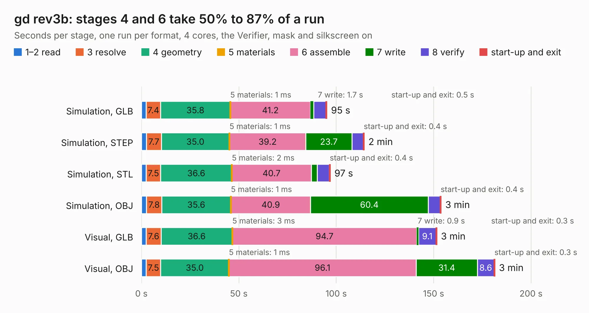

# 505. gd rev3b

Board 505 of the 3,108 of [Corpus Testing](../Corpus-Testing.md), on [Corpus Page 5](../CorpusTestingPages/Corpus-Testing-05.md#505-gd-rev3b).

| Mode and format | 1–2 read | 3 resolve | 4 geometry | 5 materials | 6 assemble | 7 write | 8 verify | start-up and exit | Total |
|---|---:|---:|---:|---:|---:|---:|---:|---:|---:|
| Simulation, GLB | 2.5 | 7.4 | 35.8 | 1&nbsp;ms | 41.2 | 1.7 | 6.3 | 0.5 | 95.2 |
| Simulation, STEP | 2.6 | 7.7 | 35.0 | 1&nbsp;ms | 39.2 | 23.7 | 5.9 | 0.4 | 114.4 |
| Simulation, STL | 2.4 | 7.5 | 36.6 | 2&nbsp;ms | 40.7 | 3.0 | 6.3 | 0.4 | 96.9 |
| Simulation, OBJ | 2.6 | 7.8 | 35.6 | 1&nbsp;ms | 40.9 | 60.4 | 6.2 | 0.4 | 153.9 |
| Visual, GLB | 2.5 | 7.6 | 36.6 | 3&nbsp;ms | 94.7 | 0.9 | 9.1 | 0.3 | 151.6 |
| Visual, OBJ | 2.4 | 7.5 | 35.0 | 1&nbsp;ms | 96.1 | 31.4 | 8.6 | 0.3 | 181.4 |

<table align="center"><tr><td valign="top">

| Board | Repo: [baldengineer/Mega-IIe](https://github.com/baldengineer/Mega-IIe) Board: `gd rev3b.kicad_pcb` |
|---|---|
| Folder | kicad files / gd rev3b |
| Complexity | 419&nbsp;/&nbsp;1000 (size&nbsp;294, features&nbsp;125) |
| KESE&nbsp;features | through vias, slotted holes, custom pads, rounded, trapezoid or chamfered pads, filled zones, copper drawings, curved board outline, stack-up, dielectric εr and tanδ, mask and silkscreen colours |
| Tested | 9th November 2026 |
| Copper&nbsp;layers | 4 |
| File&nbsp;format | KiCad 7 (20221018) |
| Parts,&nbsp;tracks,&nbsp;vias | 302, 4,102, 546 |
| Triangles,&nbsp;simulation | 7,783,106 in 438 parts |
| Verifier | PASS in all six runs |

</td><td valign="top">

<table>
<tr><th>File type</th><th>File size</th><th>Peak memory used</th></tr>
<tr><th colspan="3" align="left">Simulation</th></tr>
<tr><td>GLB</td><td align="right">265&nbsp;MB</td><td align="right">2.0&nbsp;GB</td></tr>
<tr><td>STEP</td><td align="right">1.3&nbsp;GB</td><td align="right">2.8&nbsp;GB</td></tr>
<tr><td>STL</td><td align="right">389&nbsp;MB</td><td align="right">2.0&nbsp;GB</td></tr>
<tr><td>OBJ</td><td align="right">839&nbsp;MB</td><td align="right">5.0&nbsp;GB</td></tr>
<tr><th colspan="3" align="left">Visual</th></tr>
<tr><td>GLB</td><td align="right">166&nbsp;MB</td><td align="right">2.7&nbsp;GB</td></tr>
<tr><td>OBJ</td><td align="right">535&nbsp;MB</td><td align="right">3.5&nbsp;GB</td></tr>
</table>

</td></tr></table>

| Previous | Next |
|:---|---:|
| [504. gd rev3](b0504b_Mega-IIe_gd-rev3.md) | [506. gd rp2040 keyboard proto pcb](b0506b_Mega-IIe_gd-rp2040-keyboard-proto-pcb.md) |
