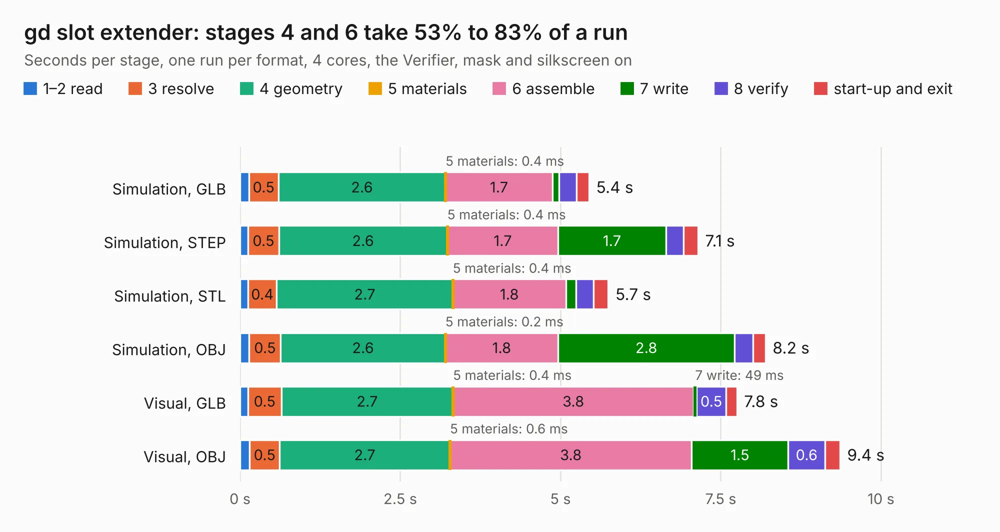

# 505. gd slot extender

Board 505 of the 3,102 of [Corpus Testing](../Corpus-Testing.md), on [Corpus Page 5](../CorpusTestingPages/Corpus-Testing-05.md#505-gd-slot-extender).

| Mode and format | 1–2 read | 3 resolve | 4 geometry | 5 materials | 6 assemble | 7 write | 8 verify | start-up and exit | Total |
|---|---:|---:|---:|---:|---:|---:|---:|---:|---:|
| Simulation, GLB | 0.1 | 0.5 | 2.6 | 0.4&nbsp;ms | 1.7 | 99&nbsp;ms | 0.3 | 0.2 | 5.4 |
| Simulation, STEP | 0.1 | 0.5 | 2.6 | 0.4&nbsp;ms | 1.7 | 1.7 | 0.3 | 0.2 | 7.1 |
| Simulation, STL | 0.1 | 0.4 | 2.7 | 0.4&nbsp;ms | 1.8 | 0.2 | 0.3 | 0.2 | 5.7 |
| Simulation, OBJ | 0.1 | 0.5 | 2.6 | 0.2&nbsp;ms | 1.8 | 2.8 | 0.3 | 0.2 | 8.2 |
| Visual, GLB | 0.1 | 0.5 | 2.7 | 0.4&nbsp;ms | 3.8 | 49&nbsp;ms | 0.5 | 0.2 | 7.8 |
| Visual, OBJ | 0.2 | 0.5 | 2.7 | 0.6&nbsp;ms | 3.8 | 1.5 | 0.6 | 0.2 | 9.4 |

<table align="center"><tr><td valign="top">

| Board | Repo: [baldengineer/Mega-IIe](https://github.com/baldengineer/Mega-IIe) Board: `gd slot extender.kicad_pcb` |
|---|---|
| Folder | kicad files / gd slot extender |
| Complexity | 219&nbsp;/&nbsp;1000 (size&nbsp;129, features&nbsp;90) |
| KESE&nbsp;features | custom pads, copper drawings, knockout text, stack-up, dielectric εr and tanδ, copper finish, mask and silkscreen colours |
| Tested | 9th November 2026 |
| Copper&nbsp;layers | 2 |
| File&nbsp;format | KiCad 8 (20240108) |
| Parts,&nbsp;tracks,&nbsp;vias | 4, 326, 0 |
| Triangles,&nbsp;simulation | 648,746 in 63 parts |
| Verifier | PASS in all six runs |

</td><td valign="top">

<table>
<tr><th>File type</th><th>File size</th><th>Peak memory used</th></tr>
<tr><th colspan="3" align="left">Simulation</th></tr>
<tr><td>GLB</td><td align="right">22&nbsp;MB</td><td align="right">351&nbsp;MB</td></tr>
<tr><td>STEP</td><td align="right">112&nbsp;MB</td><td align="right">359&nbsp;MB</td></tr>
<tr><td>STL</td><td align="right">32&nbsp;MB</td><td align="right">333&nbsp;MB</td></tr>
<tr><td>OBJ</td><td align="right">67&nbsp;MB</td><td align="right">476&nbsp;MB</td></tr>
<tr><th colspan="3" align="left">Visual</th></tr>
<tr><td>GLB</td><td align="right">13&nbsp;MB</td><td align="right">351&nbsp;MB</td></tr>
<tr><td>OBJ</td><td align="right">38&nbsp;MB</td><td align="right">350&nbsp;MB</td></tr>
</table>

</td></tr></table>

| Previous | Next |
|:---|---:|
| [504. gd rp2040 keyboard proto pcb](b0504b_Mega-IIe_gd-rp2040-keyboard-proto-pcb.md) | [506. gd vga pico proto pcb](b0506b_Mega-IIe_gd-vga-pico-proto-pcb.md) |
