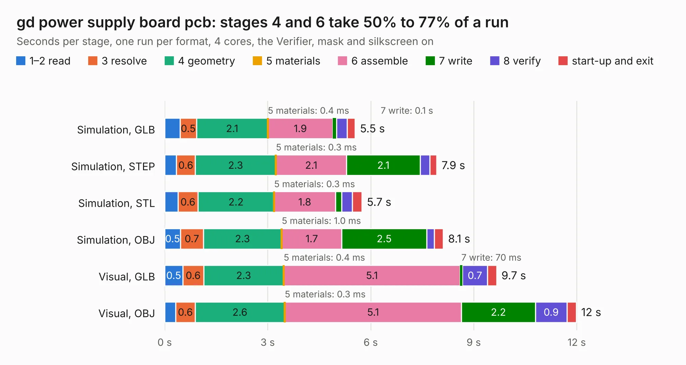

# 507. gd power supply board pcb

Board 507 of the 3,131 of [Corpus Testing](../Corpus-Testing.md), on [Corpus Page 5](../CorpusTestingPages/Corpus-Testing-05.md#507-gd-power-supply-board-pcb).

| Mode and format | 1–2 read | 3 resolve | 4 geometry | 5 materials | 6 assemble | 7 write | 8 verify | start-up and exit | Total |
|---|---:|---:|---:|---:|---:|---:|---:|---:|---:|
| Simulation, GLB | 0.4 | 0.5 | 2.1 | 0.4&nbsp;ms | 1.9 | 0.1 | 0.3 | 0.2 | 5.5 |
| Simulation, STEP | 0.3 | 0.6 | 2.3 | 0.3&nbsp;ms | 2.1 | 2.1 | 0.3 | 0.2 | 7.9 |
| Simulation, STL | 0.4 | 0.6 | 2.2 | 0.3&nbsp;ms | 1.8 | 0.2 | 0.3 | 0.3 | 5.7 |
| Simulation, OBJ | 0.5 | 0.7 | 2.3 | 1.0&nbsp;ms | 1.7 | 2.5 | 0.2 | 0.3 | 8.1 |
| Visual, GLB | 0.5 | 0.6 | 2.3 | 0.4&nbsp;ms | 5.1 | 70&nbsp;ms | 0.7 | 0.3 | 9.7 |
| Visual, OBJ | 0.3 | 0.6 | 2.6 | 0.3&nbsp;ms | 5.1 | 2.2 | 0.9 | 0.3 | 12.0 |

<table align="center"><tr><td valign="top">

| Board | Repo: [baldengineer/Mega-IIe](https://github.com/baldengineer/Mega-IIe) Board: `gd power supply board pcb.kicad_pcb` |
|---|---|
| Folder | kicad files / gd power supply board pcb / gd ps rev1 |
| Complexity | 313&nbsp;/&nbsp;1000 (size&nbsp;158, features&nbsp;155) |
| KESE&nbsp;features | through vias, slotted holes, custom pads, rounded, trapezoid or chamfered pads, arc tracks, filled zones, copper drawings, curved board outline, stack-up, dielectric εr and tanδ, copper finish, mask and silkscreen colours |
| Tested | 9th November 2026 |
| Copper&nbsp;layers | 2 |
| File&nbsp;format | KiCad 7 (20221018) |
| Parts,&nbsp;tracks,&nbsp;vias | 73, 144, 61 |
| Triangles,&nbsp;simulation | 509,766 in 55 parts |
| Verifier | PASS in all six runs |

</td><td valign="top">

<table>
<tr><th>File type</th><th>File size</th><th>Peak memory used</th></tr>
<tr><th colspan="3" align="left">Simulation</th></tr>
<tr><td>GLB</td><td align="right">18&nbsp;MB</td><td align="right">350&nbsp;MB</td></tr>
<tr><td>STEP</td><td align="right">101&nbsp;MB</td><td align="right">380&nbsp;MB</td></tr>
<tr><td>STL</td><td align="right">25&nbsp;MB</td><td align="right">321&nbsp;MB</td></tr>
<tr><td>OBJ</td><td align="right">53&nbsp;MB</td><td align="right">402&nbsp;MB</td></tr>
<tr><th colspan="3" align="left">Visual</th></tr>
<tr><td>GLB</td><td align="right">15&nbsp;MB</td><td align="right">397&nbsp;MB</td></tr>
<tr><td>OBJ</td><td align="right">44&nbsp;MB</td><td align="right">397&nbsp;MB</td></tr>
</table>

</td></tr></table>

| Previous | Next |
|:---|---:|
| [506. gd power supply board pcb](b0506b_Mega-IIe_kicad-files-gd-power-supply-board-pcb_gd-power-supply-board-pcb.md) | [508. proto socket adapter](b0508b_Mega-IIe_proto-socket-adapter.md) |
