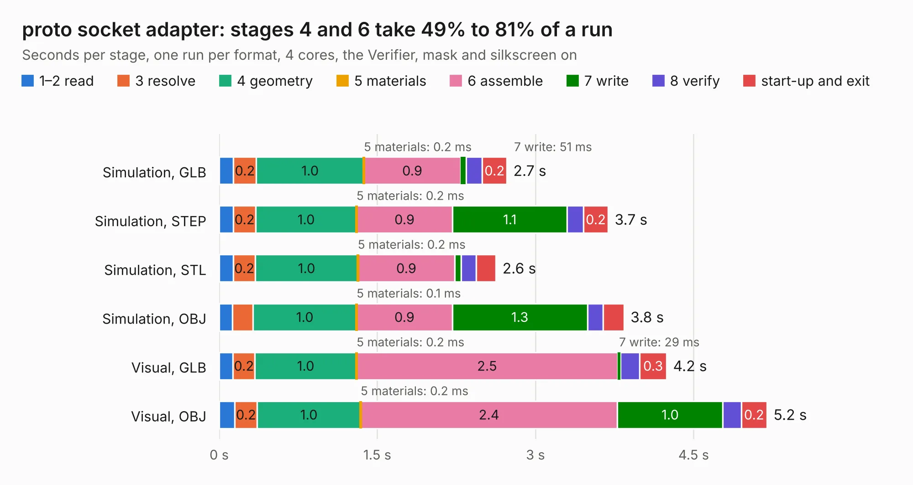

# 508. proto socket adapter

Board 508 of the 3,139 of [Corpus Testing](../Corpus-Testing.md), on [Corpus Page 5](../CorpusTestingPages/Corpus-Testing-05.md#508-proto-socket-adapter).

| Mode and format | 1–2 read | 3 resolve | 4 geometry | 5 materials | 6 assemble | 7 write | 8 verify | start-up and exit | Total |
|---|---:|---:|---:|---:|---:|---:|---:|---:|---:|
| Simulation, GLB | 0.1 | 0.2 | 1.0 | 0.2&nbsp;ms | 0.9 | 51&nbsp;ms | 0.2 | 0.2 | 2.7 |
| Simulation, STEP | 0.1 | 0.2 | 1.0 | 0.2&nbsp;ms | 0.9 | 1.1 | 0.2 | 0.2 | 3.7 |
| Simulation, STL | 0.1 | 0.2 | 1.0 | 0.2&nbsp;ms | 0.9 | 59&nbsp;ms | 0.1 | 0.2 | 2.6 |
| Simulation, OBJ | 0.1 | 0.2 | 1.0 | 0.1&nbsp;ms | 0.9 | 1.3 | 0.1 | 0.2 | 3.8 |
| Visual, GLB | 0.1 | 0.2 | 1.0 | 0.2&nbsp;ms | 2.5 | 29&nbsp;ms | 0.2 | 0.3 | 4.2 |
| Visual, OBJ | 0.1 | 0.2 | 1.0 | 0.2&nbsp;ms | 2.4 | 1.0 | 0.2 | 0.2 | 5.2 |

<table align="center"><tr><td valign="top">

| Board | Repo: [baldengineer/Mega-IIe](https://github.com/baldengineer/Mega-IIe) Board: `proto socket adapter.kicad_pcb` |
|---|---|
| Folder | kicad files / gd power supply board pcb / proto socket adapter |
| Complexity | 190&nbsp;/&nbsp;1000 (size&nbsp;105, features&nbsp;85) |
| KESE&nbsp;features | through vias, rounded, trapezoid or chamfered pads, filled zones, curved board outline, stack-up, dielectric εr and tanδ |
| Tested | 9th November 2026 |
| Copper&nbsp;layers | 2 |
| File&nbsp;format | KiCad 6 (20211014) |
| Parts,&nbsp;tracks,&nbsp;vias | 11, 26, 5 |
| Triangles,&nbsp;simulation | 243,618 in 24 parts |
| Verifier | PASS in all six runs |

</td><td valign="top">

<table>
<tr><th>File type</th><th>File size</th><th>Peak memory used</th></tr>
<tr><th colspan="3" align="left">Simulation</th></tr>
<tr><td>GLB</td><td align="right">8.4&nbsp;MB</td><td align="right">226&nbsp;MB</td></tr>
<tr><td>STEP</td><td align="right">43&nbsp;MB</td><td align="right">240&nbsp;MB</td></tr>
<tr><td>STL</td><td align="right">12&nbsp;MB</td><td align="right">231&nbsp;MB</td></tr>
<tr><td>OBJ</td><td align="right">24&nbsp;MB</td><td align="right">227&nbsp;MB</td></tr>
<tr><th colspan="3" align="left">Visual</th></tr>
<tr><td>GLB</td><td align="right">5.5&nbsp;MB</td><td align="right">222&nbsp;MB</td></tr>
<tr><td>OBJ</td><td align="right">16&nbsp;MB</td><td align="right">219&nbsp;MB</td></tr>
</table>

</td></tr></table>

| Previous | Next |
|:---|---:|
| [507. gd power supply board pcb](b0507b_Mega-IIe_kicad-files-gd-power-supply-board-pcb-gd-ps-rev1_gd-power-supply-board-pcb.md) | [509. gd protoboard pcb](b0509b_Mega-IIe_gd-protoboard-pcb.md) |
