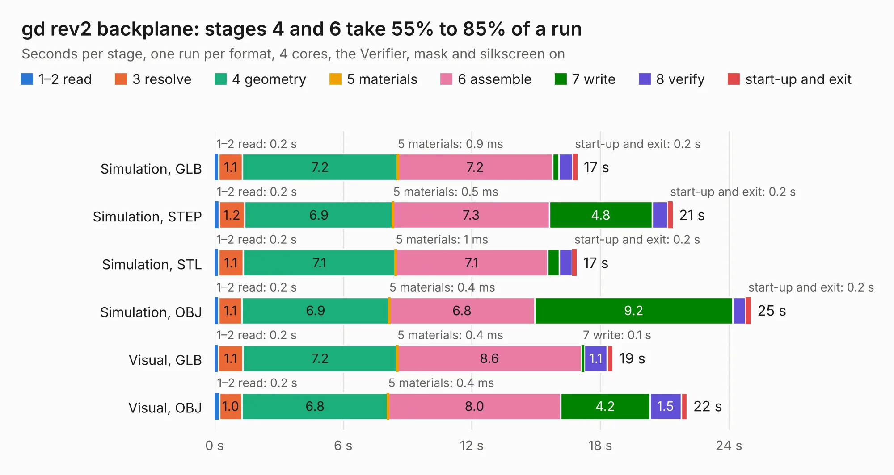

# 511. gd rev2 backplane

Board 511 of the 3,107 of [Corpus Testing](../Corpus-Testing.md), on [Corpus Page 5](../CorpusTestingPages/Corpus-Testing-05.md#511-gd-rev2-backplane).

| Mode and format | 1–2 read | 3 resolve | 4 geometry | 5 materials | 6 assemble | 7 write | 8 verify | start-up and exit | Total |
|---|---:|---:|---:|---:|---:|---:|---:|---:|---:|
| Simulation, GLB | 0.2 | 1.1 | 7.2 | 0.9&nbsp;ms | 7.2 | 0.3 | 0.6 | 0.2 | 16.9 |
| Simulation, STEP | 0.2 | 1.2 | 6.9 | 0.5&nbsp;ms | 7.3 | 4.8 | 0.7 | 0.2 | 21.4 |
| Simulation, STL | 0.2 | 1.1 | 7.1 | 1&nbsp;ms | 7.1 | 0.5 | 0.6 | 0.2 | 16.9 |
| Simulation, OBJ | 0.2 | 1.1 | 6.9 | 0.4&nbsp;ms | 6.8 | 9.2 | 0.6 | 0.2 | 25.0 |
| Visual, GLB | 0.2 | 1.1 | 7.2 | 0.4&nbsp;ms | 8.6 | 0.1 | 1.1 | 0.3 | 18.6 |
| Visual, OBJ | 0.2 | 1.0 | 6.8 | 0.4&nbsp;ms | 8.0 | 4.2 | 1.5 | 0.3 | 22.0 |

<table align="center"><tr><td valign="top">

| Board | Repo: [baldengineer/Mega-IIe](https://github.com/baldengineer/Mega-IIe) Board: `gd rev2 backplane.kicad_pcb` |
|---|---|
| Folder | kicad files / not_used / gd rev2 backplane |
| Complexity | 141&nbsp;/&nbsp;1000 (size&nbsp;131, features&nbsp;10) |
| KESE&nbsp;features | curved board outline |
| Tested | 9th November 2026 |
| Copper&nbsp;layers | 2 |
| File&nbsp;format | KiCad 5 (20171130) |
| Parts,&nbsp;tracks,&nbsp;vias | 25, 120, 0 |
| Triangles,&nbsp;simulation | 1,573,568 in 62 parts |
| Verifier | PASS in all six runs |

</td><td valign="top">

<table>
<tr><th>File type</th><th>File size</th><th>Peak memory used</th></tr>
<tr><th colspan="3" align="left">Simulation</th></tr>
<tr><td>GLB</td><td align="right">48&nbsp;MB</td><td align="right">550&nbsp;MB</td></tr>
<tr><td>STEP</td><td align="right">183&nbsp;MB</td><td align="right">743&nbsp;MB</td></tr>
<tr><td>STL</td><td align="right">79&nbsp;MB</td><td align="right">558&nbsp;MB</td></tr>
<tr><td>OBJ</td><td align="right">158&nbsp;MB</td><td align="right">1.0&nbsp;GB</td></tr>
<tr><th colspan="3" align="left">Visual</th></tr>
<tr><td>GLB</td><td align="right">26&nbsp;MB</td><td align="right">709&nbsp;MB</td></tr>
<tr><td>OBJ</td><td align="right">78&nbsp;MB</td><td align="right">758&nbsp;MB</td></tr>
</table>

</td></tr></table>

| Previous | Next |
|:---|---:|
| [510. MegaII Breakout](b0510b_Mega-IIe_kicad-files-MegaII-Breakout_MegaII-Breakout.md) | [512. PLCC44 to DIP44 Adapter](b0512b_Mega-IIe_PLCC44-to-DIP44-Adapter.md) |
