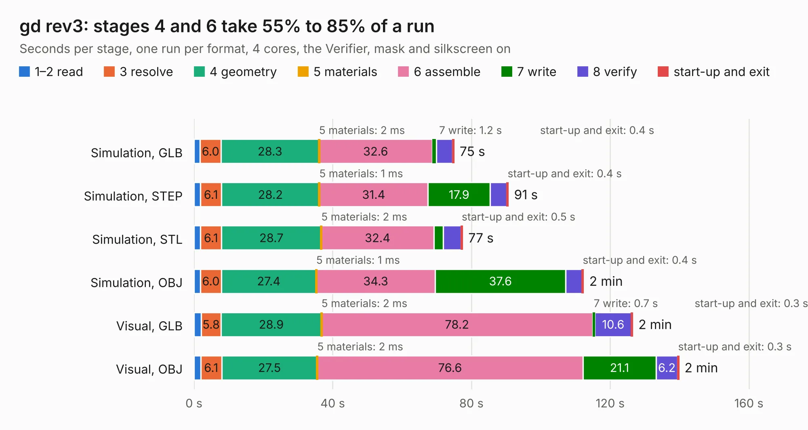

# 511. gd rev3

Board 511 of the 3,132 of [Corpus Testing](../Corpus-Testing.md), on [Corpus Page 5](../CorpusTestingPages/Corpus-Testing-05.md#511-gd-rev3).

| Mode and format | 1–2 read | 3 resolve | 4 geometry | 5 materials | 6 assemble | 7 write | 8 verify | start-up and exit | Total |
|---|---:|---:|---:|---:|---:|---:|---:|---:|---:|
| Simulation, GLB | 1.8 | 6.0 | 28.3 | 2&nbsp;ms | 32.6 | 1.2 | 4.6 | 0.4 | 74.9 |
| Simulation, STEP | 1.9 | 6.1 | 28.2 | 1&nbsp;ms | 31.4 | 17.9 | 4.9 | 0.4 | 90.6 |
| Simulation, STL | 1.9 | 6.1 | 28.7 | 2&nbsp;ms | 32.4 | 2.7 | 5.1 | 0.5 | 77.4 |
| Simulation, OBJ | 1.9 | 6.0 | 27.4 | 1&nbsp;ms | 34.3 | 37.6 | 4.7 | 0.4 | 112.3 |
| Visual, GLB | 2.1 | 5.8 | 28.9 | 2&nbsp;ms | 78.2 | 0.7 | 10.6 | 0.3 | 126.5 |
| Visual, OBJ | 1.9 | 6.1 | 27.5 | 2&nbsp;ms | 76.6 | 21.1 | 6.2 | 0.3 | 139.8 |

<table align="center"><tr><td valign="top">

| Board | Repo: [baldengineer/Mega-IIe](https://github.com/baldengineer/Mega-IIe) Board: `gd rev3.kicad_pcb` |
|---|---|
| Folder | kicad files / gd rev3 |
| Complexity | 419&nbsp;/&nbsp;1000 (size&nbsp;294, features&nbsp;125) |
| KESE&nbsp;features | through vias, slotted holes, custom pads, rounded, trapezoid or chamfered pads, filled zones, copper drawings, curved board outline, stack-up, dielectric εr and tanδ, mask and silkscreen colours |
| Tested | 9th November 2026 |
| Copper&nbsp;layers | 4 |
| File&nbsp;format | KiCad 7 (20221018) |
| Parts,&nbsp;tracks,&nbsp;vias | 292, 4,016, 543 |
| Triangles,&nbsp;simulation | 7,713,312 in 434 parts |
| Verifier | PASS in all six runs |

</td><td valign="top">

<table>
<tr><th>File type</th><th>File size</th><th>Peak memory used</th></tr>
<tr><th colspan="3" align="left">Simulation</th></tr>
<tr><td>GLB</td><td align="right">262&nbsp;MB</td><td align="right">2.0&nbsp;GB</td></tr>
<tr><td>STEP</td><td align="right">1.3&nbsp;GB</td><td align="right">2.8&nbsp;GB</td></tr>
<tr><td>STL</td><td align="right">386&nbsp;MB</td><td align="right">2.0&nbsp;GB</td></tr>
<tr><td>OBJ</td><td align="right">831&nbsp;MB</td><td align="right">4.9&nbsp;GB</td></tr>
<tr><th colspan="3" align="left">Visual</th></tr>
<tr><td>GLB</td><td align="right">164&nbsp;MB</td><td align="right">2.7&nbsp;GB</td></tr>
<tr><td>OBJ</td><td align="right">529&nbsp;MB</td><td align="right">3.5&nbsp;GB</td></tr>
</table>

</td></tr></table>

| Previous | Next |
|:---|---:|
| [510. gd rev2 crystalposer](b0510b_Mega-IIe_gd-rev2-crystalposer.md) | [512. gd rev3b](b0512b_Mega-IIe_gd-rev3b.md) |
