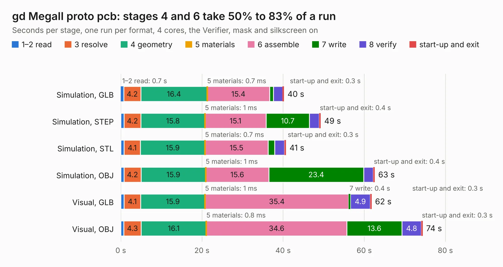

# 512. gd MegaII proto pcb

Board 512 of the 3,102 of [Corpus Testing](../Corpus-Testing.md), on [Corpus Page 5](../CorpusTestingPages/Corpus-Testing-05.md#512-gd-megaii-proto-pcb).

| Mode and format | 1–2 read | 3 resolve | 4 geometry | 5 materials | 6 assemble | 7 write | 8 verify | start-up and exit | Total |
|---|---:|---:|---:|---:|---:|---:|---:|---:|---:|
| Simulation, GLB | 0.7 | 4.2 | 16.4 | 0.7&nbsp;ms | 15.4 | 0.9 | 2.3 | 0.3 | 40.2 |
| Simulation, STEP | 0.8 | 4.2 | 15.8 | 1&nbsp;ms | 15.1 | 10.7 | 2.4 | 0.4 | 49.3 |
| Simulation, STL | 0.8 | 4.1 | 15.9 | 0.7&nbsp;ms | 15.5 | 1.6 | 2.4 | 0.3 | 40.7 |
| Simulation, OBJ | 0.8 | 4.2 | 15.9 | 1&nbsp;ms | 15.6 | 23.4 | 2.3 | 0.4 | 62.6 |
| Visual, GLB | 0.8 | 4.1 | 15.9 | 1&nbsp;ms | 35.4 | 0.4 | 4.9 | 0.3 | 61.8 |
| Visual, OBJ | 0.7 | 4.3 | 16.1 | 0.8&nbsp;ms | 34.6 | 13.6 | 4.8 | 0.3 | 74.4 |

<table align="center"><tr><td valign="top">

| Board | Repo: [baldengineer/Mega-IIe](https://github.com/baldengineer/Mega-IIe) Board: `gd MegaII proto pcb.kicad_pcb` |
|---|---|
| Folder | kicad files / rev1 / gd MegaII proto pcb |
| Complexity | 297&nbsp;/&nbsp;1000 (size&nbsp;242, features&nbsp;55) |
| KESE&nbsp;features | through vias, rounded, trapezoid or chamfered pads, filled zones, curved board outline |
| Tested | 9th November 2026 |
| Copper&nbsp;layers | 4 |
| File&nbsp;format | KiCad 5 (20171130) |
| Parts,&nbsp;tracks,&nbsp;vias | 54, 1,412, 217 |
| Triangles,&nbsp;simulation | 4,368,550 in 145 parts |
| Verifier | PASS in all six runs |

</td><td valign="top">

<table>
<tr><th>File type</th><th>File size</th><th>Peak memory used</th></tr>
<tr><th colspan="3" align="left">Simulation</th></tr>
<tr><td>GLB</td><td align="right">149&nbsp;MB</td><td align="right">1.3&nbsp;GB</td></tr>
<tr><td>STEP</td><td align="right">575&nbsp;MB</td><td align="right">1.6&nbsp;GB</td></tr>
<tr><td>STL</td><td align="right">218&nbsp;MB</td><td align="right">1.3&nbsp;GB</td></tr>
<tr><td>OBJ</td><td align="right">463&nbsp;MB</td><td align="right">2.8&nbsp;GB</td></tr>
<tr><th colspan="3" align="left">Visual</th></tr>
<tr><td>GLB</td><td align="right">92&nbsp;MB</td><td align="right">1.5&nbsp;GB</td></tr>
<tr><td>OBJ</td><td align="right">289&nbsp;MB</td><td align="right">1.9&nbsp;GB</td></tr>
</table>

</td></tr></table>

| Previous | Next |
|:---|---:|
| [511. gd 6502 proto pcb](b0511b_Mega-IIe_kicad-files-rev1-gd-6502-proto-pcb_gd-6502-proto-pcb.md) | [513. gd VGC proto pcb](b0513b_Mega-IIe_kicad-files-rev1-gd-VGC-proto-pcb_gd-VGC-proto-pcb.md) |
