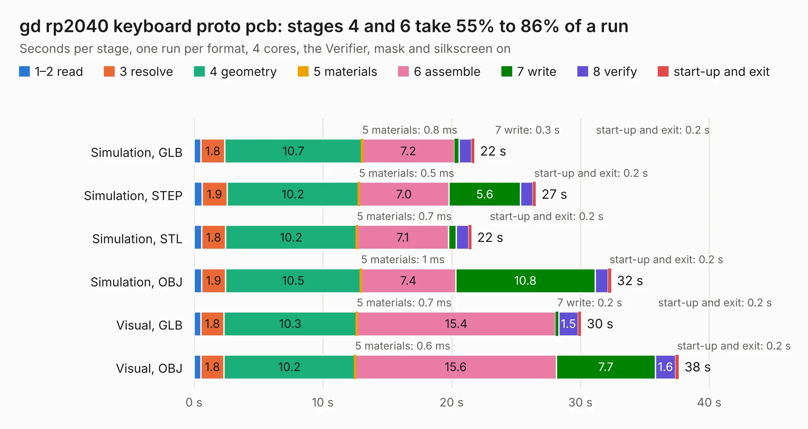

# 513. gd rp2040 keyboard proto pcb

Board 513 of the 3,132 of [Corpus Testing](../Corpus-Testing.md), on [Corpus Page 5](../CorpusTestingPages/Corpus-Testing-05.md#513-gd-rp2040-keyboard-proto-pcb).

| Mode and format | 1–2 read | 3 resolve | 4 geometry | 5 materials | 6 assemble | 7 write | 8 verify | start-up and exit | Total |
|---|---:|---:|---:|---:|---:|---:|---:|---:|---:|
| Simulation, GLB | 0.5 | 1.8 | 10.7 | 0.8&nbsp;ms | 7.2 | 0.3 | 1.0 | 0.2 | 21.8 |
| Simulation, STEP | 0.6 | 1.9 | 10.2 | 0.5&nbsp;ms | 7.0 | 5.6 | 0.9 | 0.2 | 26.5 |
| Simulation, STL | 0.6 | 1.8 | 10.2 | 0.7&nbsp;ms | 7.1 | 0.6 | 1.0 | 0.2 | 21.5 |
| Simulation, OBJ | 0.6 | 1.9 | 10.5 | 1&nbsp;ms | 7.4 | 10.8 | 1.0 | 0.2 | 32.4 |
| Visual, GLB | 0.5 | 1.8 | 10.3 | 0.7&nbsp;ms | 15.4 | 0.2 | 1.5 | 0.2 | 30.0 |
| Visual, OBJ | 0.5 | 1.8 | 10.2 | 0.6&nbsp;ms | 15.6 | 7.7 | 1.6 | 0.2 | 37.6 |

<table align="center"><tr><td valign="top">

| Board | Repo: [baldengineer/Mega-IIe](https://github.com/baldengineer/Mega-IIe) Board: `gd rp2040 keyboard proto pcb.kicad_pcb` |
|---|---|
| Folder | kicad files / gd rp2040 keyboard proto pcb / kicad |
| Complexity | 345&nbsp;/&nbsp;1000 (size&nbsp;215, features&nbsp;130) |
| KESE&nbsp;features | through vias, slotted holes, rounded, trapezoid or chamfered pads, arc tracks, filled zones, curved board outline, stack-up, dielectric εr and tanδ, copper finish, mask and silkscreen colours |
| Tested | 9th November 2026 |
| Copper&nbsp;layers | 2 |
| File&nbsp;format | KiCad 6 (20211014) |
| Parts,&nbsp;tracks,&nbsp;vias | 56, 743, 113 |
| Triangles,&nbsp;simulation | 2,035,154 in 118 parts |
| Verifier | PASS in all six runs |

</td><td valign="top">

<table>
<tr><th>File type</th><th>File size</th><th>Peak memory used</th></tr>
<tr><th colspan="3" align="left">Simulation</th></tr>
<tr><td>GLB</td><td align="right">71&nbsp;MB</td><td align="right">776&nbsp;MB</td></tr>
<tr><td>STEP</td><td align="right">423&nbsp;MB</td><td align="right">931&nbsp;MB</td></tr>
<tr><td>STL</td><td align="right">102&nbsp;MB</td><td align="right">799&nbsp;MB</td></tr>
<tr><td>OBJ</td><td align="right">217&nbsp;MB</td><td align="right">1.4&nbsp;GB</td></tr>
<tr><th colspan="3" align="left">Visual</th></tr>
<tr><td>GLB</td><td align="right">47&nbsp;MB</td><td align="right">883&nbsp;MB</td></tr>
<tr><td>OBJ</td><td align="right">145&nbsp;MB</td><td align="right">1.1&nbsp;GB</td></tr>
</table>

</td></tr></table>

| Previous | Next |
|:---|---:|
| [512. gd rev3b](b0512b_Mega-IIe_gd-rev3b.md) | [514. gd slot extender](b0514b_Mega-IIe_gd-slot-extender.md) |
