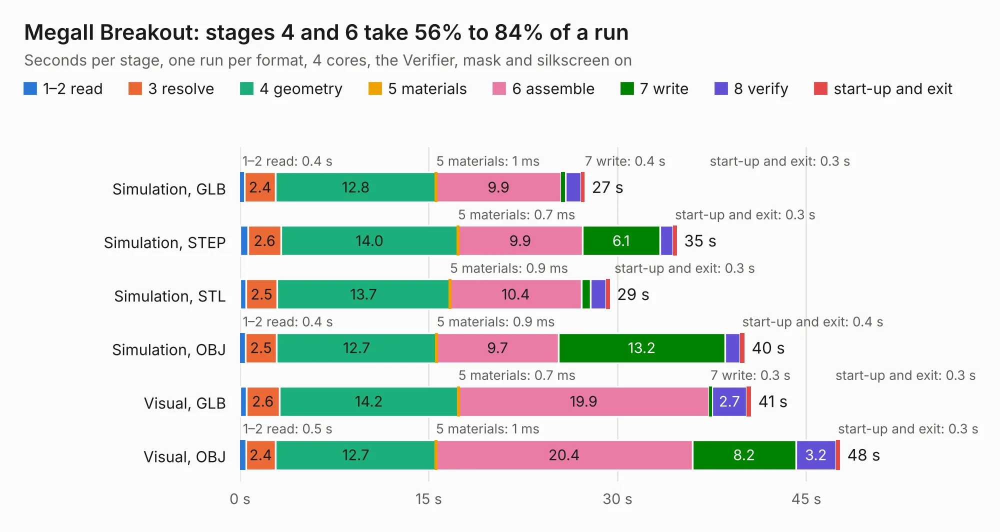

# 513. MegaII Breakout

Board 513 of the 3,100 of [Corpus Testing](../Corpus-Testing.md), on [Corpus Page 5](../CorpusTestingPages/Corpus-Testing-05.md#513-megaii-breakout).

| Mode and format | 1–2 read | 3 resolve | 4 geometry | 5 materials | 6 assemble | 7 write | 8 verify | start-up and exit | Total |
|---|---:|---:|---:|---:|---:|---:|---:|---:|---:|
| Simulation, GLB | 0.4 | 2.4 | 12.8 | 1&nbsp;ms | 9.9 | 0.4 | 1.2 | 0.3 | 27.4 |
| Simulation, STEP | 0.6 | 2.6 | 14.0 | 0.7&nbsp;ms | 9.9 | 6.1 | 1.1 | 0.3 | 34.7 |
| Simulation, STL | 0.5 | 2.5 | 13.7 | 0.9&nbsp;ms | 10.4 | 0.7 | 1.3 | 0.3 | 29.4 |
| Simulation, OBJ | 0.4 | 2.5 | 12.7 | 0.9&nbsp;ms | 9.7 | 13.2 | 1.2 | 0.4 | 40.1 |
| Visual, GLB | 0.5 | 2.6 | 14.2 | 0.7&nbsp;ms | 19.9 | 0.3 | 2.7 | 0.3 | 40.6 |
| Visual, OBJ | 0.5 | 2.4 | 12.7 | 1&nbsp;ms | 20.4 | 8.2 | 3.2 | 0.3 | 47.7 |

<table align="center"><tr><td valign="top">

| Board | Repo: [baldengineer/Mega-IIe](https://github.com/baldengineer/Mega-IIe) Board: `MegaII Breakout.kicad_pcb` |
|---|---|
| Folder | kicad files / rev1 / MegaII Breakout |
| Complexity | 241&nbsp;/&nbsp;1000 (size&nbsp;196, features&nbsp;45) |
| KESE&nbsp;features | through vias, filled zones, curved board outline |
| Tested | 9th November 2026 |
| Copper&nbsp;layers | 2 |
| File&nbsp;format | KiCad 5 (20171130) |
| Parts,&nbsp;tracks,&nbsp;vias | 21, 377, 84 |
| Triangles,&nbsp;simulation | 2,172,348 in 96 parts |
| Verifier | PASS in all six runs |

</td><td valign="top">

<table>
<tr><th>File type</th><th>File size</th><th>Peak memory used</th></tr>
<tr><th colspan="3" align="left">Simulation</th></tr>
<tr><td>GLB</td><td align="right">75&nbsp;MB</td><td align="right">692&nbsp;MB</td></tr>
<tr><td>STEP</td><td align="right">349&nbsp;MB</td><td align="right">891&nbsp;MB</td></tr>
<tr><td>STL</td><td align="right">109&nbsp;MB</td><td align="right">753&nbsp;MB</td></tr>
<tr><td>OBJ</td><td align="right">230&nbsp;MB</td><td align="right">1.5&nbsp;GB</td></tr>
<tr><th colspan="3" align="left">Visual</th></tr>
<tr><td>GLB</td><td align="right">50&nbsp;MB</td><td align="right">980&nbsp;MB</td></tr>
<tr><td>OBJ</td><td align="right">152&nbsp;MB</td><td align="right">1.1&nbsp;GB</td></tr>
</table>

</td></tr></table>

| Previous | Next |
|:---|---:|
| [512. gd VGC proto pcb](b0512b_Mega-IIe_kicad-files-rev1-gd-VGC-proto-pcb_gd-VGC-proto-pcb.md) | [514. ROM Interposer board](b0514b_Mega-IIe_kicad-files-rev1-ROM-Interposer-board_ROM-Interposer-board.md) |
