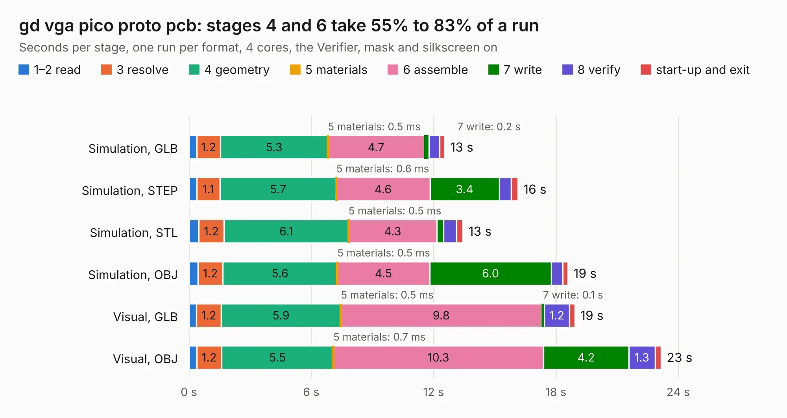

# 515. gd vga pico proto pcb

Board 515 of the 3,139 of [Corpus Testing](../Corpus-Testing.md), on [Corpus Page 5](../CorpusTestingPages/Corpus-Testing-05.md#515-gd-vga-pico-proto-pcb).

| Mode and format | 1–2 read | 3 resolve | 4 geometry | 5 materials | 6 assemble | 7 write | 8 verify | start-up and exit | Total |
|---|---:|---:|---:|---:|---:|---:|---:|---:|---:|
| Simulation, GLB | 0.4 | 1.2 | 5.3 | 0.5&nbsp;ms | 4.7 | 0.2 | 0.5 | 0.2 | 12.5 |
| Simulation, STEP | 0.4 | 1.1 | 5.7 | 0.6&nbsp;ms | 4.6 | 3.4 | 0.6 | 0.3 | 16.1 |
| Simulation, STL | 0.5 | 1.2 | 6.1 | 0.5&nbsp;ms | 4.3 | 0.3 | 0.6 | 0.3 | 13.4 |
| Simulation, OBJ | 0.4 | 1.2 | 5.6 | 0.5&nbsp;ms | 4.5 | 6.0 | 0.6 | 0.2 | 18.6 |
| Visual, GLB | 0.4 | 1.2 | 5.9 | 0.5&nbsp;ms | 9.8 | 0.1 | 1.2 | 0.3 | 18.9 |
| Visual, OBJ | 0.4 | 1.2 | 5.5 | 0.7&nbsp;ms | 10.3 | 4.2 | 1.3 | 0.3 | 23.2 |

<table align="center"><tr><td valign="top">

| Board | Repo: [baldengineer/Mega-IIe](https://github.com/baldengineer/Mega-IIe) Board: `gd vga pico proto pcb.kicad_pcb` |
|---|---|
| Folder | kicad files / gd vga pico proto pcb |
| Complexity | 323&nbsp;/&nbsp;1000 (size&nbsp;208, features&nbsp;115) |
| KESE&nbsp;features | through vias, slotted holes, rounded, trapezoid or chamfered pads, filled zones, curved board outline, stack-up, dielectric εr and tanδ, copper finish, mask and silkscreen colours |
| Tested | 9th November 2026 |
| Copper&nbsp;layers | 2 |
| File&nbsp;format | KiCad 6 (20211014) |
| Parts,&nbsp;tracks,&nbsp;vias | 55, 481, 76 |
| Triangles,&nbsp;simulation | 1,015,088 in 97 parts |
| Verifier | PASS in all six runs |

</td><td valign="top">

<table>
<tr><th>File type</th><th>File size</th><th>Peak memory used</th></tr>
<tr><th colspan="3" align="left">Simulation</th></tr>
<tr><td>GLB</td><td align="right">36&nbsp;MB</td><td align="right">463&nbsp;MB</td></tr>
<tr><td>STEP</td><td align="right">217&nbsp;MB</td><td align="right">537&nbsp;MB</td></tr>
<tr><td>STL</td><td align="right">51&nbsp;MB</td><td align="right">461&nbsp;MB</td></tr>
<tr><td>OBJ</td><td align="right">105&nbsp;MB</td><td align="right">717&nbsp;MB</td></tr>
<tr><th colspan="3" align="left">Visual</th></tr>
<tr><td>GLB</td><td align="right">25&nbsp;MB</td><td align="right">539&nbsp;MB</td></tr>
<tr><td>OBJ</td><td align="right">74&nbsp;MB</td><td align="right">587&nbsp;MB</td></tr>
</table>

</td></tr></table>

| Previous | Next |
|:---|---:|
| [514. gd slot extender](b0514b_Mega-IIe_gd-slot-extender.md) | [516. gd VGC proto pcb](b0516b_Mega-IIe_kicad-files-gd-VGC-proto-pcb_gd-VGC-proto-pcb.md) |
