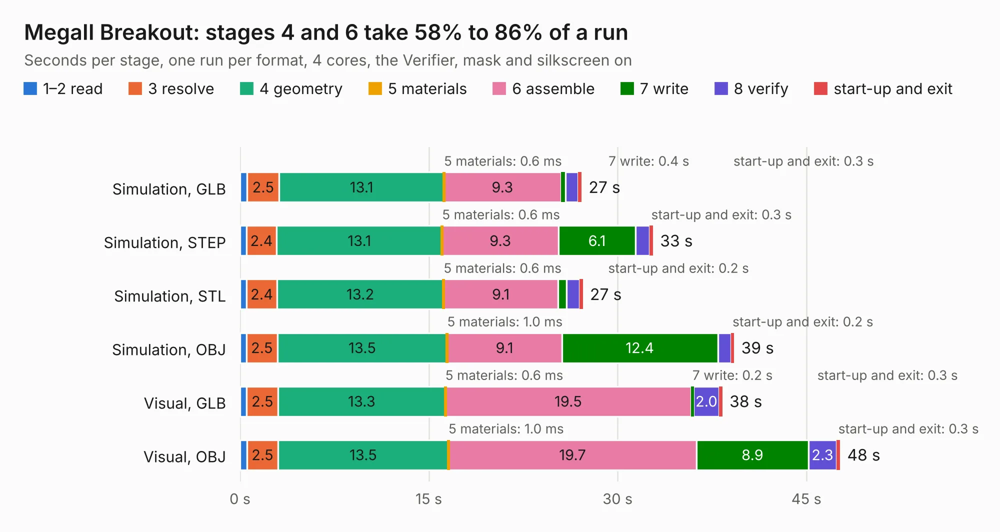

# 515. MegaII Breakout

Board 515 of the 3,121 of [Corpus Testing](../Corpus-Testing.md), on [Corpus Page 5](../CorpusTestingPages/Corpus-Testing-05.md#515-megaii-breakout).

| Mode and format | 1–2 read | 3 resolve | 4 geometry | 5 materials | 6 assemble | 7 write | 8 verify | start-up and exit | Total |
|---|---:|---:|---:|---:|---:|---:|---:|---:|---:|
| Simulation, GLB | 0.6 | 2.5 | 13.1 | 0.6&nbsp;ms | 9.3 | 0.4 | 1.0 | 0.3 | 27.1 |
| Simulation, STEP | 0.5 | 2.4 | 13.1 | 0.6&nbsp;ms | 9.3 | 6.1 | 1.1 | 0.3 | 32.8 |
| Simulation, STL | 0.5 | 2.4 | 13.2 | 0.6&nbsp;ms | 9.1 | 0.7 | 1.1 | 0.2 | 27.2 |
| Simulation, OBJ | 0.5 | 2.5 | 13.5 | 1.0&nbsp;ms | 9.1 | 12.4 | 1.0 | 0.2 | 39.3 |
| Visual, GLB | 0.5 | 2.5 | 13.3 | 0.6&nbsp;ms | 19.5 | 0.2 | 2.0 | 0.3 | 38.3 |
| Visual, OBJ | 0.6 | 2.5 | 13.5 | 1.0&nbsp;ms | 19.7 | 8.9 | 2.3 | 0.3 | 47.7 |

<table align="center"><tr><td valign="top">

| Board | Repo: [baldengineer/Mega-IIe](https://github.com/baldengineer/Mega-IIe) Board: `MegaII Breakout.kicad_pcb` |
|---|---|
| Folder | kicad files / MegaII Breakout |
| Complexity | 241&nbsp;/&nbsp;1000 (size&nbsp;196, features&nbsp;45) |
| KESE&nbsp;features | through vias, filled zones, curved board outline |
| Tested | 9th November 2026 |
| Copper&nbsp;layers | 2 |
| File&nbsp;format | KiCad 7 (20221018) |
| Parts,&nbsp;tracks,&nbsp;vias | 21, 377, 84 |
| Triangles,&nbsp;simulation | 2,103,604 in 96 parts |
| Verifier | PASS in all six runs |

</td><td valign="top">

<table>
<tr><th>File type</th><th>File size</th><th>Peak memory used</th></tr>
<tr><th colspan="3" align="left">Simulation</th></tr>
<tr><td>GLB</td><td align="right">73&nbsp;MB</td><td align="right">658&nbsp;MB</td></tr>
<tr><td>STEP</td><td align="right">352&nbsp;MB</td><td align="right">856&nbsp;MB</td></tr>
<tr><td>STL</td><td align="right">105&nbsp;MB</td><td align="right">666&nbsp;MB</td></tr>
<tr><td>OBJ</td><td align="right">223&nbsp;MB</td><td align="right">1.5&nbsp;GB</td></tr>
<tr><th colspan="3" align="left">Visual</th></tr>
<tr><td>GLB</td><td align="right">48&nbsp;MB</td><td align="right">878&nbsp;MB</td></tr>
<tr><td>OBJ</td><td align="right">145&nbsp;MB</td><td align="right">1.1&nbsp;GB</td></tr>
</table>

</td></tr></table>

| Previous | Next |
|:---|---:|
| [514. gd VGC proto pcb](b0514b_Mega-IIe_kicad-files-gd-VGC-proto-pcb_gd-VGC-proto-pcb.md) | [516. gd rev2 backplane](b0516b_Mega-IIe_gd-rev2-backplane.md) |
