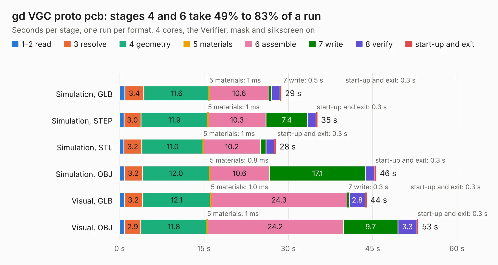

# 515. gd VGC proto pcb

Board 515 of the 3,127 of [Corpus Testing](../Corpus-Testing.md), on [Corpus Page 5](../CorpusTestingPages/Corpus-Testing-05.md#515-gd-vgc-proto-pcb).

| Mode and format | 1–2 read | 3 resolve | 4 geometry | 5 materials | 6 assemble | 7 write | 8 verify | start-up and exit | Total |
|---|---:|---:|---:|---:|---:|---:|---:|---:|---:|
| Simulation, GLB | 1.0 | 3.4 | 11.6 | 1&nbsp;ms | 10.6 | 0.5 | 1.5 | 0.3 | 28.8 |
| Simulation, STEP | 0.8 | 3.0 | 11.9 | 1&nbsp;ms | 10.3 | 7.4 | 1.5 | 0.3 | 35.2 |
| Simulation, STL | 0.8 | 3.2 | 11.0 | 1&nbsp;ms | 10.2 | 1.0 | 1.5 | 0.3 | 27.8 |
| Simulation, OBJ | 0.8 | 3.2 | 12.0 | 0.8&nbsp;ms | 10.6 | 17.1 | 1.6 | 0.3 | 45.6 |
| Visual, GLB | 0.8 | 3.2 | 12.1 | 1.0&nbsp;ms | 24.3 | 0.3 | 2.8 | 0.3 | 44.0 |
| Visual, OBJ | 0.9 | 2.9 | 11.8 | 1&nbsp;ms | 24.2 | 9.7 | 3.3 | 0.3 | 53.1 |

<table align="center"><tr><td valign="top">

| Board | Repo: [baldengineer/Mega-IIe](https://github.com/baldengineer/Mega-IIe) Board: `gd VGC proto pcb.kicad_pcb` |
|---|---|
| Folder | kicad files / gd VGC proto pcb |
| Complexity | 293&nbsp;/&nbsp;1000 (size&nbsp;238, features&nbsp;55) |
| KESE&nbsp;features | through vias, slotted holes, rounded, trapezoid or chamfered pads, filled zones |
| Tested | 9th November 2026 |
| Copper&nbsp;layers | 4 |
| File&nbsp;format | KiCad 7 (20221018) |
| Parts,&nbsp;tracks,&nbsp;vias | 101, 856, 77 |
| Triangles,&nbsp;simulation | 3,225,426 in 136 parts |
| Verifier | PASS in all six runs |

</td><td valign="top">

<table>
<tr><th>File type</th><th>File size</th><th>Peak memory used</th></tr>
<tr><th colspan="3" align="left">Simulation</th></tr>
<tr><td>GLB</td><td align="right">110&nbsp;MB</td><td align="right">1.0&nbsp;GB</td></tr>
<tr><td>STEP</td><td align="right">456&nbsp;MB</td><td align="right">1.2&nbsp;GB</td></tr>
<tr><td>STL</td><td align="right">161&nbsp;MB</td><td align="right">1.0&nbsp;GB</td></tr>
<tr><td>OBJ</td><td align="right">340&nbsp;MB</td><td align="right">2.1&nbsp;GB</td></tr>
<tr><th colspan="3" align="left">Visual</th></tr>
<tr><td>GLB</td><td align="right">66&nbsp;MB</td><td align="right">1.5&nbsp;GB</td></tr>
<tr><td>OBJ</td><td align="right">204&nbsp;MB</td><td align="right">1.5&nbsp;GB</td></tr>
</table>

</td></tr></table>

| Previous | Next |
|:---|---:|
| [514. gd vga pico proto pcb](b0514b_Mega-IIe_gd-vga-pico-proto-pcb.md) | [516. MegaII Breakout](b0516b_Mega-IIe_kicad-files-MegaII-Breakout_MegaII-Breakout.md) |
