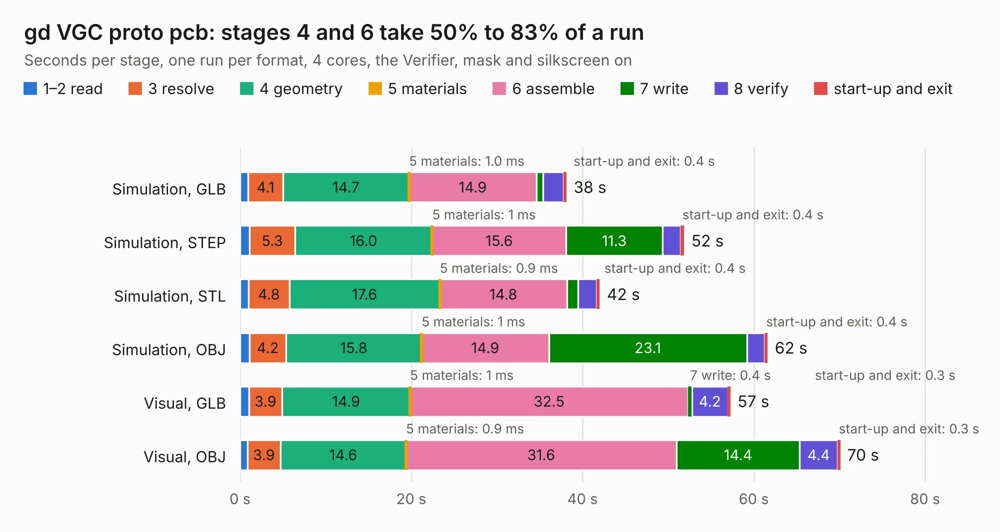

# 515. gd VGC proto pcb

Board 515 of the 3,107 of [Corpus Testing](../Corpus-Testing.md), on [Corpus Page 5](../CorpusTestingPages/Corpus-Testing-05.md#515-gd-vgc-proto-pcb).

| Mode and format | 1–2 read | 3 resolve | 4 geometry | 5 materials | 6 assemble | 7 write | 8 verify | start-up and exit | Total |
|---|---:|---:|---:|---:|---:|---:|---:|---:|---:|
| Simulation, GLB | 0.9 | 4.1 | 14.7 | 1.0&nbsp;ms | 14.9 | 0.8 | 2.4 | 0.4 | 38.1 |
| Simulation, STEP | 1.1 | 5.3 | 16.0 | 1&nbsp;ms | 15.6 | 11.3 | 2.1 | 0.4 | 51.9 |
| Simulation, STL | 1.0 | 4.8 | 17.6 | 0.9&nbsp;ms | 14.8 | 1.3 | 2.2 | 0.4 | 42.0 |
| Simulation, OBJ | 1.1 | 4.2 | 15.8 | 1&nbsp;ms | 14.9 | 23.1 | 2.1 | 0.4 | 61.6 |
| Visual, GLB | 1.0 | 3.9 | 14.9 | 1&nbsp;ms | 32.5 | 0.4 | 4.2 | 0.3 | 57.3 |
| Visual, OBJ | 0.9 | 3.9 | 14.6 | 0.9&nbsp;ms | 31.6 | 14.4 | 4.4 | 0.3 | 70.1 |

<table align="center"><tr><td valign="top">

| Board | Repo: [baldengineer/Mega-IIe](https://github.com/baldengineer/Mega-IIe) Board: `gd VGC proto pcb.kicad_pcb` |
|---|---|
| Folder | kicad files / rev1 / gd VGC proto pcb |
| Complexity | 293&nbsp;/&nbsp;1000 (size&nbsp;238, features&nbsp;55) |
| KESE&nbsp;features | through vias, slotted holes, rounded, trapezoid or chamfered pads, filled zones |
| Tested | 9th November 2026 |
| Copper&nbsp;layers | 4 |
| File&nbsp;format | KiCad 5 (20171130) |
| Parts,&nbsp;tracks,&nbsp;vias | 101, 856, 77 |
| Triangles,&nbsp;simulation | 3,502,212 in 136 parts |
| Verifier | Simulation, GLB: Verifier FAIL Simulation, STEP: Verifier FAIL Simulation, STL: Verifier FAIL Simulation, OBJ: Verifier FAIL |
| Bad&nbsp;design | Bad design according to KESE: copper of two nets on top of each other in the file, a short KiCad's DRC reports; two through-hole pads at one spot, (143.51, 102.87) mm, of nets `/UG3-7` and `/VBL.L`. KESE models what the file says, so the Verifier rightly finds the two nets' solids overlapping |

</td><td valign="top">

<table>
<tr><th>File type</th><th>File size</th><th>Peak memory used</th></tr>
<tr><th colspan="3" align="left">Simulation</th></tr>
<tr><td>GLB</td><td align="right">119&nbsp;MB</td><td align="right">1.1&nbsp;GB</td></tr>
<tr><td>STEP</td><td align="right">485&nbsp;MB</td><td align="right">1.3&nbsp;GB</td></tr>
<tr><td>STL</td><td align="right">175&nbsp;MB</td><td align="right">1.1&nbsp;GB</td></tr>
<tr><td>OBJ</td><td align="right">369&nbsp;MB</td><td align="right">2.3&nbsp;GB</td></tr>
<tr><th colspan="3" align="left">Visual</th></tr>
<tr><td>GLB</td><td align="right">74&nbsp;MB</td><td align="right">1.2&nbsp;GB</td></tr>
<tr><td>OBJ</td><td align="right">228&nbsp;MB</td><td align="right">1.6&nbsp;GB</td></tr>
</table>

</td></tr></table>

| Previous | Next |
|:---|---:|
| [514. gd MegaII proto pcb](b0514b_Mega-IIe_kicad-files-rev1-gd-MegaII-proto-pcb_gd-MegaII-proto-pcb.md) | [516. MegaII Breakout](b0516b_Mega-IIe_kicad-files-rev1-MegaII-Breakout_MegaII-Breakout.md) |
