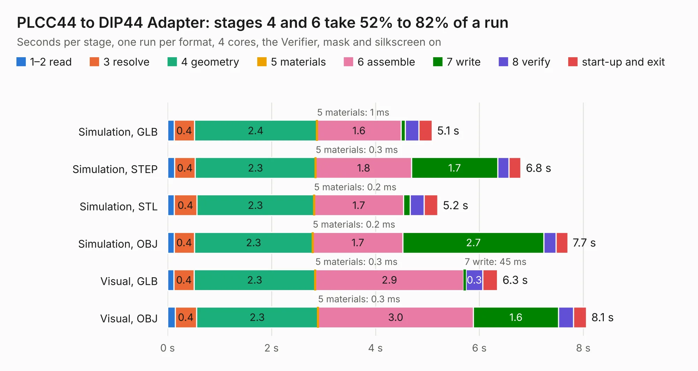

# 518. PLCC44 to DIP44 Adapter

Board 518 of the 3,127 of [Corpus Testing](../Corpus-Testing.md), on [Corpus Page 5](../CorpusTestingPages/Corpus-Testing-05.md#518-plcc44-to-dip44-adapter).

| Mode and format | 1–2 read | 3 resolve | 4 geometry | 5 materials | 6 assemble | 7 write | 8 verify | start-up and exit | Total |
|---|---:|---:|---:|---:|---:|---:|---:|---:|---:|
| Simulation, GLB | 0.1 | 0.4 | 2.4 | 1&nbsp;ms | 1.6 | 81&nbsp;ms | 0.3 | 0.3 | 5.1 |
| Simulation, STEP | 0.1 | 0.4 | 2.3 | 0.3&nbsp;ms | 1.8 | 1.7 | 0.2 | 0.2 | 6.8 |
| Simulation, STL | 0.1 | 0.4 | 2.3 | 0.2&nbsp;ms | 1.7 | 0.1 | 0.3 | 0.3 | 5.2 |
| Simulation, OBJ | 0.1 | 0.4 | 2.3 | 0.2&nbsp;ms | 1.7 | 2.7 | 0.2 | 0.2 | 7.7 |
| Visual, GLB | 0.1 | 0.4 | 2.3 | 0.3&nbsp;ms | 2.9 | 45&nbsp;ms | 0.3 | 0.3 | 6.3 |
| Visual, OBJ | 0.1 | 0.4 | 2.3 | 0.3&nbsp;ms | 3.0 | 1.6 | 0.3 | 0.2 | 8.1 |

<table align="center"><tr><td valign="top">

| Board | Repo: [baldengineer/Mega-IIe](https://github.com/baldengineer/Mega-IIe) Board: `PLCC44 to DIP44 Adapter.kicad_pcb` |
|---|---|
| Folder | kicad files / not_used / PLCC44 to DIP44 Adapter |
| Complexity | 165&nbsp;/&nbsp;1000 (size&nbsp;155, features&nbsp;10) |
| KESE&nbsp;features | curved board outline |
| Tested | 9th November 2026 |
| Copper&nbsp;layers | 2 |
| File&nbsp;format | KiCad 5 (20171130) |
| Parts,&nbsp;tracks,&nbsp;vias | 3, 160, 0 |
| Triangles,&nbsp;simulation | 439,398 in 12 parts |
| Verifier | PASS in all six runs |

</td><td valign="top">

<table>
<tr><th>File type</th><th>File size</th><th>Peak memory used</th></tr>
<tr><th colspan="3" align="left">Simulation</th></tr>
<tr><td>GLB</td><td align="right">15&nbsp;MB</td><td align="right">274&nbsp;MB</td></tr>
<tr><td>STEP</td><td align="right">53&nbsp;MB</td><td align="right">311&nbsp;MB</td></tr>
<tr><td>STL</td><td align="right">22&nbsp;MB</td><td align="right">277&nbsp;MB</td></tr>
<tr><td>OBJ</td><td align="right">44&nbsp;MB</td><td align="right">341&nbsp;MB</td></tr>
<tr><th colspan="3" align="left">Visual</th></tr>
<tr><td>GLB</td><td align="right">9.2&nbsp;MB</td><td align="right">304&nbsp;MB</td></tr>
<tr><td>OBJ</td><td align="right">27&nbsp;MB</td><td align="right">310&nbsp;MB</td></tr>
</table>

</td></tr></table>

| Previous | Next |
|:---|---:|
| [517. gd rev2 backplane](b0517b_Mega-IIe_gd-rev2-backplane.md) | [519. gd 6502 proto pcb](b0519b_Mega-IIe_kicad-files-rev1-gd-6502-proto-pcb_gd-6502-proto-pcb.md) |
