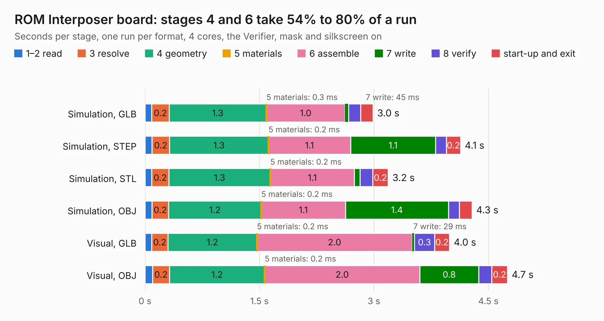

# 518. ROM Interposer board

Board 518 of the 3,112 of [Corpus Testing](../Corpus-Testing.md), on [Corpus Page 5](../CorpusTestingPages/Corpus-Testing-05.md#518-rom-interposer-board).

| Mode and format | 1–2 read | 3 resolve | 4 geometry | 5 materials | 6 assemble | 7 write | 8 verify | start-up and exit | Total |
|---|---:|---:|---:|---:|---:|---:|---:|---:|---:|
| Simulation, GLB | 89&nbsp;ms | 0.2 | 1.3 | 0.3&nbsp;ms | 1.0 | 45&nbsp;ms | 0.2 | 0.2 | 3.0 |
| Simulation, STEP | 91&nbsp;ms | 0.2 | 1.3 | 0.2&nbsp;ms | 1.1 | 1.1 | 0.1 | 0.2 | 4.1 |
| Simulation, STL | 87&nbsp;ms | 0.2 | 1.3 | 0.2&nbsp;ms | 1.1 | 74&nbsp;ms | 0.2 | 0.2 | 3.2 |
| Simulation, OBJ | 92&nbsp;ms | 0.2 | 1.2 | 0.2&nbsp;ms | 1.1 | 1.4 | 0.1 | 0.2 | 4.3 |
| Visual, GLB | 88&nbsp;ms | 0.2 | 1.2 | 0.2&nbsp;ms | 2.0 | 29&nbsp;ms | 0.3 | 0.2 | 4.0 |
| Visual, OBJ | 99&nbsp;ms | 0.2 | 1.2 | 0.2&nbsp;ms | 2.0 | 0.8 | 0.2 | 0.2 | 4.7 |

<table align="center"><tr><td valign="top">

| Board | Repo: [baldengineer/Mega-IIe](https://github.com/baldengineer/Mega-IIe) Board: `ROM Interposer board.kicad_pcb` |
|---|---|
| Folder | kicad files / rev1 / ROM Interposer board |
| Complexity | 114&nbsp;/&nbsp;1000 (size&nbsp;104, features&nbsp;10) |
| KESE&nbsp;features | curved board outline |
| Tested | 9th November 2026 |
| Copper&nbsp;layers | 2 |
| File&nbsp;format | KiCad 5 (20171130) |
| Parts,&nbsp;tracks,&nbsp;vias | 4, 72, 0 |
| Triangles,&nbsp;simulation | 350,966 in 36 parts |
| Verifier | PASS in all six runs |

</td><td valign="top">

<table>
<tr><th>File type</th><th>File size</th><th>Peak memory used</th></tr>
<tr><th colspan="3" align="left">Simulation</th></tr>
<tr><td>GLB</td><td align="right">11&nbsp;MB</td><td align="right">236&nbsp;MB</td></tr>
<tr><td>STEP</td><td align="right">42&nbsp;MB</td><td align="right">272&nbsp;MB</td></tr>
<tr><td>STL</td><td align="right">18&nbsp;MB</td><td align="right">236&nbsp;MB</td></tr>
<tr><td>OBJ</td><td align="right">35&nbsp;MB</td><td align="right">259&nbsp;MB</td></tr>
<tr><th colspan="3" align="left">Visual</th></tr>
<tr><td>GLB</td><td align="right">7.0&nbsp;MB</td><td align="right">259&nbsp;MB</td></tr>
<tr><td>OBJ</td><td align="right">21&nbsp;MB</td><td align="right">260&nbsp;MB</td></tr>
</table>

</td></tr></table>

| Previous | Next |
|:---|---:|
| [517. MegaII Breakout](b0517b_Mega-IIe_kicad-files-rev1-MegaII-Breakout_MegaII-Breakout.md) | [519. ROM Interposer board](b0519b_Mega-IIe_kicad-files-ROM-Interposer-board_ROM-Interposer-board.md) |
