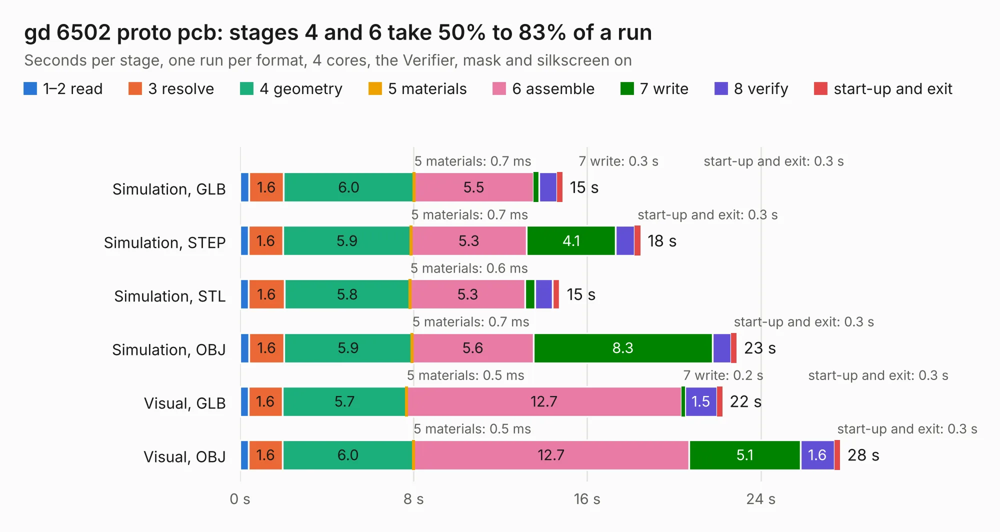

# 518. gd 6502 proto pcb

Board 518 of the 3,121 of [Corpus Testing](../Corpus-Testing.md), on [Corpus Page 5](../CorpusTestingPages/Corpus-Testing-05.md#518-gd-6502-proto-pcb).

| Mode and format | 1–2 read | 3 resolve | 4 geometry | 5 materials | 6 assemble | 7 write | 8 verify | start-up and exit | Total |
|---|---:|---:|---:|---:|---:|---:|---:|---:|---:|
| Simulation, GLB | 0.4 | 1.6 | 6.0 | 0.7&nbsp;ms | 5.5 | 0.3 | 0.8 | 0.3 | 14.9 |
| Simulation, STEP | 0.4 | 1.6 | 5.9 | 0.7&nbsp;ms | 5.3 | 4.1 | 0.9 | 0.3 | 18.5 |
| Simulation, STL | 0.4 | 1.6 | 5.8 | 0.6&nbsp;ms | 5.3 | 0.5 | 0.8 | 0.3 | 14.7 |
| Simulation, OBJ | 0.4 | 1.6 | 5.9 | 0.7&nbsp;ms | 5.6 | 8.3 | 0.9 | 0.3 | 22.9 |
| Visual, GLB | 0.4 | 1.6 | 5.7 | 0.5&nbsp;ms | 12.7 | 0.2 | 1.5 | 0.3 | 22.2 |
| Visual, OBJ | 0.4 | 1.6 | 6.0 | 0.5&nbsp;ms | 12.7 | 5.1 | 1.6 | 0.3 | 27.6 |

<table align="center"><tr><td valign="top">

| Board | Repo: [baldengineer/Mega-IIe](https://github.com/baldengineer/Mega-IIe) Board: `gd 6502 proto pcb.kicad_pcb` |
|---|---|
| Folder | kicad files / rev1 / gd 6502 proto pcb |
| Complexity | 304&nbsp;/&nbsp;1000 (size&nbsp;224, features&nbsp;80) |
| KESE&nbsp;features | through vias, custom pads, rounded, trapezoid or chamfered pads, filled zones, copper drawings, curved board outline |
| Tested | 9th November 2026 |
| Copper&nbsp;layers | 4 |
| File&nbsp;format | KiCad 5 (20171130) |
| Parts,&nbsp;tracks,&nbsp;vias | 37, 755, 47 |
| Triangles,&nbsp;simulation | 1,686,854 in 92 parts |
| Verifier | PASS in all six runs |

</td><td valign="top">

<table>
<tr><th>File type</th><th>File size</th><th>Peak memory used</th></tr>
<tr><th colspan="3" align="left">Simulation</th></tr>
<tr><td>GLB</td><td align="right">58&nbsp;MB</td><td align="right">632&nbsp;MB</td></tr>
<tr><td>STEP</td><td align="right">245&nbsp;MB</td><td align="right">715&nbsp;MB</td></tr>
<tr><td>STL</td><td align="right">84&nbsp;MB</td><td align="right">648&nbsp;MB</td></tr>
<tr><td>OBJ</td><td align="right">175&nbsp;MB</td><td align="right">1.1&nbsp;GB</td></tr>
<tr><th colspan="3" align="left">Visual</th></tr>
<tr><td>GLB</td><td align="right">38&nbsp;MB</td><td align="right">729&nbsp;MB</td></tr>
<tr><td>OBJ</td><td align="right">113&nbsp;MB</td><td align="right">836&nbsp;MB</td></tr>
</table>

</td></tr></table>

| Previous | Next |
|:---|---:|
| [517. PLCC44 to DIP44 Adapter](b0517b_Mega-IIe_PLCC44-to-DIP44-Adapter.md) | [519. gd MegaII proto pcb](b0519b_Mega-IIe_kicad-files-rev1-gd-MegaII-proto-pcb_gd-MegaII-proto-pcb.md) |
