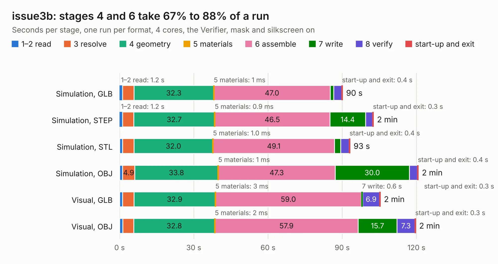

# 520. issue3b

Board 520 of the 3,110 of [Corpus Testing](../Corpus-Testing.md), on [Corpus Page 5](../CorpusTestingPages/Corpus-Testing-05.md#520-issue3b).

| Mode and format | 1–2 read | 3 resolve | 4 geometry | 5 materials | 6 assemble | 7 write | 8 verify | start-up and exit | Total |
|---|---:|---:|---:|---:|---:|---:|---:|---:|---:|
| Simulation, GLB | 1.2 | 4.6 | 32.3 | 1&nbsp;ms | 47.0 | 1.5 | 3.2 | 0.4 | 90.1 |
| Simulation, STEP | 1.2 | 4.5 | 32.7 | 0.9&nbsp;ms | 46.5 | 14.4 | 2.9 | 0.3 | 102.6 |
| Simulation, STL | 1.2 | 4.6 | 32.0 | 1.0&nbsp;ms | 49.1 | 2.4 | 3.5 | 0.4 | 93.2 |
| Simulation, OBJ | 1.2 | 4.9 | 33.8 | 1&nbsp;ms | 47.3 | 30.0 | 3.3 | 0.4 | 120.8 |
| Visual, GLB | 1.2 | 4.6 | 32.9 | 3&nbsp;ms | 59.0 | 0.6 | 6.9 | 0.3 | 105.4 |
| Visual, OBJ | 1.3 | 4.4 | 32.8 | 2&nbsp;ms | 57.9 | 15.7 | 7.3 | 0.3 | 119.7 |

<table align="center"><tr><td valign="top">

| Board | Repo: [Bambelweeny57/zxspectrum_issue3b](https://github.com/Bambelweeny57/zxspectrum_issue3b) Board: `issue3b.kicad_pcb` |
|---|---|
| Folder | src |
| Complexity | 317&nbsp;/&nbsp;1000 (size&nbsp;222, features&nbsp;95) |
| KESE&nbsp;features | through vias, slotted holes, rounded, trapezoid or chamfered pads, copper drawings, copper text, curved board outline, stack-up, dielectric εr and tanδ |
| Tested | 9th November 2026 |
| Copper&nbsp;layers | 2 |
| File&nbsp;format | KiCad 10 (20260206) |
| Parts,&nbsp;tracks,&nbsp;vias | 201, 6,888, 455 |
| Triangles,&nbsp;simulation | 6,030,258 in 181 parts |
| Verifier | PASS in all six runs |

</td><td valign="top">

<table>
<tr><th>File type</th><th>File size</th><th>Peak memory used</th></tr>
<tr><th colspan="3" align="left">Simulation</th></tr>
<tr><td>GLB</td><td align="right">208&nbsp;MB</td><td align="right">1.5&nbsp;GB</td></tr>
<tr><td>STEP</td><td align="right">1.0&nbsp;GB</td><td align="right">2.1&nbsp;GB</td></tr>
<tr><td>STL</td><td align="right">302&nbsp;MB</td><td align="right">1.6&nbsp;GB</td></tr>
<tr><td>OBJ</td><td align="right">651&nbsp;MB</td><td align="right">3.9&nbsp;GB</td></tr>
<tr><th colspan="3" align="left">Visual</th></tr>
<tr><td>GLB</td><td align="right">120&nbsp;MB</td><td align="right">2.1&nbsp;GB</td></tr>
<tr><td>OBJ</td><td align="right">380&nbsp;MB</td><td align="right">2.5&nbsp;GB</td></tr>
</table>

</td></tr></table>

| Previous | Next |
|:---|---:|
| [519. servid-rp2040-hdmi proto rev1](b0519b_Mega-IIe_servid-rp2040-hdmi-proto-rev1.md) | [521. zx_coil](b0521b_zxspectrum-issue3b_zx-coil.md) |
