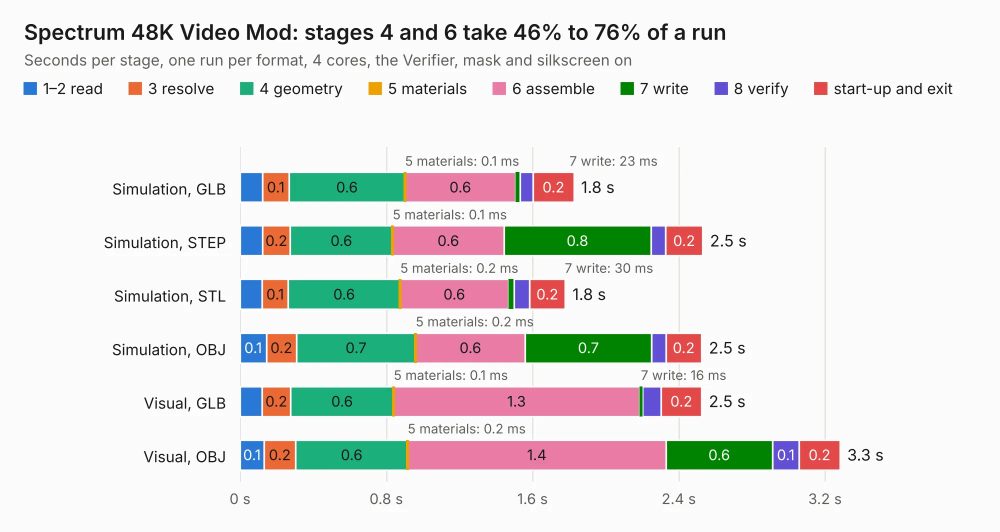

# 522. Spectrum 48K Video Mod

Board 522 of the 3,105 of [Corpus Testing](../Corpus-Testing.md), on [Corpus Page 5](../CorpusTestingPages/Corpus-Testing-05.md#522-spectrum-48k-video-mod).

| Mode and format | 1–2 read | 3 resolve | 4 geometry | 5 materials | 6 assemble | 7 write | 8 verify | start-up and exit | Total |
|---|---:|---:|---:|---:|---:|---:|---:|---:|---:|
| Simulation, GLB | 0.1 | 0.1 | 0.6 | 0.1&nbsp;ms | 0.6 | 23&nbsp;ms | 72&nbsp;ms | 0.2 | 1.8 |
| Simulation, STEP | 0.1 | 0.2 | 0.6 | 0.1&nbsp;ms | 0.6 | 0.8 | 80&nbsp;ms | 0.2 | 2.5 |
| Simulation, STL | 0.1 | 0.1 | 0.6 | 0.2&nbsp;ms | 0.6 | 30&nbsp;ms | 85&nbsp;ms | 0.2 | 1.8 |
| Simulation, OBJ | 0.1 | 0.2 | 0.7 | 0.2&nbsp;ms | 0.6 | 0.7 | 77&nbsp;ms | 0.2 | 2.5 |
| Visual, GLB | 0.1 | 0.2 | 0.6 | 0.1&nbsp;ms | 1.3 | 16&nbsp;ms | 0.1 | 0.2 | 2.5 |
| Visual, OBJ | 0.1 | 0.2 | 0.6 | 0.2&nbsp;ms | 1.4 | 0.6 | 0.1 | 0.2 | 3.3 |

<table align="center"><tr><td valign="top">

| Board | Repo: [Bambelweeny57/zxspectrum_issue3b](https://github.com/Bambelweeny57/zxspectrum_issue3b) Board: `Spectrum 48K Video Mod.kicad_pcb` |
|---|---|
| Folder | zx_composite_mod |
| Complexity | 147&nbsp;/&nbsp;1000 (size&nbsp;102, features&nbsp;45) |
| KESE&nbsp;features | through vias, filled zones, curved board outline |
| Tested | 9th November 2026 |
| Copper&nbsp;layers | 2 |
| File&nbsp;format | KiCad 9 (20241229) |
| Parts,&nbsp;tracks,&nbsp;vias | 6, 41, 3 |
| Triangles,&nbsp;simulation | 139,726 in 17 parts |
| Verifier | PASS in all six runs |

</td><td valign="top">

<table>
<tr><th>File type</th><th>File size</th><th>Peak memory used</th></tr>
<tr><th colspan="3" align="left">Simulation</th></tr>
<tr><td>GLB</td><td align="right">4.8&nbsp;MB</td><td align="right">193&nbsp;MB</td></tr>
<tr><td>STEP</td><td align="right">25&nbsp;MB</td><td align="right">211&nbsp;MB</td></tr>
<tr><td>STL</td><td align="right">7.0&nbsp;MB</td><td align="right">199&nbsp;MB</td></tr>
<tr><td>OBJ</td><td align="right">14&nbsp;MB</td><td align="right">207&nbsp;MB</td></tr>
<tr><th colspan="3" align="left">Visual</th></tr>
<tr><td>GLB</td><td align="right">3.6&nbsp;MB</td><td align="right">164&nbsp;MB</td></tr>
<tr><td>OBJ</td><td align="right">10&nbsp;MB</td><td align="right">157&nbsp;MB</td></tr>
</table>

</td></tr></table>

| Previous | Next |
|:---|---:|
| [521. zx_coil](b0521b_zxspectrum-issue3b_zx-coil.md) | [523. zx_spectrum_composite_mod](b0523b_zxspectrum-issue3b_zx-spectrum-composite-mod.md) |
