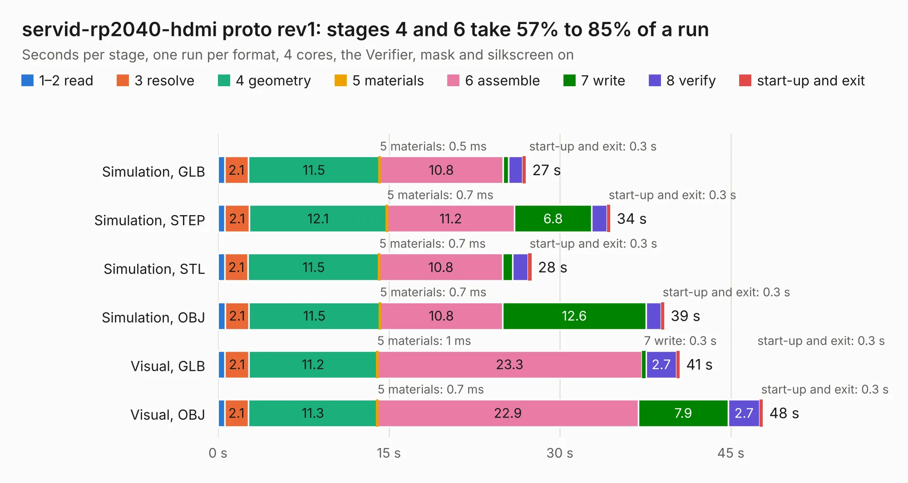

# 525. servid-rp2040-hdmi proto rev1

Board 525 of the 3,126 of [Corpus Testing](../Corpus-Testing.md), on [Corpus Page 5](../CorpusTestingPages/Corpus-Testing-05.md#525-servid-rp2040-hdmi-proto-rev1).

| Mode and format | 1–2 read | 3 resolve | 4 geometry | 5 materials | 6 assemble | 7 write | 8 verify | start-up and exit | Total |
|---|---:|---:|---:|---:|---:|---:|---:|---:|---:|
| Simulation, GLB | 0.6 | 2.1 | 11.5 | 0.5&nbsp;ms | 10.8 | 0.5 | 1.2 | 0.3 | 27.0 |
| Simulation, STEP | 0.6 | 2.1 | 12.1 | 0.7&nbsp;ms | 11.2 | 6.8 | 1.3 | 0.3 | 34.4 |
| Simulation, STL | 0.6 | 2.1 | 11.5 | 0.7&nbsp;ms | 10.8 | 0.9 | 1.4 | 0.3 | 27.5 |
| Simulation, OBJ | 0.6 | 2.1 | 11.5 | 0.7&nbsp;ms | 10.8 | 12.6 | 1.3 | 0.3 | 39.2 |
| Visual, GLB | 0.6 | 2.1 | 11.2 | 1&nbsp;ms | 23.3 | 0.3 | 2.7 | 0.3 | 40.5 |
| Visual, OBJ | 0.6 | 2.1 | 11.3 | 0.7&nbsp;ms | 22.9 | 7.9 | 2.7 | 0.3 | 47.8 |

<table align="center"><tr><td valign="top">

| Board | Repo: [baldengineer/Mega-IIe](https://github.com/baldengineer/Mega-IIe) Board: `servid-rp2040-hdmi proto rev1.kicad_pcb` |
|---|---|
| Folder | kicad files / servid-rp2040-hdmi proto rev1 |
| Complexity | 339&nbsp;/&nbsp;1000 (size&nbsp;249, features&nbsp;90) |
| KESE&nbsp;features | through vias, slotted holes, custom pads, rounded, trapezoid or chamfered pads, filled zones, copper drawings, curved board outline |
| Tested | 9th November 2026 |
| Copper&nbsp;layers | 4 |
| File&nbsp;format | KiCad 5 (20171130) |
| Parts,&nbsp;tracks,&nbsp;vias | 97, 880, 196 |
| Triangles,&nbsp;simulation | 2,549,040 in 113 parts |
| Verifier | PASS in all six runs |

</td><td valign="top">

<table>
<tr><th>File type</th><th>File size</th><th>Peak memory used</th></tr>
<tr><th colspan="3" align="left">Simulation</th></tr>
<tr><td>GLB</td><td align="right">89&nbsp;MB</td><td align="right">864&nbsp;MB</td></tr>
<tr><td>STEP</td><td align="right">413&nbsp;MB</td><td align="right">1.0&nbsp;GB</td></tr>
<tr><td>STL</td><td align="right">127&nbsp;MB</td><td align="right">854&nbsp;MB</td></tr>
<tr><td>OBJ</td><td align="right">273&nbsp;MB</td><td align="right">1.7&nbsp;GB</td></tr>
<tr><th colspan="3" align="left">Visual</th></tr>
<tr><td>GLB</td><td align="right">57&nbsp;MB</td><td align="right">1.1&nbsp;GB</td></tr>
<tr><td>OBJ</td><td align="right">175&nbsp;MB</td><td align="right">1.2&nbsp;GB</td></tr>
</table>

</td></tr></table>

| Previous | Next |
|:---|---:|
| [524. ROM Interposer board](b0524b_Mega-IIe_kicad-files-ROM-Interposer-board_ROM-Interposer-board.md) | [526. issue3b](b0526b_zxspectrum-issue3b_issue3b.md) |
