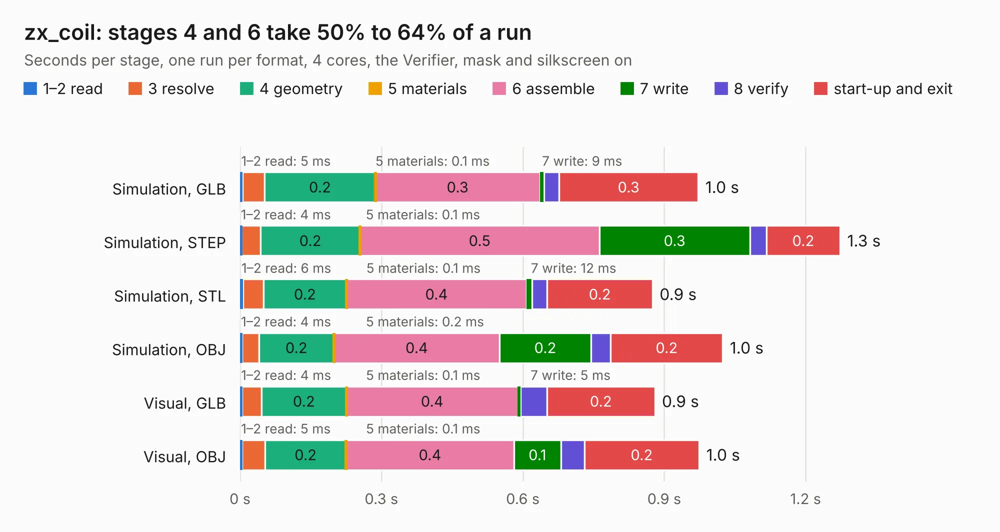

# 526. zx_coil

Board 526 of the 3,122 of [Corpus Testing](../Corpus-Testing.md), on [Corpus Page 5](../CorpusTestingPages/Corpus-Testing-05.md#526-zx_coil).

| Mode and format | 1–2 read | 3 resolve | 4 geometry | 5 materials | 6 assemble | 7 write | 8 verify | start-up and exit | Total |
|---|---:|---:|---:|---:|---:|---:|---:|---:|---:|
| Simulation, GLB | 5&nbsp;ms | 47&nbsp;ms | 0.2 | 0.1&nbsp;ms | 0.3 | 9&nbsp;ms | 31&nbsp;ms | 0.3 | 1.0 |
| Simulation, STEP | 4&nbsp;ms | 40&nbsp;ms | 0.2 | 0.1&nbsp;ms | 0.5 | 0.3 | 35&nbsp;ms | 0.2 | 1.3 |
| Simulation, STL | 6&nbsp;ms | 43&nbsp;ms | 0.2 | 0.1&nbsp;ms | 0.4 | 12&nbsp;ms | 32&nbsp;ms | 0.2 | 0.9 |
| Simulation, OBJ | 4&nbsp;ms | 36&nbsp;ms | 0.2 | 0.2&nbsp;ms | 0.4 | 0.2 | 42&nbsp;ms | 0.2 | 1.0 |
| Visual, GLB | 4&nbsp;ms | 41&nbsp;ms | 0.2 | 0.1&nbsp;ms | 0.4 | 5&nbsp;ms | 57&nbsp;ms | 0.2 | 0.9 |
| Visual, OBJ | 5&nbsp;ms | 49&nbsp;ms | 0.2 | 0.1&nbsp;ms | 0.4 | 0.1 | 50&nbsp;ms | 0.2 | 1.0 |

<table align="center"><tr><td valign="top">

| Board | Repo: [Bambelweeny57/zxspectrum_issue3b](https://github.com/Bambelweeny57/zxspectrum_issue3b) Board: `zx_coil.kicad_pcb` |
|---|---|
| Folder | zx_coil |
| Complexity | 90&nbsp;/&nbsp;1000 (size&nbsp;75, features&nbsp;15) |
| KESE&nbsp;features | through vias |
| Tested | 9th November 2026 |
| Copper&nbsp;layers | 2 |
| File&nbsp;format | KiCad 9 (20241229) |
| Parts,&nbsp;tracks,&nbsp;vias | 2, 1, 5 |
| Triangles,&nbsp;simulation | 40,656 in 10 parts |
| Verifier | PASS in all six runs |

</td><td valign="top">

<table>
<tr><th>File type</th><th>File size</th><th>Peak memory used</th></tr>
<tr><th colspan="3" align="left">Simulation</th></tr>
<tr><td>GLB</td><td align="right">1.4&nbsp;MB</td><td align="right">46&nbsp;MB</td></tr>
<tr><td>STEP</td><td align="right">4.5&nbsp;MB</td><td align="right">49&nbsp;MB</td></tr>
<tr><td>STL</td><td align="right">2.0&nbsp;MB</td><td align="right">46&nbsp;MB</td></tr>
<tr><td>OBJ</td><td align="right">3.8&nbsp;MB</td><td align="right">53&nbsp;MB</td></tr>
<tr><th colspan="3" align="left">Visual</th></tr>
<tr><td>GLB</td><td align="right">568&nbsp;kB</td><td align="right">74&nbsp;MB</td></tr>
<tr><td>OBJ</td><td align="right">1.5&nbsp;MB</td><td align="right">55&nbsp;MB</td></tr>
</table>

</td></tr></table>

| Previous | Next |
|:---|---:|
| [525. issue3b](b0525b_zxspectrum-issue3b_issue3b.md) | [527. Spectrum 48K Video Mod](b0527b_zxspectrum-issue3b_Spectrum-48K-Video-Mod.md) |
