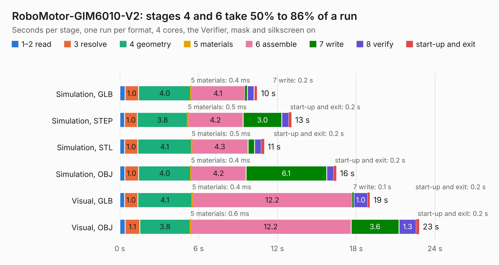

# 527. RoboMotor-GIM6010-V2

Board 527 of the 3,108 of [Corpus Testing](../Corpus-Testing.md), on [Corpus Page 5](../CorpusTestingPages/Corpus-Testing-05.md#527-robomotor-gim6010-v2).

| Mode and format | 1–2 read | 3 resolve | 4 geometry | 5 materials | 6 assemble | 7 write | 8 verify | start-up and exit | Total |
|---|---:|---:|---:|---:|---:|---:|---:|---:|---:|
| Simulation, GLB | 0.4 | 1.0 | 4.0 | 0.4&nbsp;ms | 4.1 | 0.2 | 0.5 | 0.3 | 10.5 |
| Simulation, STEP | 0.4 | 1.0 | 3.8 | 0.5&nbsp;ms | 4.2 | 3.0 | 0.5 | 0.2 | 13.1 |
| Simulation, STL | 0.4 | 1.0 | 4.1 | 0.5&nbsp;ms | 4.3 | 0.5 | 0.5 | 0.2 | 11.0 |
| Simulation, OBJ | 0.4 | 1.0 | 4.0 | 0.4&nbsp;ms | 4.2 | 6.1 | 0.5 | 0.2 | 16.5 |
| Visual, GLB | 0.4 | 1.0 | 4.1 | 0.4&nbsp;ms | 12.2 | 0.1 | 1.0 | 0.2 | 19.0 |
| Visual, OBJ | 0.4 | 1.1 | 3.8 | 0.6&nbsp;ms | 12.2 | 3.6 | 1.3 | 0.2 | 22.8 |

<table align="center"><tr><td valign="top">

| Board | Repo: [baoqi-zhong/robomotor](https://github.com/baoqi-zhong/robomotor) Board: `RoboMotor-GIM6010-V2.kicad_pcb` |
|---|---|
| Folder | Hardware / RoboMotor-GIM6010-V2 |
| Complexity | 391&nbsp;/&nbsp;1000 (size&nbsp;246, features&nbsp;145) |
| KESE&nbsp;features | through vias, custom pads, rounded, trapezoid or chamfered pads, arc tracks, filled zones, curved board outline, knockout text, TrueType text, stack-up, dielectric εr and tanδ |
| Tested | 9th November 2026 |
| Copper&nbsp;layers | 4 |
| File&nbsp;format | KiCad 8 (20240108) |
| Parts,&nbsp;tracks,&nbsp;vias | 122, 870, 240 |
| Triangles,&nbsp;simulation | 1,499,776 in 118 parts |
| Verifier | PASS in all six runs |

</td><td valign="top">

<table>
<tr><th>File type</th><th>File size</th><th>Peak memory used</th></tr>
<tr><th colspan="3" align="left">Simulation</th></tr>
<tr><td>GLB</td><td align="right">51&nbsp;MB</td><td align="right">571&nbsp;MB</td></tr>
<tr><td>STEP</td><td align="right">187&nbsp;MB</td><td align="right">676&nbsp;MB</td></tr>
<tr><td>STL</td><td align="right">75&nbsp;MB</td><td align="right">547&nbsp;MB</td></tr>
<tr><td>OBJ</td><td align="right">153&nbsp;MB</td><td align="right">1.0&nbsp;GB</td></tr>
<tr><th colspan="3" align="left">Visual</th></tr>
<tr><td>GLB</td><td align="right">29&nbsp;MB</td><td align="right">670&nbsp;MB</td></tr>
<tr><td>OBJ</td><td align="right">89&nbsp;MB</td><td align="right">767&nbsp;MB</td></tr>
</table>

</td></tr></table>

| Previous | Next |
|:---|---:|
| [526. RoboMotor-GIM6010-V2-Encoder](b0526b_robomotor_RoboMotor-GIM6010-V2-Encoder.md) | [528. RoboMotor-GIM6010](b0528b_robomotor_RoboMotor-GIM6010.md) |
