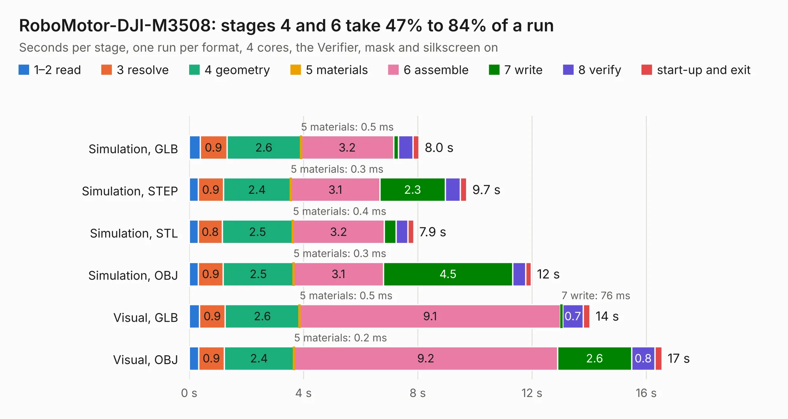

# 528. RoboMotor-DJI-M3508

Board 528 of the 3,116 of [Corpus Testing](../Corpus-Testing.md), on [Corpus Page 5](../CorpusTestingPages/Corpus-Testing-05.md#528-robomotor-dji-m3508).

| Mode and format | 1–2 read | 3 resolve | 4 geometry | 5 materials | 6 assemble | 7 write | 8 verify | start-up and exit | Total |
|---|---:|---:|---:|---:|---:|---:|---:|---:|---:|
| Simulation, GLB | 0.4 | 0.9 | 2.6 | 0.5&nbsp;ms | 3.2 | 0.2 | 0.5 | 0.2 | 8.0 |
| Simulation, STEP | 0.3 | 0.9 | 2.4 | 0.3&nbsp;ms | 3.1 | 2.3 | 0.5 | 0.2 | 9.7 |
| Simulation, STL | 0.3 | 0.8 | 2.5 | 0.4&nbsp;ms | 3.2 | 0.4 | 0.4 | 0.2 | 7.9 |
| Simulation, OBJ | 0.3 | 0.9 | 2.5 | 0.3&nbsp;ms | 3.1 | 4.5 | 0.5 | 0.2 | 12.0 |
| Visual, GLB | 0.4 | 0.9 | 2.6 | 0.5&nbsp;ms | 9.1 | 76&nbsp;ms | 0.7 | 0.2 | 14.0 |
| Visual, OBJ | 0.3 | 0.9 | 2.4 | 0.2&nbsp;ms | 9.2 | 2.6 | 0.8 | 0.2 | 16.5 |

<table align="center"><tr><td valign="top">

| Board | Repo: [baoqi-zhong/robomotor](https://github.com/baoqi-zhong/robomotor) Board: `RoboMotor-DJI-M3508.kicad_pcb` |
|---|---|
| Folder | Hardware / RoboMotor-DJI-M3508 |
| Complexity | 414&nbsp;/&nbsp;1000 (size&nbsp;249, features&nbsp;165) |
| KESE&nbsp;features | through vias, custom pads, rounded, trapezoid or chamfered pads, arc tracks, filled zones, copper drawings, copper text, curved board outline, knockout text, TrueType text, stack-up, dielectric εr and tanδ |
| Tested | 9th November 2026 |
| Copper&nbsp;layers | 6 |
| File&nbsp;format | KiCad 8 (20240108) |
| Parts,&nbsp;tracks,&nbsp;vias | 93, 701, 171 |
| Triangles,&nbsp;simulation | 1,135,228 in 95 parts |
| Verifier | PASS in all six runs |

</td><td valign="top">

<table>
<tr><th>File type</th><th>File size</th><th>Peak memory used</th></tr>
<tr><th colspan="3" align="left">Simulation</th></tr>
<tr><td>GLB</td><td align="right">38&nbsp;MB</td><td align="right">426&nbsp;MB</td></tr>
<tr><td>STEP</td><td align="right">129&nbsp;MB</td><td align="right">499&nbsp;MB</td></tr>
<tr><td>STL</td><td align="right">57&nbsp;MB</td><td align="right">418&nbsp;MB</td></tr>
<tr><td>OBJ</td><td align="right">114&nbsp;MB</td><td align="right">789&nbsp;MB</td></tr>
<tr><th colspan="3" align="left">Visual</th></tr>
<tr><td>GLB</td><td align="right">19&nbsp;MB</td><td align="right">544&nbsp;MB</td></tr>
<tr><td>OBJ</td><td align="right">59&nbsp;MB</td><td align="right">542&nbsp;MB</td></tr>
</table>

</td></tr></table>

| Previous | Next |
|:---|---:|
| [527. dabao_v3c](b0527b_dabao_dabao-v3c.md) | [529. RoboMotor-GIM6010-V2-Encoder](b0529b_robomotor_RoboMotor-GIM6010-V2-Encoder.md) |
