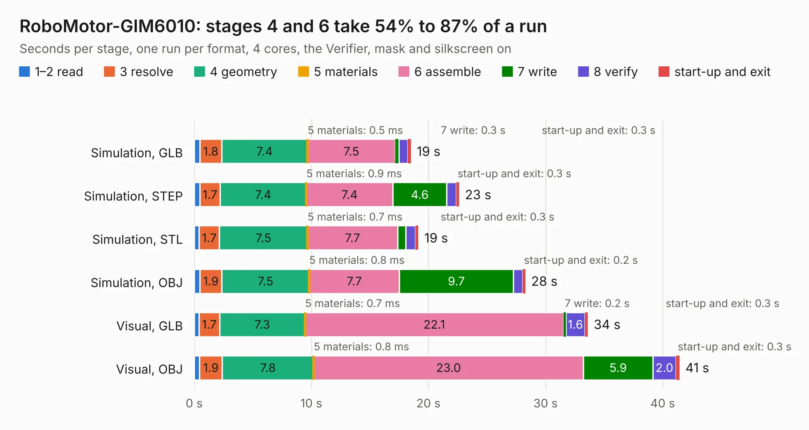

# 528. RoboMotor-GIM6010

Board 528 of the 3,108 of [Corpus Testing](../Corpus-Testing.md), on [Corpus Page 5](../CorpusTestingPages/Corpus-Testing-05.md#528-robomotor-gim6010).

| Mode and format | 1–2 read | 3 resolve | 4 geometry | 5 materials | 6 assemble | 7 write | 8 verify | start-up and exit | Total |
|---|---:|---:|---:|---:|---:|---:|---:|---:|---:|
| Simulation, GLB | 0.5 | 1.8 | 7.4 | 0.5&nbsp;ms | 7.5 | 0.3 | 0.8 | 0.3 | 18.5 |
| Simulation, STEP | 0.5 | 1.7 | 7.4 | 0.9&nbsp;ms | 7.4 | 4.6 | 0.8 | 0.3 | 22.6 |
| Simulation, STL | 0.4 | 1.7 | 7.5 | 0.7&nbsp;ms | 7.7 | 0.7 | 0.8 | 0.3 | 19.1 |
| Simulation, OBJ | 0.5 | 1.9 | 7.5 | 0.8&nbsp;ms | 7.7 | 9.7 | 0.8 | 0.2 | 28.3 |
| Visual, GLB | 0.4 | 1.7 | 7.3 | 0.7&nbsp;ms | 22.1 | 0.2 | 1.6 | 0.3 | 33.6 |
| Visual, OBJ | 0.5 | 1.9 | 7.8 | 0.8&nbsp;ms | 23.0 | 5.9 | 2.0 | 0.3 | 41.4 |

<table align="center"><tr><td valign="top">

| Board | Repo: [baoqi-zhong/robomotor](https://github.com/baoqi-zhong/robomotor) Board: `RoboMotor-GIM6010.kicad_pcb` |
|---|---|
| Folder | Hardware / RoboMotor-GIM6010 |
| Complexity | 394&nbsp;/&nbsp;1000 (size&nbsp;254, features&nbsp;140) |
| KESE&nbsp;features | through vias, custom pads, rounded, trapezoid or chamfered pads, arc tracks, filled zones, copper drawings, curved board outline, TrueType text, stack-up, dielectric εr and tanδ |
| Tested | 9th November 2026 |
| Copper&nbsp;layers | 4 |
| File&nbsp;format | KiCad 8 (20240108) |
| Parts,&nbsp;tracks,&nbsp;vias | 123, 1,080, 478 |
| Triangles,&nbsp;simulation | 2,080,912 in 109 parts |
| Verifier | PASS in all six runs |

</td><td valign="top">

<table>
<tr><th>File type</th><th>File size</th><th>Peak memory used</th></tr>
<tr><th colspan="3" align="left">Simulation</th></tr>
<tr><td>GLB</td><td align="right">70&nbsp;MB</td><td align="right">774&nbsp;MB</td></tr>
<tr><td>STEP</td><td align="right">234&nbsp;MB</td><td align="right">864&nbsp;MB</td></tr>
<tr><td>STL</td><td align="right">104&nbsp;MB</td><td align="right">730&nbsp;MB</td></tr>
<tr><td>OBJ</td><td align="right">215&nbsp;MB</td><td align="right">1.4&nbsp;GB</td></tr>
<tr><th colspan="3" align="left">Visual</th></tr>
<tr><td>GLB</td><td align="right">40&nbsp;MB</td><td align="right">891&nbsp;MB</td></tr>
<tr><td>OBJ</td><td align="right">121&nbsp;MB</td><td align="right">887&nbsp;MB</td></tr>
</table>

</td></tr></table>

| Previous | Next |
|:---|---:|
| [527. RoboMotor-GIM6010-V2](b0527b_robomotor_RoboMotor-GIM6010-V2.md) | [529. beaglebone-ai](b0529b_beaglebone-ai_beaglebone-ai.md) |
