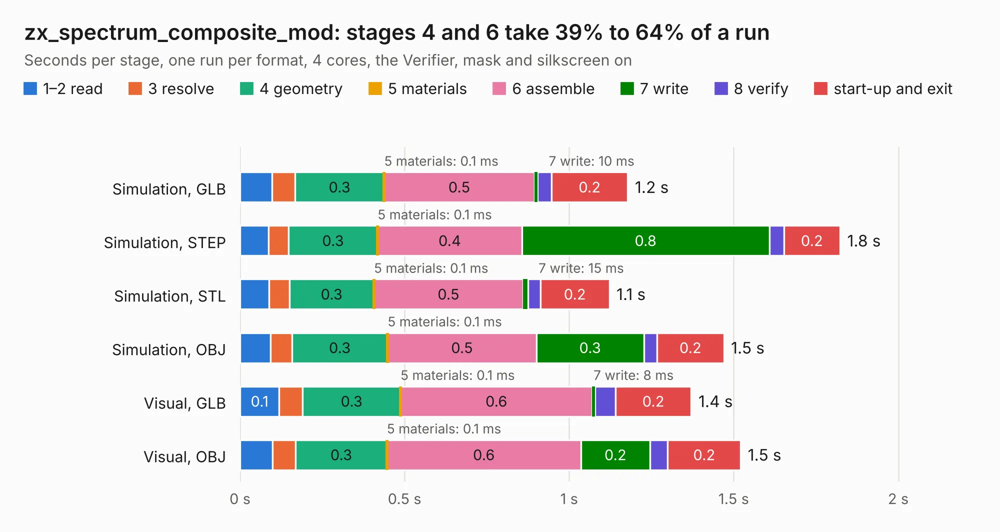

# 529. zx_spectrum_composite_mod

Board 529 of the 3,127 of [Corpus Testing](../Corpus-Testing.md), on [Corpus Page 5](../CorpusTestingPages/Corpus-Testing-05.md#529-zx_spectrum_composite_mod).

| Mode and format | 1–2 read | 3 resolve | 4 geometry | 5 materials | 6 assemble | 7 write | 8 verify | start-up and exit | Total |
|---|---:|---:|---:|---:|---:|---:|---:|---:|---:|
| Simulation, GLB | 98&nbsp;ms | 69&nbsp;ms | 0.3 | 0.1&nbsp;ms | 0.5 | 10&nbsp;ms | 42&nbsp;ms | 0.2 | 1.2 |
| Simulation, STEP | 87&nbsp;ms | 60&nbsp;ms | 0.3 | 0.1&nbsp;ms | 0.4 | 0.8 | 44&nbsp;ms | 0.2 | 1.8 |
| Simulation, STL | 88&nbsp;ms | 62&nbsp;ms | 0.3 | 0.1&nbsp;ms | 0.5 | 15&nbsp;ms | 38&nbsp;ms | 0.2 | 1.1 |
| Simulation, OBJ | 93&nbsp;ms | 65&nbsp;ms | 0.3 | 0.1&nbsp;ms | 0.5 | 0.3 | 40&nbsp;ms | 0.2 | 1.5 |
| Visual, GLB | 0.1 | 71&nbsp;ms | 0.3 | 0.1&nbsp;ms | 0.6 | 8&nbsp;ms | 63&nbsp;ms | 0.2 | 1.4 |
| Visual, OBJ | 99&nbsp;ms | 70&nbsp;ms | 0.3 | 0.1&nbsp;ms | 0.6 | 0.2 | 54&nbsp;ms | 0.2 | 1.5 |

<table align="center"><tr><td valign="top">

| Board | Repo: [Bambelweeny57/zxspectrum_issue3b](https://github.com/Bambelweeny57/zxspectrum_issue3b) Board: `zx_spectrum_composite_mod.kicad_pcb` |
|---|---|
| Folder | zx_composite_modulator |
| Complexity | 124&nbsp;/&nbsp;1000 (size&nbsp;79, features&nbsp;45) |
| KESE&nbsp;features | TrueType text, stack-up, dielectric εr and tanδ |
| Tested | 9th November 2026 |
| Copper&nbsp;layers | 2 |
| File&nbsp;format | KiCad 9 (20241229) |
| Parts,&nbsp;tracks,&nbsp;vias | 3, 17, 0 |
| Triangles,&nbsp;simulation | 64,244 in 15 parts |
| Verifier | PASS in all six runs |

</td><td valign="top">

<table>
<tr><th>File type</th><th>File size</th><th>Peak memory used</th></tr>
<tr><th colspan="3" align="left">Simulation</th></tr>
<tr><td>GLB</td><td align="right">2.2&nbsp;MB</td><td align="right">71&nbsp;MB</td></tr>
<tr><td>STEP</td><td align="right">8.5&nbsp;MB</td><td align="right">179&nbsp;MB</td></tr>
<tr><td>STL</td><td align="right">3.2&nbsp;MB</td><td align="right">72&nbsp;MB</td></tr>
<tr><td>OBJ</td><td align="right">6.1&nbsp;MB</td><td align="right">98&nbsp;MB</td></tr>
<tr><th colspan="3" align="left">Visual</th></tr>
<tr><td>GLB</td><td align="right">1.4&nbsp;MB</td><td align="right">97&nbsp;MB</td></tr>
<tr><td>OBJ</td><td align="right">4.0&nbsp;MB</td><td align="right">121&nbsp;MB</td></tr>
</table>

</td></tr></table>

| Previous | Next |
|:---|---:|
| [528. Spectrum 48K Video Mod](b0528b_zxspectrum-issue3b_Spectrum-48K-Video-Mod.md) | [530. dabao_v3c](b0530b_dabao_dabao-v3c.md) |
