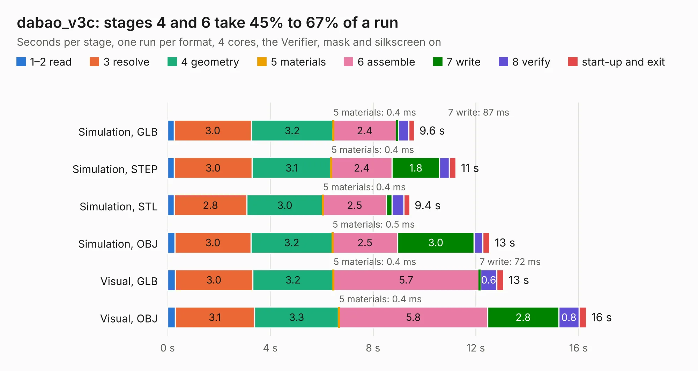

# 530. dabao_v3c

Board 530 of the 3,129 of [Corpus Testing](../Corpus-Testing.md), on [Corpus Page 5](../CorpusTestingPages/Corpus-Testing-05.md#530-dabao_v3c).

| Mode and format | 1–2 read | 3 resolve | 4 geometry | 5 materials | 6 assemble | 7 write | 8 verify | start-up and exit | Total |
|---|---:|---:|---:|---:|---:|---:|---:|---:|---:|
| Simulation, GLB | 0.3 | 3.0 | 3.2 | 0.4&nbsp;ms | 2.4 | 87&nbsp;ms | 0.4 | 0.2 | 9.6 |
| Simulation, STEP | 0.3 | 3.0 | 3.1 | 0.4&nbsp;ms | 2.4 | 1.8 | 0.4 | 0.3 | 11.2 |
| Simulation, STL | 0.3 | 2.8 | 3.0 | 0.4&nbsp;ms | 2.5 | 0.2 | 0.5 | 0.2 | 9.4 |
| Simulation, OBJ | 0.3 | 3.0 | 3.2 | 0.5&nbsp;ms | 2.5 | 3.0 | 0.3 | 0.3 | 12.5 |
| Visual, GLB | 0.3 | 3.0 | 3.2 | 0.4&nbsp;ms | 5.7 | 72&nbsp;ms | 0.6 | 0.3 | 13.1 |
| Visual, OBJ | 0.3 | 3.1 | 3.3 | 0.4&nbsp;ms | 5.8 | 2.8 | 0.8 | 0.3 | 16.3 |

<table align="center"><tr><td valign="top">

| Board | Repo: [baochip/dabao](https://github.com/baochip/dabao) Board: `dabao_v3c.kicad_pcb` |
|---|---|
| Complexity | 383&nbsp;/&nbsp;1000 (size&nbsp;218, features&nbsp;165) |
| KESE&nbsp;features | through vias, slotted holes, rounded, trapezoid or chamfered pads, drill offsets, filled zones, stack-up, dielectric εr and tanδ, copper finish, mask and silkscreen colours, castellated pads, plated board edge |
| Tested | 9th November 2026 |
| Copper&nbsp;layers | 2 |
| File&nbsp;format | KiCad 9 (20241229) |
| Parts,&nbsp;tracks,&nbsp;vias | 39, 556, 77 |
| Triangles,&nbsp;simulation | 597,570 in 78 parts |
| Verifier | PASS in all six runs |

</td><td valign="top">

<table>
<tr><th>File type</th><th>File size</th><th>Peak memory used</th></tr>
<tr><th colspan="3" align="left">Simulation</th></tr>
<tr><td>GLB</td><td align="right">21&nbsp;MB</td><td align="right">323&nbsp;MB</td></tr>
<tr><td>STEP</td><td align="right">102&nbsp;MB</td><td align="right">392&nbsp;MB</td></tr>
<tr><td>STL</td><td align="right">30&nbsp;MB</td><td align="right">323&nbsp;MB</td></tr>
<tr><td>OBJ</td><td align="right">61&nbsp;MB</td><td align="right">448&nbsp;MB</td></tr>
<tr><th colspan="3" align="left">Visual</th></tr>
<tr><td>GLB</td><td align="right">16&nbsp;MB</td><td align="right">411&nbsp;MB</td></tr>
<tr><td>OBJ</td><td align="right">48&nbsp;MB</td><td align="right">441&nbsp;MB</td></tr>
</table>

</td></tr></table>

| Previous | Next |
|:---|---:|
| [529. zx_spectrum_composite_mod](b0529b_zxspectrum-issue3b_zx-spectrum-composite-mod.md) | [531. RoboMotor-DJI-M3508](b0531b_robomotor_RoboMotor-DJI-M3508.md) |
