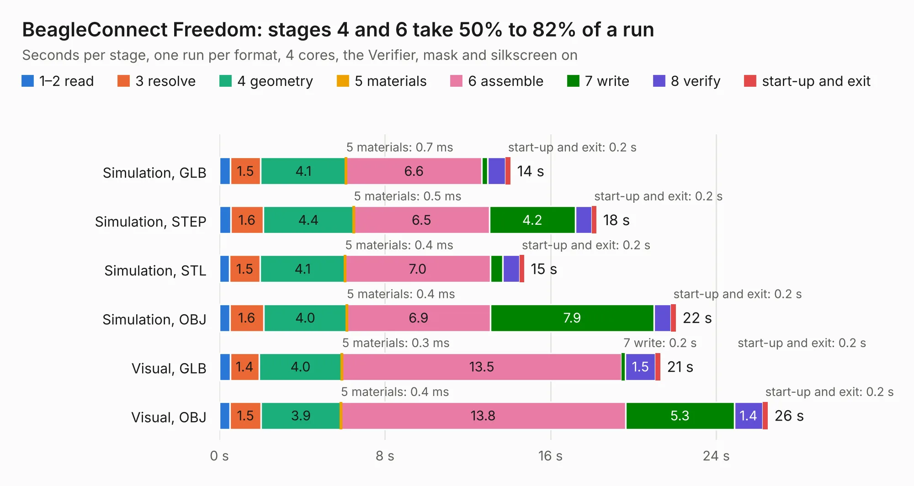

# 531. BeagleConnect Freedom

Board 531 of the 3,107 of [Corpus Testing](../Corpus-Testing.md), on [Corpus Page 5](../CorpusTestingPages/Corpus-Testing-05.md#531-beagleconnect-freedom).

| Mode and format | 1–2 read | 3 resolve | 4 geometry | 5 materials | 6 assemble | 7 write | 8 verify | start-up and exit | Total |
|---|---:|---:|---:|---:|---:|---:|---:|---:|---:|
| Simulation, GLB | 0.5 | 1.5 | 4.1 | 0.7&nbsp;ms | 6.6 | 0.3 | 0.9 | 0.2 | 14.1 |
| Simulation, STEP | 0.5 | 1.6 | 4.4 | 0.5&nbsp;ms | 6.5 | 4.2 | 0.8 | 0.2 | 18.2 |
| Simulation, STL | 0.5 | 1.5 | 4.1 | 0.4&nbsp;ms | 7.0 | 0.6 | 0.8 | 0.2 | 14.7 |
| Simulation, OBJ | 0.5 | 1.6 | 4.0 | 0.4&nbsp;ms | 6.9 | 7.9 | 0.8 | 0.2 | 22.1 |
| Visual, GLB | 0.5 | 1.4 | 4.0 | 0.3&nbsp;ms | 13.5 | 0.2 | 1.5 | 0.2 | 21.3 |
| Visual, OBJ | 0.5 | 1.5 | 3.9 | 0.4&nbsp;ms | 13.8 | 5.3 | 1.4 | 0.2 | 26.5 |

<table align="center"><tr><td valign="top">

| Board | Repo: [beagleboard/beagleconnect](https://github.com/beagleboard/beagleconnect) Board: `BeagleConnect Freedom.kicad_pcb` |
|---|---|
| Folder | hw / Freedom |
| Complexity | 356&nbsp;/&nbsp;1000 (size&nbsp;266, features&nbsp;90) |
| KESE&nbsp;features | through vias, slotted holes, custom pads, rounded, trapezoid or chamfered pads, filled zones, copper drawings, curved board outline |
| Tested | 9th November 2026 |
| Copper&nbsp;layers | 4 |
| File&nbsp;format | KiCad 5 (20171130) |
| Parts,&nbsp;tracks,&nbsp;vias | 154, 2,157, 298 |
| Triangles,&nbsp;simulation | 1,938,760 in 164 parts |
| Verifier | PASS in all six runs |

</td><td valign="top">

<table>
<tr><th>File type</th><th>File size</th><th>Peak memory used</th></tr>
<tr><th colspan="3" align="left">Simulation</th></tr>
<tr><td>GLB</td><td align="right">66&nbsp;MB</td><td align="right">777&nbsp;MB</td></tr>
<tr><td>STEP</td><td align="right">257&nbsp;MB</td><td align="right">916&nbsp;MB</td></tr>
<tr><td>STL</td><td align="right">97&nbsp;MB</td><td align="right">790&nbsp;MB</td></tr>
<tr><td>OBJ</td><td align="right">203&nbsp;MB</td><td align="right">1.3&nbsp;GB</td></tr>
<tr><th colspan="3" align="left">Visual</th></tr>
<tr><td>GLB</td><td align="right">44&nbsp;MB</td><td align="right">823&nbsp;MB</td></tr>
<tr><td>OBJ</td><td align="right">137&nbsp;MB</td><td align="right">998&nbsp;MB</td></tr>
</table>

</td></tr></table>

| Previous | Next |
|:---|---:|
| [530. beaglebone-ai-rev-a2](b0530b_beaglebone-ai_beaglebone-ai-rev-a2.md) | [532. BeagleConnect Freedom](b0532b_beagleconnect_hw-Freedom-C4_BeagleConnect-Freedom.md) |
