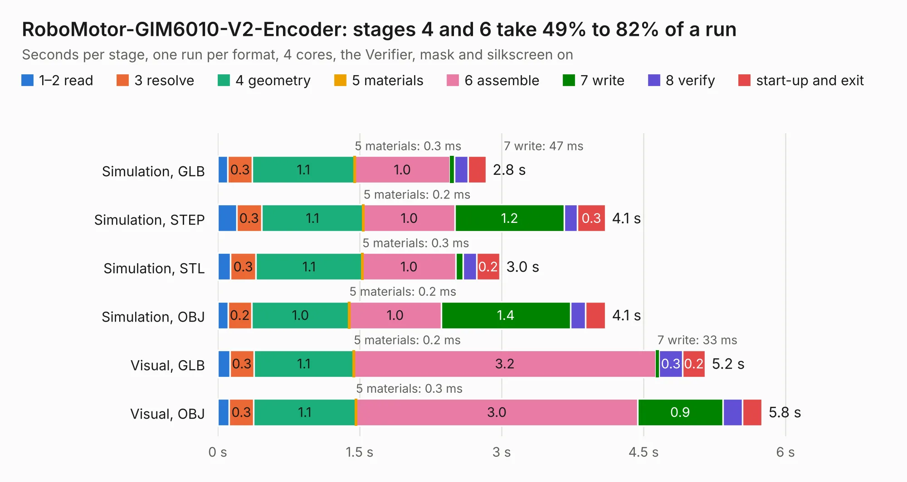

# 531. RoboMotor-GIM6010-V2-Encoder

Board 531 of the 3,118 of [Corpus Testing](../Corpus-Testing.md), on [Corpus Page 5](../CorpusTestingPages/Corpus-Testing-05.md#531-robomotor-gim6010-v2-encoder).

| Mode and format | 1–2 read | 3 resolve | 4 geometry | 5 materials | 6 assemble | 7 write | 8 verify | start-up and exit | Total |
|---|---:|---:|---:|---:|---:|---:|---:|---:|---:|
| Simulation, GLB | 0.1 | 0.3 | 1.1 | 0.3&nbsp;ms | 1.0 | 47&nbsp;ms | 0.1 | 0.2 | 2.8 |
| Simulation, STEP | 0.2 | 0.3 | 1.1 | 0.2&nbsp;ms | 1.0 | 1.2 | 0.1 | 0.3 | 4.1 |
| Simulation, STL | 0.1 | 0.3 | 1.1 | 0.3&nbsp;ms | 1.0 | 79&nbsp;ms | 0.1 | 0.2 | 3.0 |
| Simulation, OBJ | 0.1 | 0.2 | 1.0 | 0.2&nbsp;ms | 1.0 | 1.4 | 0.2 | 0.2 | 4.1 |
| Visual, GLB | 0.1 | 0.3 | 1.1 | 0.2&nbsp;ms | 3.2 | 33&nbsp;ms | 0.3 | 0.2 | 5.2 |
| Visual, OBJ | 0.1 | 0.3 | 1.1 | 0.3&nbsp;ms | 3.0 | 0.9 | 0.2 | 0.2 | 5.8 |

<table align="center"><tr><td valign="top">

| Board | Repo: [baoqi-zhong/robomotor](https://github.com/baoqi-zhong/robomotor) Board: `RoboMotor-GIM6010-V2-Encoder.kicad_pcb` |
|---|---|
| Folder | Hardware / RoboMotor-GIM6010-V2-Encoder |
| Complexity | 249&nbsp;/&nbsp;1000 (size&nbsp;134, features&nbsp;115) |
| KESE&nbsp;features | through vias, rounded, trapezoid or chamfered pads, filled zones, curved board outline, knockout text, TrueType text, stack-up, dielectric εr and tanδ |
| Tested | 9th November 2026 |
| Copper&nbsp;layers | 2 |
| File&nbsp;format | KiCad 8 (20240108) |
| Parts,&nbsp;tracks,&nbsp;vias | 13, 99, 42 |
| Triangles,&nbsp;simulation | 272,894 in 49 parts |
| Verifier | PASS in all six runs |

</td><td valign="top">

<table>
<tr><th>File type</th><th>File size</th><th>Peak memory used</th></tr>
<tr><th colspan="3" align="left">Simulation</th></tr>
<tr><td>GLB</td><td align="right">9.3&nbsp;MB</td><td align="right">221&nbsp;MB</td></tr>
<tr><td>STEP</td><td align="right">34&nbsp;MB</td><td align="right">232&nbsp;MB</td></tr>
<tr><td>STL</td><td align="right">14&nbsp;MB</td><td align="right">214&nbsp;MB</td></tr>
<tr><td>OBJ</td><td align="right">27&nbsp;MB</td><td align="right">212&nbsp;MB</td></tr>
<tr><th colspan="3" align="left">Visual</th></tr>
<tr><td>GLB</td><td align="right">6.6&nbsp;MB</td><td align="right">204&nbsp;MB</td></tr>
<tr><td>OBJ</td><td align="right">19&nbsp;MB</td><td align="right">212&nbsp;MB</td></tr>
</table>

</td></tr></table>

| Previous | Next |
|:---|---:|
| [530. RoboMotor-DJI-M3508](b0530b_robomotor_RoboMotor-DJI-M3508.md) | [532. RoboMotor-GIM6010-V2](b0532b_robomotor_RoboMotor-GIM6010-V2.md) |
