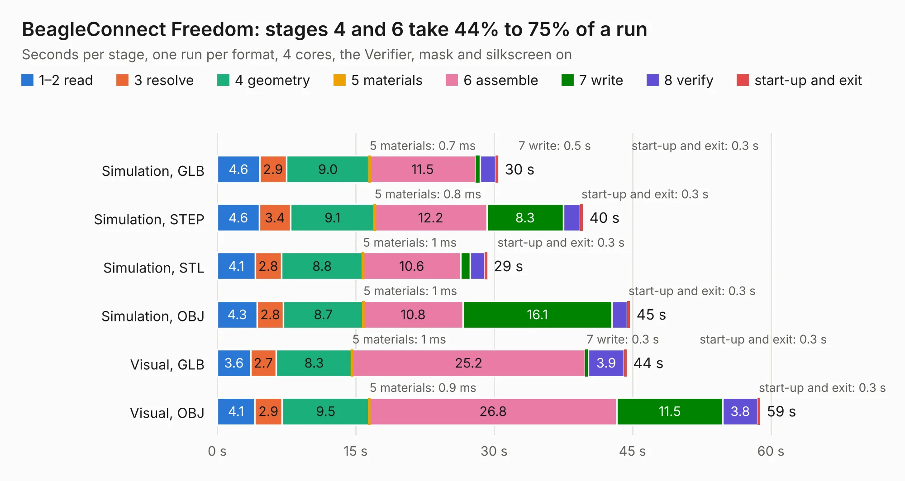

# 532. BeagleConnect Freedom

Board 532 of the 3,107 of [Corpus Testing](../Corpus-Testing.md), on [Corpus Page 5](../CorpusTestingPages/Corpus-Testing-05.md#532-beagleconnect-freedom).

| Mode and format | 1–2 read | 3 resolve | 4 geometry | 5 materials | 6 assemble | 7 write | 8 verify | start-up and exit | Total |
|---|---:|---:|---:|---:|---:|---:|---:|---:|---:|
| Simulation, GLB | 4.6 | 2.9 | 9.0 | 0.7&nbsp;ms | 11.5 | 0.5 | 1.7 | 0.3 | 30.5 |
| Simulation, STEP | 4.6 | 3.4 | 9.1 | 0.8&nbsp;ms | 12.2 | 8.3 | 1.8 | 0.3 | 39.6 |
| Simulation, STL | 4.1 | 2.8 | 8.8 | 1&nbsp;ms | 10.6 | 1.0 | 1.6 | 0.3 | 29.3 |
| Simulation, OBJ | 4.3 | 2.8 | 8.7 | 1&nbsp;ms | 10.8 | 16.1 | 1.6 | 0.3 | 44.7 |
| Visual, GLB | 3.6 | 2.7 | 8.3 | 1&nbsp;ms | 25.2 | 0.3 | 3.9 | 0.3 | 44.4 |
| Visual, OBJ | 4.1 | 2.9 | 9.5 | 0.9&nbsp;ms | 26.8 | 11.5 | 3.8 | 0.3 | 58.8 |

<table align="center"><tr><td valign="top">

| Board | Repo: [beagleboard/beagleconnect](https://github.com/beagleboard/beagleconnect) Board: `BeagleConnect Freedom.kicad_pcb` |
|---|---|
| Folder | hw / Freedom_C4 |
| Complexity | 360&nbsp;/&nbsp;1000 (size&nbsp;270, features&nbsp;90) |
| KESE&nbsp;features | through vias, slotted holes, custom pads, rounded, trapezoid or chamfered pads, filled zones, copper drawings, curved board outline |
| Tested | 9th November 2026 |
| Copper&nbsp;layers | 4 |
| File&nbsp;format | KiCad 5 (20171130) |
| Parts,&nbsp;tracks,&nbsp;vias | 176, 2,275, 398 |
| Triangles,&nbsp;simulation | 2,620,062 in 179 parts |
| Verifier | PASS in all six runs |

</td><td valign="top">

<table>
<tr><th>File type</th><th>File size</th><th>Peak memory used</th></tr>
<tr><th colspan="3" align="left">Simulation</th></tr>
<tr><td>GLB</td><td align="right">89&nbsp;MB</td><td align="right">1.1&nbsp;GB</td></tr>
<tr><td>STEP</td><td align="right">378&nbsp;MB</td><td align="right">1.2&nbsp;GB</td></tr>
<tr><td>STL</td><td align="right">131&nbsp;MB</td><td align="right">1.0&nbsp;GB</td></tr>
<tr><td>OBJ</td><td align="right">278&nbsp;MB</td><td align="right">1.7&nbsp;GB</td></tr>
<tr><th colspan="3" align="left">Visual</th></tr>
<tr><td>GLB</td><td align="right">59&nbsp;MB</td><td align="right">1.1&nbsp;GB</td></tr>
<tr><td>OBJ</td><td align="right">183&nbsp;MB</td><td align="right">1.3&nbsp;GB</td></tr>
</table>

</td></tr></table>

| Previous | Next |
|:---|---:|
| [531. BeagleConnect Freedom](b0531b_beagleconnect_hw-Freedom_BeagleConnect-Freedom.md) | [533. BeagleConnect](b0533b_beagleconnect_BeagleConnect.md) |
