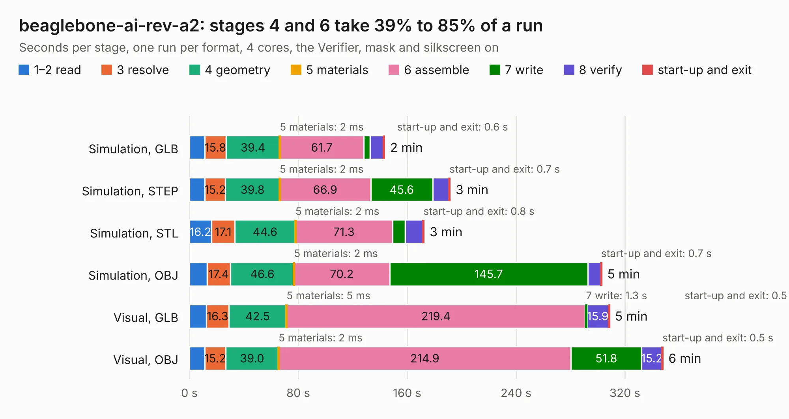

# 535. beaglebone-ai-rev-a2

Board 535 of the 3,119 of [Corpus Testing](../Corpus-Testing.md), on [Corpus Page 5](../CorpusTestingPages/Corpus-Testing-05.md#535-beaglebone-ai-rev-a2).

| Mode and format | 1–2 read | 3 resolve | 4 geometry | 5 materials | 6 assemble | 7 write | 8 verify | start-up and exit | Total |
|---|---:|---:|---:|---:|---:|---:|---:|---:|---:|
| Simulation, GLB | 11.2 | 15.8 | 39.4 | 2&nbsp;ms | 61.7 | 4.6 | 10.0 | 0.6 | 143.3 |
| Simulation, STEP | 11.3 | 15.2 | 39.8 | 2&nbsp;ms | 66.9 | 45.6 | 11.9 | 0.7 | 191.5 |
| Simulation, STL | 16.2 | 17.1 | 44.6 | 2&nbsp;ms | 71.3 | 9.4 | 13.0 | 0.8 | 172.4 |
| Simulation, OBJ | 12.9 | 17.4 | 46.6 | 2&nbsp;ms | 70.2 | 145.7 | 9.4 | 0.7 | 302.9 |
| Visual, GLB | 12.6 | 16.3 | 42.5 | 5&nbsp;ms | 219.4 | 1.3 | 15.9 | 0.5 | 308.5 |
| Visual, OBJ | 11.4 | 15.2 | 39.0 | 2&nbsp;ms | 214.9 | 51.8 | 15.2 | 0.5 | 347.8 |

<table align="center"><tr><td valign="top">

| Board | Repo: [beagleboard/beaglebone-ai](https://github.com/beagleboard/beaglebone-ai) Board: `beaglebone-ai-rev-a2.kicad_pcb` |
|---|---|
| Folder | kicad / beaglebone-ai-rev-a2 |
| Complexity | 488&nbsp;/&nbsp;1000 (size&nbsp;363, features&nbsp;125) |
| KESE&nbsp;features | through vias, slotted holes, custom pads, rounded, trapezoid or chamfered pads, filled zones, copper drawings, curved board outline, stack-up, dielectric εr and tanδ, mask and silkscreen colours |
| Tested | 9th November 2026 |
| Copper&nbsp;layers | 12 |
| File&nbsp;format | KiCad 6 (20210126) |
| Parts,&nbsp;tracks,&nbsp;vias | 748, 15,532, 1,835 |
| Triangles,&nbsp;simulation | 15,413,698 in 976 parts |
| Verifier | PASS in all six runs |

</td><td valign="top">

<table>
<tr><th>File type</th><th>File size</th><th>Peak memory used</th></tr>
<tr><th colspan="3" align="left">Simulation</th></tr>
<tr><td>GLB</td><td align="right">516&nbsp;MB</td><td align="right">3.2&nbsp;GB</td></tr>
<tr><td>STEP</td><td align="right">1.6&nbsp;GB</td><td align="right">4.4&nbsp;GB</td></tr>
<tr><td>STL</td><td align="right">771&nbsp;MB</td><td align="right">3.4&nbsp;GB</td></tr>
<tr><td>OBJ</td><td align="right">1.7&nbsp;GB</td><td align="right">9.7&nbsp;GB</td></tr>
<tr><th colspan="3" align="left">Visual</th></tr>
<tr><td>GLB</td><td align="right">234&nbsp;MB</td><td align="right">4.3&nbsp;GB</td></tr>
<tr><td>OBJ</td><td align="right">804&nbsp;MB</td><td align="right">5.2&nbsp;GB</td></tr>
</table>

</td></tr></table>

| Previous | Next |
|:---|---:|
| [534. beaglebone-ai](b0534b_beaglebone-ai_beaglebone-ai.md) | [536. BeagleConnect Freedom](b0536b_beagleconnect_hw-Freedom_BeagleConnect-Freedom.md) |
