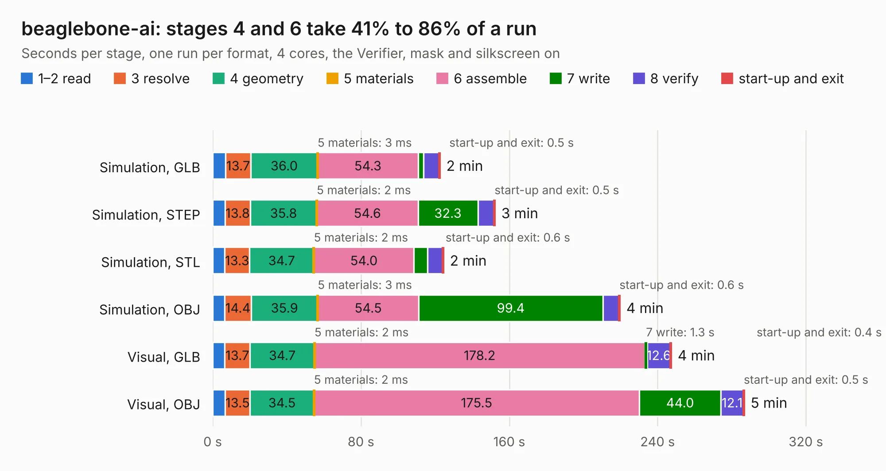

# 535. beaglebone-ai

Board 535 of the 3,130 of [Corpus Testing](../Corpus-Testing.md), on [Corpus Page 5](../CorpusTestingPages/Corpus-Testing-05.md#535-beaglebone-ai).

| Mode and format | 1–2 read | 3 resolve | 4 geometry | 5 materials | 6 assemble | 7 write | 8 verify | start-up and exit | Total |
|---|---:|---:|---:|---:|---:|---:|---:|---:|---:|
| Simulation, GLB | 6.9 | 13.7 | 36.0 | 3&nbsp;ms | 54.3 | 2.9 | 8.3 | 0.5 | 122.6 |
| Simulation, STEP | 6.6 | 13.8 | 35.8 | 2&nbsp;ms | 54.6 | 32.3 | 8.8 | 0.5 | 152.3 |
| Simulation, STL | 6.5 | 13.3 | 34.7 | 2&nbsp;ms | 54.0 | 7.3 | 8.0 | 0.6 | 124.5 |
| Simulation, OBJ | 6.4 | 14.4 | 35.9 | 3&nbsp;ms | 54.5 | 99.4 | 8.6 | 0.6 | 219.7 |
| Visual, GLB | 6.5 | 13.7 | 34.7 | 2&nbsp;ms | 178.2 | 1.3 | 12.6 | 0.4 | 247.4 |
| Visual, OBJ | 6.7 | 13.5 | 34.5 | 2&nbsp;ms | 175.5 | 44.0 | 12.1 | 0.5 | 286.8 |

<table align="center"><tr><td valign="top">

| Board | Repo: [beagleboard/beaglebone-ai](https://github.com/beagleboard/beaglebone-ai) Board: `beaglebone-ai.kicad_pcb` |
|---|---|
| Folder | kicad / beaglebone-ai-rev-a1 |
| Complexity | 452&nbsp;/&nbsp;1000 (size&nbsp;362, features&nbsp;90) |
| KESE&nbsp;features | through vias, slotted holes, filled zones, curved board outline, stack-up, dielectric εr and tanδ, mask and silkscreen colours |
| Tested | 9th November 2026 |
| Copper&nbsp;layers | 12 |
| File&nbsp;format | KiCad 6 (20210126) |
| Parts,&nbsp;tracks,&nbsp;vias | 702, 14,421, 1,788 |
| Triangles,&nbsp;simulation | 15,421,850 in 956 parts |
| Verifier | PASS in all six runs |

</td><td valign="top">

<table>
<tr><th>File type</th><th>File size</th><th>Peak memory used</th></tr>
<tr><th colspan="3" align="left">Simulation</th></tr>
<tr><td>GLB</td><td align="right">499&nbsp;MB</td><td align="right">3.2&nbsp;GB</td></tr>
<tr><td>STEP</td><td align="right">1.7&nbsp;GB</td><td align="right">4.6&nbsp;GB</td></tr>
<tr><td>STL</td><td align="right">771&nbsp;MB</td><td align="right">3.5&nbsp;GB</td></tr>
<tr><td>OBJ</td><td align="right">1.7&nbsp;GB</td><td align="right">9.7&nbsp;GB</td></tr>
<tr><th colspan="3" align="left">Visual</th></tr>
<tr><td>GLB</td><td align="right">253&nbsp;MB</td><td align="right">4.6&nbsp;GB</td></tr>
<tr><td>OBJ</td><td align="right">875&nbsp;MB</td><td align="right">5.7&nbsp;GB</td></tr>
</table>

</td></tr></table>

| Previous | Next |
|:---|---:|
| [534. RoboMotor-GIM6010](b0534b_robomotor_RoboMotor-GIM6010.md) | [536. beaglebone-ai-rev-a2](b0536b_beaglebone-ai_beaglebone-ai-rev-a2.md) |
