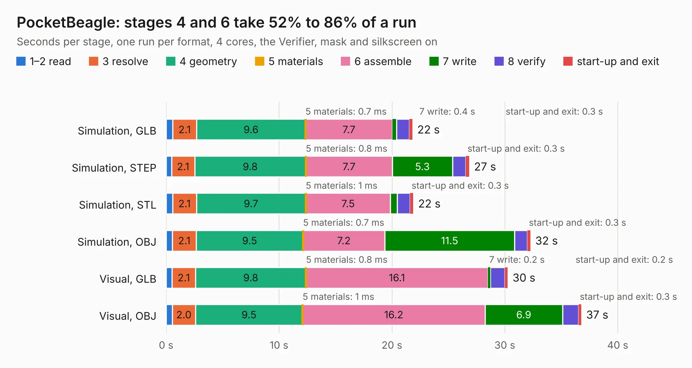

# 536. PocketBeagle

Board 536 of the 3,104 of [Corpus Testing](../Corpus-Testing.md), on [Corpus Page 5](../CorpusTestingPages/Corpus-Testing-05.md#536-pocketbeagle).

| Mode and format | 1–2 read | 3 resolve | 4 geometry | 5 materials | 6 assemble | 7 write | 8 verify | start-up and exit | Total |
|---|---:|---:|---:|---:|---:|---:|---:|---:|---:|
| Simulation, GLB | 0.6 | 2.1 | 9.6 | 0.7&nbsp;ms | 7.7 | 0.4 | 1.1 | 0.3 | 21.8 |
| Simulation, STEP | 0.5 | 2.1 | 9.8 | 0.8&nbsp;ms | 7.7 | 5.3 | 1.2 | 0.3 | 26.8 |
| Simulation, STL | 0.6 | 2.1 | 9.7 | 1&nbsp;ms | 7.5 | 0.6 | 1.1 | 0.3 | 21.9 |
| Simulation, OBJ | 0.6 | 2.1 | 9.5 | 0.7&nbsp;ms | 7.2 | 11.5 | 1.1 | 0.3 | 32.3 |
| Visual, GLB | 0.5 | 2.1 | 9.8 | 0.8&nbsp;ms | 16.1 | 0.2 | 1.3 | 0.2 | 30.3 |
| Visual, OBJ | 0.6 | 2.0 | 9.5 | 1&nbsp;ms | 16.2 | 6.9 | 1.4 | 0.3 | 36.8 |

<table align="center"><tr><td valign="top">

| Board | Repo: [beagleboard/pocketbeagle](https://github.com/beagleboard/pocketbeagle) Board: `PocketBeagle.kicad_pcb` |
|---|---|
| Folder | KiCAD |
| Complexity | 292&nbsp;/&nbsp;1000 (size&nbsp;247, features&nbsp;45) |
| KESE&nbsp;features | through vias, filled zones, curved board outline |
| Tested | 9th November 2026 |
| Copper&nbsp;layers | 4 |
| File&nbsp;format | KiCad 5 (20170123) |
| Parts,&nbsp;tracks,&nbsp;vias | 35, 1,297, 171 |
| Triangles,&nbsp;simulation | 1,930,146 in 201 parts |
| Verifier | PASS in all six runs |

</td><td valign="top">

<table>
<tr><th>File type</th><th>File size</th><th>Peak memory used</th></tr>
<tr><th colspan="3" align="left">Simulation</th></tr>
<tr><td>GLB</td><td align="right">67&nbsp;MB</td><td align="right">651&nbsp;MB</td></tr>
<tr><td>STEP</td><td align="right">290&nbsp;MB</td><td align="right">770&nbsp;MB</td></tr>
<tr><td>STL</td><td align="right">97&nbsp;MB</td><td align="right">666&nbsp;MB</td></tr>
<tr><td>OBJ</td><td align="right">205&nbsp;MB</td><td align="right">1.3&nbsp;GB</td></tr>
<tr><th colspan="3" align="left">Visual</th></tr>
<tr><td>GLB</td><td align="right">39&nbsp;MB</td><td align="right">785&nbsp;MB</td></tr>
<tr><td>OBJ</td><td align="right">118&nbsp;MB</td><td align="right">844&nbsp;MB</td></tr>
</table>

</td></tr></table>

| Previous | Next |
|:---|---:|
| [535. TechLab](b0535b_capes_TechLab.md) | [537. keyboard_pcb](b0537b_piantor_pcb-left_keyboard-pcb.md) |
