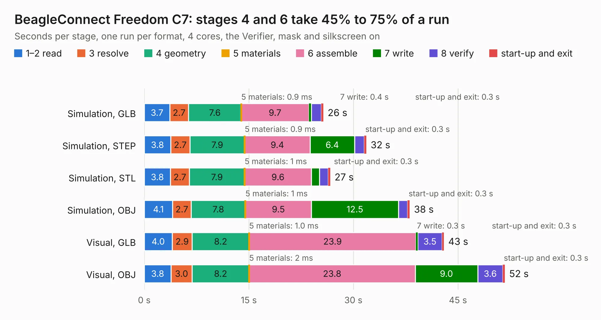

# 538. BeagleConnect Freedom C7

Board 538 of the 3,117 of [Corpus Testing](../Corpus-Testing.md), on [Corpus Page 5](../CorpusTestingPages/Corpus-Testing-05.md#538-beagleconnect-freedom-c7).

| Mode and format | 1–2 read | 3 resolve | 4 geometry | 5 materials | 6 assemble | 7 write | 8 verify | start-up and exit | Total |
|---|---:|---:|---:|---:|---:|---:|---:|---:|---:|
| Simulation, GLB | 3.7 | 2.7 | 7.6 | 0.9&nbsp;ms | 9.7 | 0.4 | 1.4 | 0.3 | 25.7 |
| Simulation, STEP | 3.8 | 2.7 | 7.9 | 0.9&nbsp;ms | 9.4 | 6.4 | 1.4 | 0.3 | 31.9 |
| Simulation, STL | 3.8 | 2.7 | 7.9 | 1&nbsp;ms | 9.6 | 1.2 | 1.3 | 0.3 | 26.7 |
| Simulation, OBJ | 4.1 | 2.7 | 7.8 | 1&nbsp;ms | 9.5 | 12.5 | 1.3 | 0.3 | 38.1 |
| Visual, GLB | 4.0 | 2.9 | 8.2 | 1.0&nbsp;ms | 23.9 | 0.3 | 3.5 | 0.3 | 43.0 |
| Visual, OBJ | 3.8 | 3.0 | 8.2 | 2&nbsp;ms | 23.8 | 9.0 | 3.6 | 0.3 | 51.7 |

<table align="center"><tr><td valign="top">

| Board | Repo: [beagleboard/beagleconnect-freedom](https://github.com/beagleboard/beagleconnect-freedom) Board: `BeagleConnect Freedom C7.kicad_pcb` |
|---|---|
| Folder | hw / KICAD |
| Complexity | 360&nbsp;/&nbsp;1000 (size&nbsp;270, features&nbsp;90) |
| KESE&nbsp;features | through vias, slotted holes, custom pads, rounded, trapezoid or chamfered pads, filled zones, copper drawings, curved board outline |
| Tested | 9th November 2026 |
| Copper&nbsp;layers | 4 |
| File&nbsp;format | KiCad 6 (20211014) |
| Parts,&nbsp;tracks,&nbsp;vias | 179, 2,291, 399 |
| Triangles,&nbsp;simulation | 2,441,248 in 177 parts |
| Verifier | PASS in all six runs |

</td><td valign="top">

<table>
<tr><th>File type</th><th>File size</th><th>Peak memory used</th></tr>
<tr><th colspan="3" align="left">Simulation</th></tr>
<tr><td>GLB</td><td align="right">84&nbsp;MB</td><td align="right">943&nbsp;MB</td></tr>
<tr><td>STEP</td><td align="right">371&nbsp;MB</td><td align="right">1.1&nbsp;GB</td></tr>
<tr><td>STL</td><td align="right">122&nbsp;MB</td><td align="right">956&nbsp;MB</td></tr>
<tr><td>OBJ</td><td align="right">260&nbsp;MB</td><td align="right">1.7&nbsp;GB</td></tr>
<tr><th colspan="3" align="left">Visual</th></tr>
<tr><td>GLB</td><td align="right">55&nbsp;MB</td><td align="right">1.1&nbsp;GB</td></tr>
<tr><td>OBJ</td><td align="right">170&nbsp;MB</td><td align="right">1.2&nbsp;GB</td></tr>
</table>

</td></tr></table>

| Previous | Next |
|:---|---:|
| [537. BeagleConnect](b0537b_beagleconnect_BeagleConnect.md) | [539. TechLab](b0539b_capes_TechLab.md) |
