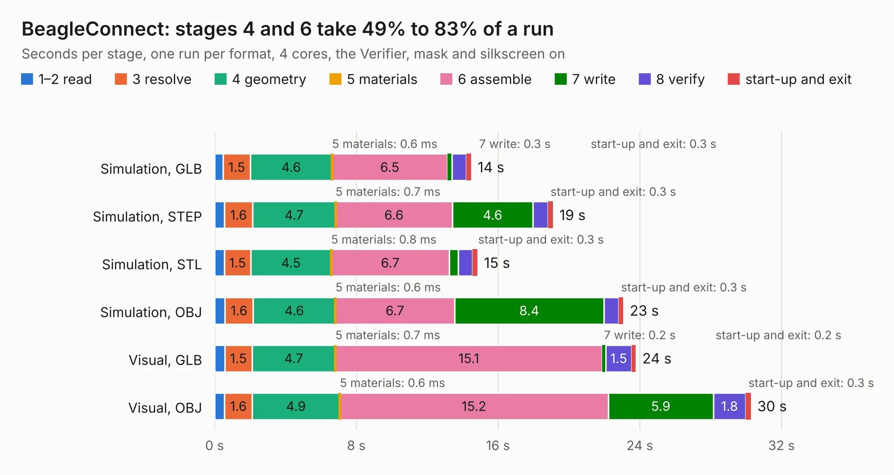

# 538. BeagleConnect

Board 538 of the 3,119 of [Corpus Testing](../Corpus-Testing.md), on [Corpus Page 5](../CorpusTestingPages/Corpus-Testing-05.md#538-beagleconnect).

| Mode and format | 1–2 read | 3 resolve | 4 geometry | 5 materials | 6 assemble | 7 write | 8 verify | start-up and exit | Total |
|---|---:|---:|---:|---:|---:|---:|---:|---:|---:|
| Simulation, GLB | 0.5 | 1.5 | 4.6 | 0.6&nbsp;ms | 6.5 | 0.3 | 0.8 | 0.3 | 14.5 |
| Simulation, STEP | 0.6 | 1.6 | 4.7 | 0.7&nbsp;ms | 6.6 | 4.6 | 0.8 | 0.3 | 19.1 |
| Simulation, STL | 0.6 | 1.5 | 4.5 | 0.8&nbsp;ms | 6.7 | 0.5 | 0.8 | 0.3 | 14.8 |
| Simulation, OBJ | 0.6 | 1.6 | 4.6 | 0.6&nbsp;ms | 6.7 | 8.4 | 0.8 | 0.3 | 23.1 |
| Visual, GLB | 0.6 | 1.5 | 4.7 | 0.7&nbsp;ms | 15.1 | 0.2 | 1.5 | 0.2 | 23.8 |
| Visual, OBJ | 0.6 | 1.6 | 4.9 | 0.6&nbsp;ms | 15.2 | 5.9 | 1.8 | 0.3 | 30.3 |

<table align="center"><tr><td valign="top">

| Board | Repo: [beagleboard/beagleconnect](https://github.com/beagleboard/beagleconnect) Board: `BeagleConnect.kicad_pcb` |
|---|---|
| Folder | hw / Leash |
| Complexity | 353&nbsp;/&nbsp;1000 (size&nbsp;263, features&nbsp;90) |
| KESE&nbsp;features | through vias, slotted holes, custom pads, rounded, trapezoid or chamfered pads, filled zones, copper drawings, curved board outline |
| Tested | 9th November 2026 |
| Copper&nbsp;layers | 4 |
| File&nbsp;format | KiCad 5 (20171130) |
| Parts,&nbsp;tracks,&nbsp;vias | 140, 1,915, 277 |
| Triangles,&nbsp;simulation | 1,817,122 in 155 parts |
| Verifier | PASS in all six runs |

</td><td valign="top">

<table>
<tr><th>File type</th><th>File size</th><th>Peak memory used</th></tr>
<tr><th colspan="3" align="left">Simulation</th></tr>
<tr><td>GLB</td><td align="right">62&nbsp;MB</td><td align="right">793&nbsp;MB</td></tr>
<tr><td>STEP</td><td align="right">261&nbsp;MB</td><td align="right">883&nbsp;MB</td></tr>
<tr><td>STL</td><td align="right">91&nbsp;MB</td><td align="right">765&nbsp;MB</td></tr>
<tr><td>OBJ</td><td align="right">191&nbsp;MB</td><td align="right">1.2&nbsp;GB</td></tr>
<tr><th colspan="3" align="left">Visual</th></tr>
<tr><td>GLB</td><td align="right">41&nbsp;MB</td><td align="right">817&nbsp;MB</td></tr>
<tr><td>OBJ</td><td align="right">126&nbsp;MB</td><td align="right">935&nbsp;MB</td></tr>
</table>

</td></tr></table>

| Previous | Next |
|:---|---:|
| [537. BeagleConnect Freedom](b0537b_beagleconnect_hw-Freedom-C4_BeagleConnect-Freedom.md) | [539. BeagleConnect Freedom C7](b0539b_beagleconnect-freedom_BeagleConnect-Freedom-C7.md) |
