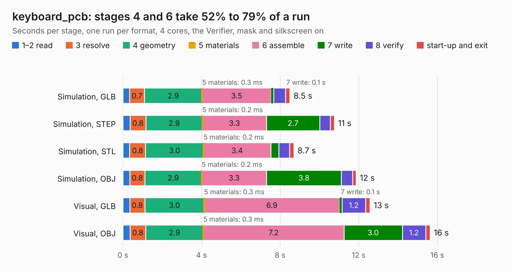

# 538. keyboard_pcb

Board 538 of the 3,104 of [Corpus Testing](../Corpus-Testing.md), on [Corpus Page 5](../CorpusTestingPages/Corpus-Testing-05.md#538-keyboard_pcb).

| Mode and format | 1–2 read | 3 resolve | 4 geometry | 5 materials | 6 assemble | 7 write | 8 verify | start-up and exit | Total |
|---|---:|---:|---:|---:|---:|---:|---:|---:|---:|
| Simulation, GLB | 0.3 | 0.7 | 2.9 | 0.3&nbsp;ms | 3.5 | 0.1 | 0.6 | 0.2 | 8.5 |
| Simulation, STEP | 0.4 | 0.8 | 2.9 | 0.2&nbsp;ms | 3.3 | 2.7 | 0.5 | 0.2 | 10.8 |
| Simulation, STL | 0.3 | 0.8 | 3.0 | 0.2&nbsp;ms | 3.4 | 0.4 | 0.5 | 0.2 | 8.7 |
| Simulation, OBJ | 0.4 | 0.8 | 2.9 | 0.2&nbsp;ms | 3.3 | 3.8 | 0.6 | 0.2 | 11.9 |
| Visual, GLB | 0.3 | 0.8 | 3.0 | 0.3&nbsp;ms | 6.9 | 0.1 | 1.2 | 0.2 | 12.6 |
| Visual, OBJ | 0.4 | 0.8 | 2.9 | 0.3&nbsp;ms | 7.2 | 3.0 | 1.2 | 0.2 | 15.6 |

<table align="center"><tr><td valign="top">

| Board | Repo: [beekeeb/piantor](https://github.com/beekeeb/piantor) Board: `keyboard_pcb.kicad_pcb` |
|---|---|
| Folder | pcb / right |
| Complexity | 250&nbsp;/&nbsp;1000 (size&nbsp;145, features&nbsp;105) |
| KESE&nbsp;features | through vias, slotted holes, rounded, trapezoid or chamfered pads, drill offsets, filled zones, curved board outline, stack-up, dielectric εr and tanδ |
| Tested | 9th November 2026 |
| Copper&nbsp;layers | 2 |
| File&nbsp;format | KiCad 6 (20211014) |
| Parts,&nbsp;tracks,&nbsp;vias | 29, 237, 11 |
| Triangles,&nbsp;simulation | 965,848 in 44 parts |
| Verifier | PASS in all six runs |

</td><td valign="top">

<table>
<tr><th>File type</th><th>File size</th><th>Peak memory used</th></tr>
<tr><th colspan="3" align="left">Simulation</th></tr>
<tr><td>GLB</td><td align="right">33&nbsp;MB</td><td align="right">488&nbsp;MB</td></tr>
<tr><td>STEP</td><td align="right">160&nbsp;MB</td><td align="right">613&nbsp;MB</td></tr>
<tr><td>STL</td><td align="right">48&nbsp;MB</td><td align="right">510&nbsp;MB</td></tr>
<tr><td>OBJ</td><td align="right">98&nbsp;MB</td><td align="right">673&nbsp;MB</td></tr>
<tr><th colspan="3" align="left">Visual</th></tr>
<tr><td>GLB</td><td align="right">24&nbsp;MB</td><td align="right">665&nbsp;MB</td></tr>
<tr><td>OBJ</td><td align="right">73&nbsp;MB</td><td align="right">652&nbsp;MB</td></tr>
</table>

</td></tr></table>

| Previous | Next |
|:---|---:|
| [537. keyboard_pcb](b0537b_piantor_pcb-left_keyboard-pcb.md) | [539. belamini_cape_C1](b0539b_bela-hardware_belamini-cape-C1.md) |
