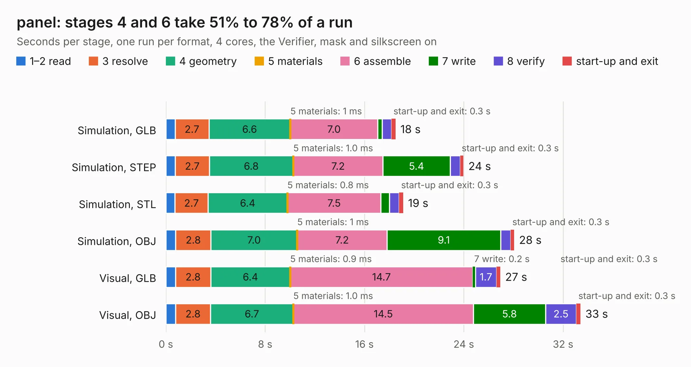

# 540. panel

Board 540 of the 3,100 of [Corpus Testing](../Corpus-Testing.md), on [Corpus Page 5](../CorpusTestingPages/Corpus-Testing-05.md#540-panel).

| Mode and format | 1–2 read | 3 resolve | 4 geometry | 5 materials | 6 assemble | 7 write | 8 verify | start-up and exit | Total |
|---|---:|---:|---:|---:|---:|---:|---:|---:|---:|
| Simulation, GLB | 0.7 | 2.7 | 6.6 | 1&nbsp;ms | 7.0 | 0.4 | 0.8 | 0.3 | 18.5 |
| Simulation, STEP | 0.8 | 2.7 | 6.8 | 1.0&nbsp;ms | 7.2 | 5.4 | 0.8 | 0.3 | 24.0 |
| Simulation, STL | 0.7 | 2.7 | 6.4 | 0.8&nbsp;ms | 7.5 | 0.7 | 0.8 | 0.3 | 19.1 |
| Simulation, OBJ | 0.8 | 2.8 | 7.0 | 1&nbsp;ms | 7.2 | 9.1 | 0.8 | 0.3 | 28.1 |
| Visual, GLB | 0.8 | 2.8 | 6.4 | 0.9&nbsp;ms | 14.7 | 0.2 | 1.7 | 0.3 | 26.9 |
| Visual, OBJ | 0.8 | 2.8 | 6.7 | 1.0&nbsp;ms | 14.5 | 5.8 | 2.5 | 0.3 | 33.4 |

<table align="center"><tr><td valign="top">

| Board | Repo: [belaplatform/bela-hardware](https://github.com/belaplatform/bela-hardware) Board: `panel.kicad_pcb` |
|---|---|
| Folder | cape / bela_cape_rev_C2 / analog_out_fix_c2 / panel |
| Complexity | 202&nbsp;/&nbsp;1000 (size&nbsp;192, features&nbsp;10) |
| KESE&nbsp;features | rounded, trapezoid or chamfered pads |
| Tested | 9th November 2026 |
| Copper&nbsp;layers | 2 |
| File&nbsp;format | KiCad 6 (20211014) |
| Parts,&nbsp;tracks,&nbsp;vias | 252, 1,134, 0 |
| Triangles,&nbsp;simulation | 1,678,584 in 221 parts |
| Note | panel |
| Verifier | PASS in all six runs |

</td><td valign="top">

<table>
<tr><th>File type</th><th>File size</th><th>Peak memory used</th></tr>
<tr><th colspan="3" align="left">Simulation</th></tr>
<tr><td>GLB</td><td align="right">55&nbsp;MB</td><td align="right">663&nbsp;MB</td></tr>
<tr><td>STEP</td><td align="right">245&nbsp;MB</td><td align="right">762&nbsp;MB</td></tr>
<tr><td>STL</td><td align="right">84&nbsp;MB</td><td align="right">677&nbsp;MB</td></tr>
<tr><td>OBJ</td><td align="right">177&nbsp;MB</td><td align="right">1.1&nbsp;GB</td></tr>
<tr><th colspan="3" align="left">Visual</th></tr>
<tr><td>GLB</td><td align="right">39&nbsp;MB</td><td align="right">929&nbsp;MB</td></tr>
<tr><td>OBJ</td><td align="right">117&nbsp;MB</td><td align="right">914&nbsp;MB</td></tr>
</table>

</td></tr></table>

| Previous | Next |
|:---|---:|
| [539. analog_out_fix_c2](b0539b_bela-hardware_analog-out-fix-c2.md) | [541. bela_cape](b0541b_bela-hardware_cape-bela-cape-rev-C2_bela-cape.md) |
