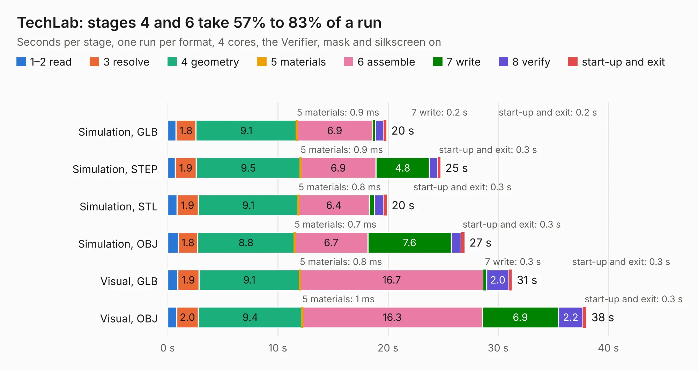

# 542. TechLab

Board 542 of the 3,139 of [Corpus Testing](../Corpus-Testing.md), on [Corpus Page 6](../CorpusTestingPages/Corpus-Testing-06.md#542-techlab).

| Mode and format | 1–2 read | 3 resolve | 4 geometry | 5 materials | 6 assemble | 7 write | 8 verify | start-up and exit | Total |
|---|---:|---:|---:|---:|---:|---:|---:|---:|---:|
| Simulation, GLB | 0.8 | 1.8 | 9.1 | 0.9&nbsp;ms | 6.9 | 0.2 | 0.8 | 0.2 | 19.9 |
| Simulation, STEP | 0.7 | 1.9 | 9.5 | 0.9&nbsp;ms | 6.9 | 4.8 | 0.7 | 0.3 | 24.8 |
| Simulation, STL | 0.9 | 1.9 | 9.1 | 0.8&nbsp;ms | 6.4 | 0.5 | 0.8 | 0.3 | 19.9 |
| Simulation, OBJ | 1.0 | 1.8 | 8.8 | 0.7&nbsp;ms | 6.7 | 7.6 | 0.9 | 0.3 | 26.9 |
| Visual, GLB | 0.9 | 1.9 | 9.1 | 0.8&nbsp;ms | 16.7 | 0.3 | 2.0 | 0.3 | 31.2 |
| Visual, OBJ | 0.8 | 2.0 | 9.4 | 1&nbsp;ms | 16.3 | 6.9 | 2.2 | 0.3 | 38.0 |

<table align="center"><tr><td valign="top">

| Board | Repo: [beagleboard/capes](https://github.com/beagleboard/capes) Board: `TechLab.kicad_pcb` |
|---|---|
| Folder | pocketbeagle / TechLab / kicad |
| Complexity | 317&nbsp;/&nbsp;1000 (size&nbsp;192, features&nbsp;125) |
| KESE&nbsp;features | through vias, slotted holes, rounded, trapezoid or chamfered pads, drill offsets, filled zones, curved board outline, TrueType text, stack-up, dielectric εr and tanδ, mask and silkscreen colours |
| Tested | 9th November 2026 |
| Copper&nbsp;layers | 2 |
| File&nbsp;format | KiCad 9 (20241229) |
| Parts,&nbsp;tracks,&nbsp;vias | 94, 1,330, 290 |
| Triangles,&nbsp;simulation | 1,484,750 in 167 parts |
| Verifier | PASS in all six runs |

</td><td valign="top">

<table>
<tr><th>File type</th><th>File size</th><th>Peak memory used</th></tr>
<tr><th colspan="3" align="left">Simulation</th></tr>
<tr><td>GLB</td><td align="right">53&nbsp;MB</td><td align="right">639&nbsp;MB</td></tr>
<tr><td>STEP</td><td align="right">293&nbsp;MB</td><td align="right">843&nbsp;MB</td></tr>
<tr><td>STL</td><td align="right">74&nbsp;MB</td><td align="right">642&nbsp;MB</td></tr>
<tr><td>OBJ</td><td align="right">159&nbsp;MB</td><td align="right">1.1&nbsp;GB</td></tr>
<tr><th colspan="3" align="left">Visual</th></tr>
<tr><td>GLB</td><td align="right">48&nbsp;MB</td><td align="right">857&nbsp;MB</td></tr>
<tr><td>OBJ</td><td align="right">146&nbsp;MB</td><td align="right">1.1&nbsp;GB</td></tr>
</table>

</td></tr></table>

| Previous | Next |
|:---|---:|
| [541. BeagleConnect Freedom C7](b0541b_beagleconnect-freedom_BeagleConnect-Freedom-C7.md) | [543. PocketBeagle](b0543b_pocketbeagle_PocketBeagle.md) |
