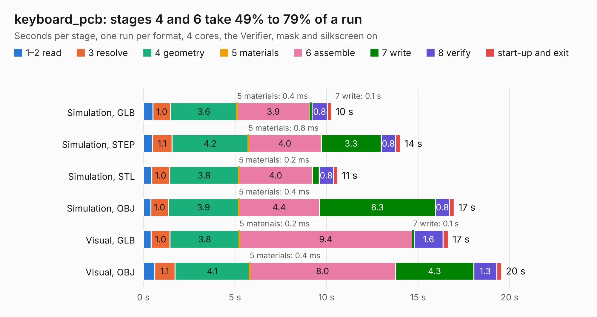

# 543. keyboard_pcb

Board 543 of the 3,126 of [Corpus Testing](../Corpus-Testing.md), on [Corpus Page 6](../CorpusTestingPages/Corpus-Testing-06.md#543-keyboard_pcb).

| Mode and format | 1–2 read | 3 resolve | 4 geometry | 5 materials | 6 assemble | 7 write | 8 verify | start-up and exit | Total |
|---|---:|---:|---:|---:|---:|---:|---:|---:|---:|
| Simulation, GLB | 0.5 | 1.0 | 3.6 | 0.4&nbsp;ms | 3.9 | 0.1 | 0.8 | 0.2 | 10.3 |
| Simulation, STEP | 0.5 | 1.1 | 4.2 | 0.8&nbsp;ms | 4.0 | 3.3 | 0.8 | 0.3 | 14.0 |
| Simulation, STL | 0.5 | 1.0 | 3.8 | 0.2&nbsp;ms | 4.0 | 0.4 | 0.8 | 0.2 | 10.6 |
| Simulation, OBJ | 0.4 | 1.0 | 3.9 | 0.4&nbsp;ms | 4.4 | 6.3 | 0.8 | 0.3 | 17.0 |
| Visual, GLB | 0.4 | 1.0 | 3.8 | 0.2&nbsp;ms | 9.4 | 0.1 | 1.6 | 0.3 | 16.7 |
| Visual, OBJ | 0.6 | 1.1 | 4.1 | 0.4&nbsp;ms | 8.0 | 4.3 | 1.3 | 0.3 | 19.6 |

<table align="center"><tr><td valign="top">

| Board | Repo: [beekeeb/piantor](https://github.com/beekeeb/piantor) Board: `keyboard_pcb.kicad_pcb` |
|---|---|
| Folder | pcb / left |
| Complexity | 248&nbsp;/&nbsp;1000 (size&nbsp;143, features&nbsp;105) |
| KESE&nbsp;features | through vias, slotted holes, rounded, trapezoid or chamfered pads, drill offsets, filled zones, curved board outline, stack-up, dielectric εr and tanδ |
| Tested | 9th November 2026 |
| Copper&nbsp;layers | 2 |
| File&nbsp;format | KiCad 6 (20211014) |
| Parts,&nbsp;tracks,&nbsp;vias | 29, 215, 8 |
| Triangles,&nbsp;simulation | 953,888 in 44 parts |
| Verifier | PASS in all six runs |

</td><td valign="top">

<table>
<tr><th>File type</th><th>File size</th><th>Peak memory used</th></tr>
<tr><th colspan="3" align="left">Simulation</th></tr>
<tr><td>GLB</td><td align="right">33&nbsp;MB</td><td align="right">490&nbsp;MB</td></tr>
<tr><td>STEP</td><td align="right">157&nbsp;MB</td><td align="right">558&nbsp;MB</td></tr>
<tr><td>STL</td><td align="right">48&nbsp;MB</td><td align="right">456&nbsp;MB</td></tr>
<tr><td>OBJ</td><td align="right">97&nbsp;MB</td><td align="right">670&nbsp;MB</td></tr>
<tr><th colspan="3" align="left">Visual</th></tr>
<tr><td>GLB</td><td align="right">24&nbsp;MB</td><td align="right">564&nbsp;MB</td></tr>
<tr><td>OBJ</td><td align="right">71&nbsp;MB</td><td align="right">657&nbsp;MB</td></tr>
</table>

</td></tr></table>

| Previous | Next |
|:---|---:|
| [542. PocketBeagle](b0542b_pocketbeagle_PocketBeagle.md) | [544. keyboard_pcb](b0544b_piantor_pcb-right_keyboard-pcb.md) |
