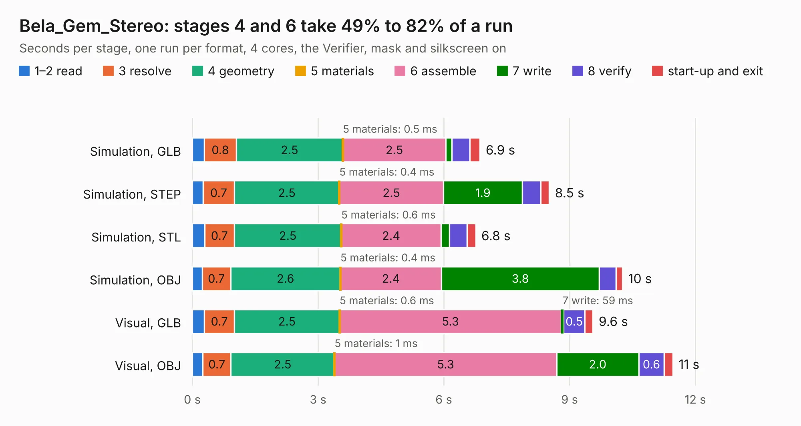

# 547. Bela_Gem_Stereo

Board 547 of the 3,101 of [Corpus Testing](../Corpus-Testing.md), on [Corpus Page 6](../CorpusTestingPages/Corpus-Testing-06.md#547-bela_gem_stereo).

| Mode and format | 1–2 read | 3 resolve | 4 geometry | 5 materials | 6 assemble | 7 write | 8 verify | start-up and exit | Total |
|---|---:|---:|---:|---:|---:|---:|---:|---:|---:|
| Simulation, GLB | 0.3 | 0.8 | 2.5 | 0.5&nbsp;ms | 2.5 | 0.1 | 0.4 | 0.2 | 6.9 |
| Simulation, STEP | 0.3 | 0.7 | 2.5 | 0.4&nbsp;ms | 2.5 | 1.9 | 0.4 | 0.2 | 8.5 |
| Simulation, STL | 0.3 | 0.7 | 2.5 | 0.6&nbsp;ms | 2.4 | 0.2 | 0.4 | 0.2 | 6.8 |
| Simulation, OBJ | 0.2 | 0.7 | 2.6 | 0.4&nbsp;ms | 2.4 | 3.8 | 0.4 | 0.2 | 10.3 |
| Visual, GLB | 0.3 | 0.7 | 2.5 | 0.6&nbsp;ms | 5.3 | 59&nbsp;ms | 0.5 | 0.2 | 9.6 |
| Visual, OBJ | 0.3 | 0.7 | 2.5 | 1&nbsp;ms | 5.3 | 2.0 | 0.6 | 0.2 | 11.5 |

<table align="center"><tr><td valign="top">

| Board | Repo: [belaplatform/bela-hardware](https://github.com/belaplatform/bela-hardware) Board: `Bela_Gem_Stereo.kicad_pcb` |
|---|---|
| Folder | GemStereo / GemStereo_rev_A4 |
| Complexity | 207&nbsp;/&nbsp;1000 (size&nbsp;67, features&nbsp;140) |
| KESE&nbsp;features | slotted holes, custom pads, rounded, trapezoid or chamfered pads, filled zones, copper drawings, curved board outline, knockout text, TrueType text, stack-up, dielectric εr and tanδ, mask and silkscreen colours |
| Tested | 9th November 2026 |
| Copper&nbsp;layers | 4 |
| File&nbsp;format | KiCad 9 (20241229) |
| Parts,&nbsp;tracks,&nbsp;vias | 21, 0, 0 |
| Triangles,&nbsp;simulation | 904,034 in 110 parts |
| Verifier | PASS in all six runs |

</td><td valign="top">

<table>
<tr><th>File type</th><th>File size</th><th>Peak memory used</th></tr>
<tr><th colspan="3" align="left">Simulation</th></tr>
<tr><td>GLB</td><td align="right">30&nbsp;MB</td><td align="right">414&nbsp;MB</td></tr>
<tr><td>STEP</td><td align="right">102&nbsp;MB</td><td align="right">439&nbsp;MB</td></tr>
<tr><td>STL</td><td align="right">45&nbsp;MB</td><td align="right">409&nbsp;MB</td></tr>
<tr><td>OBJ</td><td align="right">91&nbsp;MB</td><td align="right">638&nbsp;MB</td></tr>
<tr><th colspan="3" align="left">Visual</th></tr>
<tr><td>GLB</td><td align="right">16&nbsp;MB</td><td align="right">512&nbsp;MB</td></tr>
<tr><td>OBJ</td><td align="right">47&nbsp;MB</td><td align="right">468&nbsp;MB</td></tr>
</table>

</td></tr></table>

| Previous | Next |
|:---|---:|
| [546. bela_mini_multi_pb2_wing_top](b0546b_bela-hardware_bela-mini-multi-pb2-wing-top.md) | [548. switch-main-v5-test-rig](b0548b_switch-v5-hardware_switch-main-v5-test-rig.md) |
