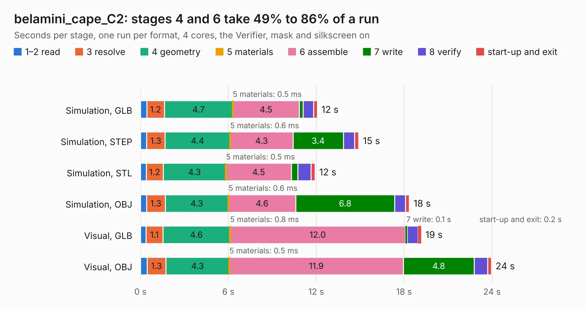

# 547 belamini_cape_C2

Board 547 of the 3,138 of [Corpus Testing](../Corpus-Testing.md), on [Corpus Page 6](../CorpusTestingPages/Corpus-Testing-06.md#547-belamini_cape_c2).

| Mode and format | 1–2 read | 3 resolve | 4 geometry | 5 materials | 6 assemble | 7 write | 8 verify | start-up and exit | Total |
|---|---:|---:|---:|---:|---:|---:|---:|---:|---:|
| Simulation, GLB | 0.4 | 1.2 | 4.7 | 0.5&nbsp;ms | 4.5 | 0.3 | 0.7 | 0.3 | 12.1 |
| Simulation, STEP | 0.4 | 1.3 | 4.4 | 0.6&nbsp;ms | 4.3 | 3.4 | 0.8 | 0.3 | 14.9 |
| Simulation, STL | 0.4 | 1.2 | 4.3 | 0.5&nbsp;ms | 4.5 | 0.4 | 0.9 | 0.3 | 11.9 |
| Simulation, OBJ | 0.4 | 1.3 | 4.3 | 0.6&nbsp;ms | 4.6 | 6.8 | 0.7 | 0.3 | 18.4 |
| Visual, GLB | 0.4 | 1.1 | 4.6 | 0.8&nbsp;ms | 12.0 | 0.1 | 0.7 | 0.2 | 19.2 |
| Visual, OBJ | 0.5 | 1.3 | 4.3 | 0.5&nbsp;ms | 11.9 | 4.8 | 0.9 | 0.3 | 24.0 |

<table align="center"><tr><td valign="top">

| Board | Repo: [belaplatform/bela-hardware](https://github.com/belaplatform/bela-hardware) Board: `belamini_cape_C2.kicad_pcb` |
|---|---|
| Folder | belamini / belamini_cape_rev_C2 |
| Complexity | 323&nbsp;/&nbsp;1000 (size&nbsp;238, features&nbsp;85) |
| KESE&nbsp;features | through vias, rounded, trapezoid or chamfered pads, filled zones, curved board outline, stack-up, dielectric εr and tanδ |
| Tested | 9th November 2026 |
| Copper&nbsp;layers | 4 |
| File&nbsp;format | KiCad 6 (20211014) |
| Parts,&nbsp;tracks,&nbsp;vias | 55, 848, 69 |
| Triangles,&nbsp;simulation | 1,162,018 in 143 parts |
| Verifier | PASS in all six runs |

</td><td valign="top">

<table>
<tr><th>File type</th><th>File size</th><th>Peak memory used</th></tr>
<tr><th colspan="3" align="left">Simulation</th></tr>
<tr><td>GLB</td><td align="right">39&nbsp;MB</td><td align="right">455&nbsp;MB</td></tr>
<tr><td>STEP</td><td align="right">185&nbsp;MB</td><td align="right">548&nbsp;MB</td></tr>
<tr><td>STL</td><td align="right">58&nbsp;MB</td><td align="right">469&nbsp;MB</td></tr>
<tr><td>OBJ</td><td align="right">119&nbsp;MB</td><td align="right">795&nbsp;MB</td></tr>
<tr><th colspan="3" align="left">Visual</th></tr>
<tr><td>GLB</td><td align="right">25&nbsp;MB</td><td align="right">619&nbsp;MB</td></tr>
<tr><td>OBJ</td><td align="right">76&nbsp;MB</td><td align="right">661&nbsp;MB</td></tr>
</table>

</td></tr></table>

| Previous | Next |
|:---|---:|
| [546 belamini_cape_C1](b0546b_bela-hardware_belamini-cape-C1.md) | [548 bela_cape](b0548b_bela-hardware_cape-bela-cape-rev-C1_bela-cape.md) |
